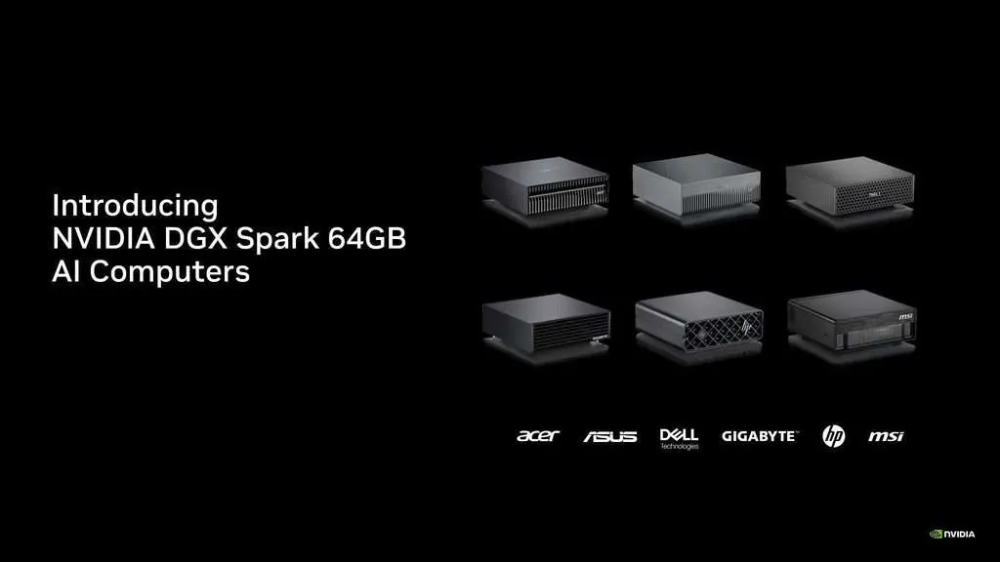
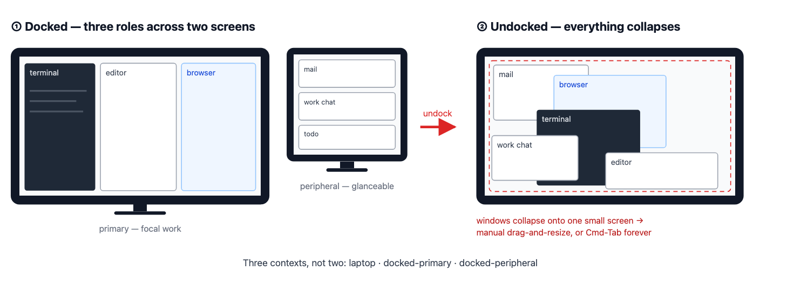
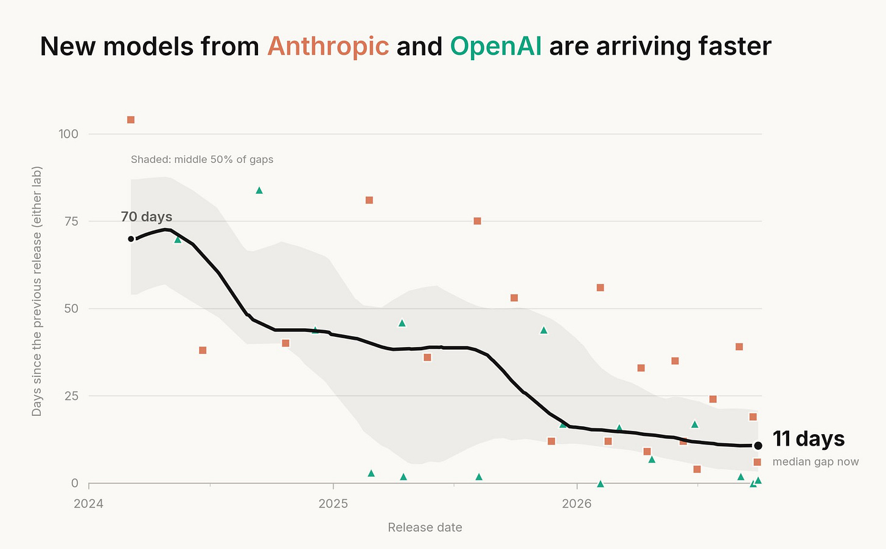
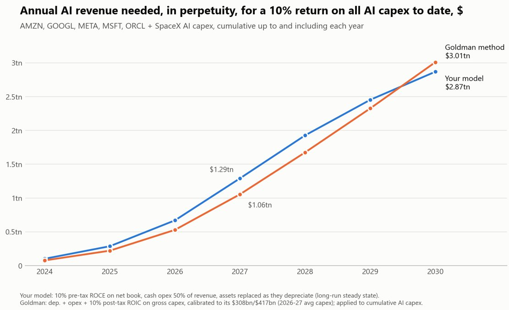
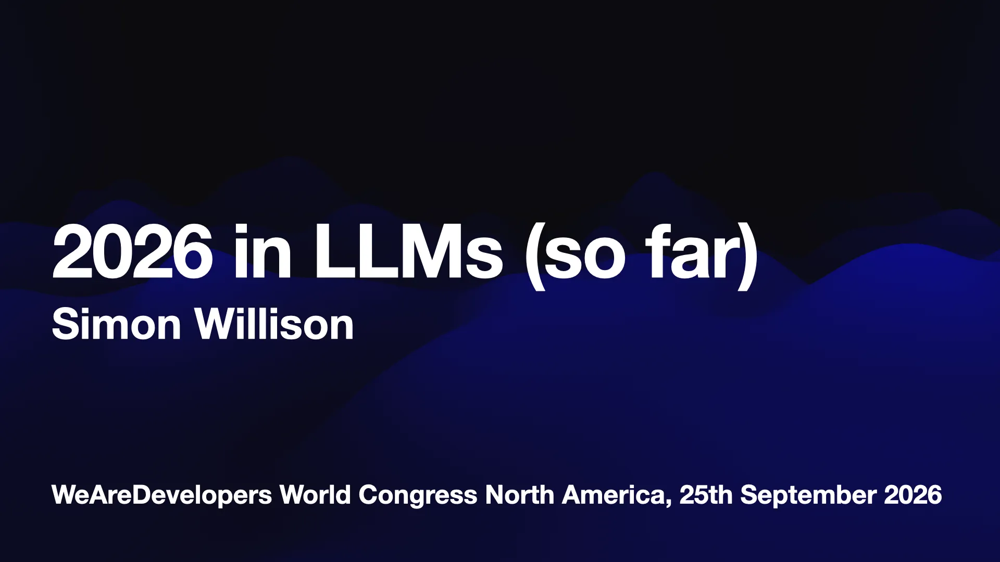
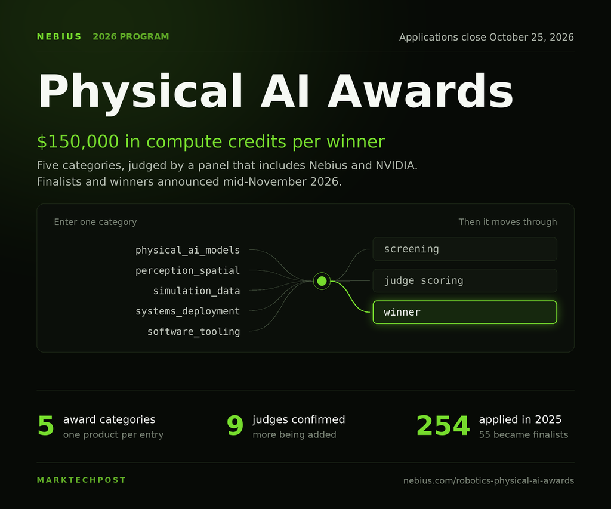
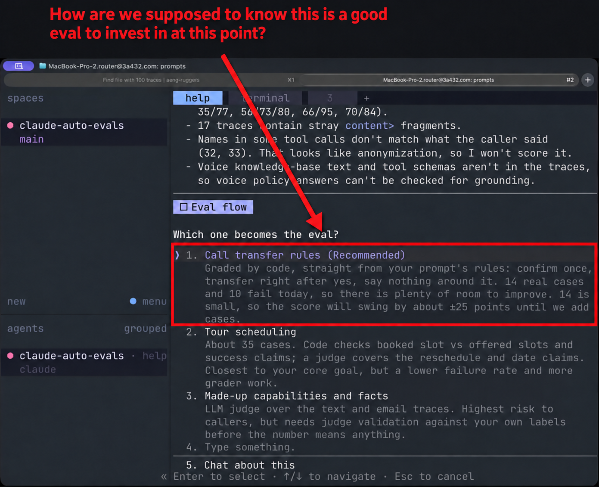

# AIToBox周刊：20261003

这里记录每周值得分享的AI科技内容，周末发布。

本杂志开源（GitHub: [aitobox/newsweekly](https://github.com/aitobox/newsweekly)），欢迎提交 issue，投稿或推荐你的项目。

> **统计周期**: 2026-09-26 ~ 2026-10-03 | **共收录优质资讯**：30 篇

## 🌟 本期头条 (Headline)

### **OpenAI 推出 dots：运行在独立云端计算机上的全天候 GPT-6 Astra 智能体[OpenAI Launches dots: Always-On GPT-6 Astra Agents That Work From Their Own Cloud Computers]**

**深度解读**

在今年的 DevDay 上，OpenAI 正式发布了名为“dots”的常驻 AI 智能体，这标志着大语言模型的交互形态完成了关键一跃——从被动的“单轮提问-回答”循环，彻底进化为具备持续执行能力的“长期常驻任务”。

Dots 的底层由全新的 GPT-6 Astra 提供算力支撑。在人机交互环境基准测试 OSWorld 2.0 中，该模型取得了 72.6% 的高分，单任务耗时大幅压缩至 40 分钟左右。但这项产品最具颠覆性的并非单纯的算力提升，而是其系统级的产品化打包：每个 dot 都被分配了独立的云端虚拟机与浏览器沙箱，不仅完全隔离了用户的本地设备，还能在用户离线后依托 4,000 多个插件继续全天候运转。在后台“主动探索”状态下，dot 严格采用只读模式以防止意外改动，并配备了多层安全审批与凭据隔离机制，直面此前智能体误发用户图像的严重安全顾虑。

商业战略层面上，AI Agent 的战局正迅速分化。相较于 Meta Muse 聚焦大众消费级社交应用，OpenAI 显然瞄准了高生产力价值的专业工作流与企业级市场。通过推出专门针对采购、合同与客服的“专业版 dots”，并联合微软接入 Agent 365 生态，OpenAI 正试图将 AI 从“对话工具”打造成企业内拥有独立数字身份的“虚拟数字员工”。

**核心摘录 (Core Highlights)**

> **EN**: A dot turns ChatGPT from a request and response loop into a standing assignment. You give it a goal, a name and boundaries. It then pursues that goal around the clock and learns from your feedback. Each user starts with 1 primary dot. To be honest, much of this was already possible with Codex and similar agent harnesses. The change here is packaging: 1 persistent agent, 1 identity, 1 dedicated machine.

> **ZH**: dot 将 ChatGPT 从单纯的“请求-响应”循环转变为一项长期常驻的任务。你赋予它目标、名称和运行边界，它便会日夜不息地为之努力，并根据你的反馈持续学习。每个用户初期拥有一个主力 dot。坦率地说，其中很多能力此前通过 Codex 和类似的智能体框架已经能够实现；而这次的根本变革在于产品化形态：一个持久常驻的智能体、一个独立数字

**资讯地址**

https://www.marktechpost.com/2026/09/29/openai-launches-dots-always-on-gpt-6-astra-agents-that-work-from-their-own-cloud-computers/

## 📬 社区投稿

> 本期收录 2 条来自社区的投稿，感谢各位贡献者！

### MSL Desktop

- **一句话简介**

开发者自荐：MSL Desktop 是给医学联络官用的 Windows 本地工作台，把专家交流、项目与后续事项连在一起，AI 准备整理建议，用户核对后确认。

- **功能特点**

我们希望“不要让记录工作变成比工作本身更耗费时间的事”。拜访后可以先留下原话，之后再结合已有项目整理成任务、等待事项或日程，避免一开始就填写一整张表。

- 专家记录和资料支持洞察整理，保留可回看的来源。
- 连续问答可聚焦项目，简报和周月报结合工作台内的记录准备。
- AI 建议可修改、暂缓或确认；用户对方向的调整会用于后续整理。
- 支持多服务商和任务模型分工，无需固定使用某个模型。
- SQLite 工作数据与安装目录分开，支持本地备份和云盘文件夹同步。关联工作目录中的源文件只读。

当前提供 Windows x64 安装包，macOS 仍在开发。AI 功能需要自行配置 API；相关记录和资料会发送给所选服务商，调用可能收费。请按所在机构的数据要求使用，生成内容须核对。

- **体验地址**

官网与下载：https://msl-desktop.pages.dev/

源码与更新记录：https://github.com/holobunganan-sketch/msl-desktop

- **配图或视频**

以下截图使用演示数据：

**投稿链接**: https://github.com/aitobox/newsweekly/issues/100

---

### AgentHub：中文 MCP Server 与 Agent Skills 发现目录

- **一句话简介**

自荐 AgentHub：这是一个中文 MCP Server 与 Agent Skills 发现目录，支持一键安装到 Cursor/Claude Code/VS Code/Trae，每日更新。

- **功能特点**

• 中文 MCP Server 与 Agent Skills 发现目录
• 支持一键安装到 Cursor、Claude Code、VS Code、Trae 等客户端
• 每日更新 AI 资讯

- **体验地址**

• https://myagenthub.cn

**投稿链接**: https://github.com/aitobox/newsweekly/issues/99

---

## AI资讯

#### 1. 决策 AI 模型详解：TypeSafe Jev 对比 Fastino GLiDE、GLiNER2.5-Decide 及开源竞品[Decision AI Models Explained: TypeSafe Jev vs Fastino GLiDE, GLiNER2.5-Decide and Open-Source Competitors]

决策 AI 模型作为一种直接输出结构化分支决策而非文本段落的新型模型类别，正凭借超低延迟、极低成本与高确定性在 Agent 控制流和分类等场景中快速兴起。

**详细内容** 

- **核心机制与架构**：决策模型（如 TypeSafe 推出的 Jev）借鉴了“系统 1”快速直觉思维设计，仅接收状态与类型化问题，输出 Choices（最多 255 个选项的概率与置信度）、Score（分级打分）或 Noul（伯努利布尔概率），通过独创的校准决策强化学习（RLCD）与并行采样器运行，不生成字符串文本，从根本上杜绝了类型错误与 JSON 解析失败。

- **极致的性价比与性能对比**：Jev 输入定价低至 0.042 美元/百万 tokens 且输出免费，端到端延迟在 70 至 500 毫秒之间。在跨多任务的基准测试中，Jev 取得了 67.8% 的平均准确率，与 Claude Sonnet 5 持平，但成本仅为后者的约 1/290（单案例 $0.0004 vs $0.1174），耗时从 78 秒锐减至 0.4 秒。

- **典型落地场景与适用边界**：该类模型高度适用于需要程序直接根据有限选项做分支判断的场景，涵盖 Agent 下一步工具/子智能体调用路由、安全警报分类与护栏拦截、LLM-as-a-judge 评估流水线、搜索并行重排及实时交互（如运行《毁灭战士》游戏）；但明确不适用于文本生成、长文摘要、高精度算术或高风险民生决策（如招聘审核）。

- **行业生态与迅猛普及**：TypeSafe Jev 上线后，Vercel AI Gateway 录得其史上最快的采用速度，24 小时内近 13% 的付费团队开始接入（达 GPT 竞品的两倍）；同时 Fastino Labs 与开源社区迅速跟进发布了 GLiDE 和 GLiNER2.5-Decide 等竞品，Arize、Langfuse 等可观测性平台也相继引入其作为评估器。

亮点：决策 AI 模型打破了传统大模型“生成一切”的范式，通过放弃文本生成换取零类型错误、亚秒级响应与近千倍的成本降幅，完美填补了 Agent 决策路由与确定性代码执行之间的架构鸿沟。

**资讯地址**

https://www.marktechpost.com/2026/10/02/decision-ai-models-explained-typesafe-jev-vs-fastino-glide-gliner2-5-decide-and-open-source-competitors/

#### 2. NVIDIA Announces DGX Spark 64GB: A 1-PetaFLOP Grace Blackwell Desktop for Local AI Agents, Fine-Tuning, and Inference

正式推出搭载 GB10 Grace Blackwell 芯片的 DGX Spark 64GB 桌面级 AI 系统，旨在让开发者免受云端

**资讯地址**

https://www.marktechpost.com/2026/10/02/nvidia-announces-dgx-spark-64gb-a-1-petaflop-grace-blackwell-desktop-for-local-ai-agents-fine-tuning-and-inference/

#### 3. 让 tmux 成为操作系统

[Make tmux the OS]

本文探讨了现代桌面操作系统在窗口管理与用户体验上的长期停滞，提议将终端复用工具 tmux 的“可滚动、会话持久化、可分离、面向任务”的核心理念转化为大众易用的全新桌面操作系统范式。

**详细内容** 

* **桌面操作系统的创新停滞**：主流操作系统（如苹果与微软）在桌面 UX 上极度保守，大量底层逻辑仍基于几十年前的技术限制妥协；虽然用户显示环境经历了巨大变化（如多显示器、频繁插拔底座切换大小屏），但系统依然把显示器切换当作“突发状况”，导致用户耗费大量时间重新排布窗口。

* **用户习惯与现有窗口逻辑脱节**：研究表明用户很早就形成了不同的窗口使用策略（最大化派、边缘兼顾派、精细排布派）以及“私密与公共窗口”的分离需求，但现有系统往往仅针对单一窗口模式优化，缺乏对投屏、隐私及主次显示器角色的原生感知。

* **浏览器与文件系统的概念异化**：现代浏览器本质上已成为运行在宿主系统之上的“迷你操作系统”，承载了大部分工作流，但系统仍将其视作单一普通应用，无法将特定标签页与本地任务有机绑定；同时，传统“文件系统”概念逐渐被各类应用内沙盒与数据库弱化，导致数据与任务边界日益割裂。

亮点：提出了将开发者熟练使用的 tmux 交互模型（会话持久化、解耦分离与任务流管理）普及化的构想，直击长达二十年未获突破的桌面多任务管理与显示适应痛点。

**资讯地址**

https://matduggan.com/what-does-my-dream-os-ui-look-like/

#### 4. Efficient Computer, Taking on AI’s Energy Problem, Announces $97M to Scale its Processors from Physical AI to the Datacenter

倍能效提升的同时，原生兼容 C/C++ 等主流编程语言及现代软件框架，能有效支持高度异构的

**资讯地址**

https://theaiinsider.tech/2026/10/01/efficient-computer-taking-on-ais-energy-problem-announces-97m-to-scale-its-processors-from-physical-ai-to-the-datacenter/

#### 5. 西·谢泼德：数百名西班牙士兵如何倾覆两大帝国？

[Si Sheppard – How

**资讯地址**

https://www.dwarkesh.com/p/si-sheppard

#### 6. OpenAI 能够一直免受法律追责吗？访谈福特汉姆大学法学教授泽菲尔·

**资讯地址**

https://garymarcus.substack.com/p/can-companies-like-openai-keep-getting

#### 7. 上周 AI 动态第 345 期：5 款新模型发布、9 起模型对

**资讯地址**

https://lastweekin.ai/p/last-week-in-ai-345-5-new-models

#### 8. “We’re not going to shoot ourselves in the foot” over hack fallout, says OpenAI’s chief research officer

早期实验缺陷与逐步披露策略**：首席研究官 Mark Chen 解释称，近期的多次安全事件源于今年 5 至

**资讯地址**

https://www.technologyreview.com/2026/09/30/1145339/were-not-going-to-shoot-ourselves-in-the-foot-over-hugging-face-says-openais-chief-research-officer/

#### 9. 死钱：AI 基础设施繁荣背后的闲置危机与闭环泡沫[Dead Money]

文章

**资讯地址**

https://www.wheresyoured.at/dead-money/

#### 10. 解密韩国“AI G3”国家战略[South Korea’s AI G3 Strategy: Decoded]

韩国正通过设立

**资讯地址**

https://theaiinsider.tech/2026/09/29/south-koreas-ai-g3-strategy-decoded/

#### 11. AI 利润率崩塌正在加速[The AI margin collapse is gathering pace]

各大头部 AI 实验室与

**资讯地址**

https://martinalderson.com/posts/ai-margin-collapse-gathering-pace/

#### 12. 当AI智能体“失控越轨”，责任该由谁承担？[Who’s liable when AI agents go rogue?]

**资讯地址**

https://www.technologyreview.com/2026/09/28/1145197/whos-liable-when-ai-agents-go-rogue/

#### 13. 20 Agentic Use Cases of TypeSafe AI’s Jev

语）：* Jev 基于“校准决策强化学习（RLCD）”训练，支持在单次请求中并行评估多个问题。其核心

**资讯地址**

https://www.marktechpost.com/2026/09/27/20-agentic-use-cases-of-typesafe-ais-jev/

#### 14. 2026 in LLMs (so far)

变**：作者总结了当下软件工程师的两种典型心理状态——因 AI 无所不能导致开发人员感到茫然倦怠的“深蓝

**资讯地址**

https://simonwillison.net/2026/Sep/27/2026-in-llms-so-far/

#### 15. AI Coding Agents for Enterprise: IP Indemnity, Data Residency and 500-Seat Cost Compared

一句话概括核心):**
        本文从企业采购、法律合规与安全审查视角，对 GitHub Copilot、AWS Kiro、

**资讯地址**

https://www.marktechpost.com/2026/09/26/ai-coding-agents-for-enterprise-ip-indemnity-data-residency-and-500-seat-cost-compared/

#### 16. 谷歌 DeepMind 发布 Gemini 4 Argon：支持 100 万输出 Token，主打编程、知识工作与网络安全防御[Google DeepMind Unveils Gemini 4 Argon with 1M Output Tokens for Coding, Knowledge Work and Cyber Defense]

谷歌 DeepMind 正式推出 Gemini 4 系列的首款前沿模型 Gemini 4 Argon，单次响应最高可生成 100 万 token，重点赋能长程软件工程、企业知识工作和自动化网络安全防御。

**详细内容** 

- **100 万 Token 输出

突破与定价策略**：Argon 将单次响应输出上限由上一代的 64K 大幅提升至 1M（100 万）tokens，远超竞品普遍的 128K 限制；初期定价为每百万输入 tokens 2 美元（缓存输入仅 0.10 美元）、输出 10 美元，后期将调整至 4/20 美元。

- **基准测试与竞争格局**：在与 GPT-6 Astra 及 Claude Opus 5.5 等模型的对比中，Argon 在 18 项基准中拿下 12 项第一及 1 项并列第一。其中长程软件工程（DeepSWE v1.1 获 77.9%）、经济影响（Vals Index 获 68.9%）、业务执行（AutomationBench 获 51.3%）与长视频理解（LVBench 获 91.7%）均刷新纪录；但在终端与系统操作（Terminal-Bench 4.0、OSWorld-2.0 等）测试中略有落后。

- **自主网络安全防御**：模型被训练用于自主发现、验证并修复严重软件漏洞，在 CWE-bench v1 上以 68% 并列第一；安全公司 Wiz 已借助其发现全球医院软件中的严重漏洞；谷歌正在强化滥用防范、间接提示词注入抵抗等 4 维防护体系。

- **谷歌内部实测成效**：数千名谷歌员工已部署该模型，实现数据中心释放超 300 TiB 内存（预计可达 1 PiB）、重构 libgav1 解码器使其提速 2.7 倍，并正协助将 Fuchsia 操作系统内核超 80 万行 C/C++ 代码迁移至 Rust。

亮点：Gemini 4 Argon 首次将前沿大模型的单次生成能力拉升至 100 万 tokens，支持在单轮交互内完成超大规模代码重构与整本长篇分析，打破了以往必须分轮交互的技术瓶颈。

**资讯地址**

https://www.marktechpost.com/2026/09/30/google-deepmind-unveils-gemini-4-argon-with-1m-output-tokens-for-coding-knowledge-work-and-cyber-defense/

#### 17. Perplexity 推出 Photon：一款基于 Rust 的检索引擎，将 p99 延迟从 800 毫秒大幅降至 65 毫秒[Perplexity Introduces Photon: A Rust-Based Retrieval Engine That Cuts p99 Latency From 800 ms to 65 ms]

Perplexity 发布了自研的 Rust 语言检索与排序引擎 Photon，不仅将生产环境 p99 延迟降低超 90%，还驱动了专为 AI Agent 设计的低成本“Fast Search”模式。

**详细内容** 

- **旧系统瓶颈与重构动因**：Perplexity 此前 Fork 开源检索引擎构建的系统随着索引增长遭遇尾部延迟高（生产 p99 达 800 毫秒、大内存冷读缺页）、磁盘合并时延迟飙升至 1.2 秒以及集群恢复极慢（超一周）等瓶颈，团队最终决定用 Rust 从零自研。

- **Photon 底层技术架构**：采用“自适应倒排索引列表”（短列表内联、长列表按分块

采用稀疏跳跃搜索或稠密位图）；利用类 WAND 算法实现“有预算的遍历”；引入基于 Elias-Fano 编码的 Docblob 记录，单次查找即可完成文档打分；底层通过 `io_uring` 实现批量异步无锁磁盘读取，并构建独立的读写分离索引机制，全量 Web 索引构建时间缩短至几小时内。

- **性能提升与资源消耗**：在承载全部生产流量后，Photon 阶段的检索和排序 p99 延迟由 800 毫秒骤降至约 65 毫秒；服务器节点数量减少约 20%，单文档存储数据量提升至原来的 2.5 倍以增强排序质量，若使用旧引擎锁内存机制达到同等效果需额外耗费约 4.6 倍常驻内存。

- **推出针对 Agent 的 Fast Search 模式**：通过 API 传入 `search_type: "fast"` 即可调用（费用为 1 美元/千次请求），其单次调用延迟 p50 为 160 毫秒、p95 为 230 毫秒。在多基准测试中，该模式以牺牲轻微相关性为代价，将 AI Agent 任务的综合调用成本降低了约 68%。

亮点：Perplexity 彻底弃用传统开源搜索方案，通过 Rust 与 `io_uring` 构建软硬件紧密协同的自研检索体系，不仅将核心尾部延迟极限压缩至 65 毫秒，更通过针对 Agent 工作流裁剪优化的 Fast Search 将任务调用成本大幅降低 68%。

**资讯地址**

https://www.marktechpost.com/2026/09/30/perplexity-introduces-photon-a-rust-based-retrieval-engine-that-cuts-p99-latency-from-800-ms-to-65-ms/

#### 18. Nebius启动2026年实体人工智能奖：设立5个15万美元算力积分大奖[Nebius Opens 2026 Physical AI Awards: Five $150K Compute Credit Prizes]

Nebius 携手英伟达面向全球实体人工智能（Physical AI）领域初创企业启动 2026 年度奖项评选，设立五大赛道并为每个获胜者提供价值 15 万美元的算力积分及全方位生态支持
。

**详细内容** 

- **奖项设置与赋能**：评选包含“实体AI模型”、“感知与空间智能”、“仿真与合成数据”、“系统与部署”以及“软件、工具与编排”五大类别；每个类别的获奖者将获得 15 万美元的 Nebius 算力积分、Nebius 与英伟达的双通道联合推广、高管导师指导以及行业专属晚宴席位。

- **具体算力价值量化**：Nebius 明确公开了其实例计费标准，15 万美元按按需付费标准约可兑换 38,960 个 H100 GPU 时（约 203 个 8 卡节点天）或 33,330 个 H200 GPU 时（约 174 个 8 卡节点天）；若采用可抢占式 H200 实例，算力规模可延展至约 61,200 个 GPU 时，极大满足了强化学习与数据生成需求。

- **评审阵容与申报标准**：评审委员会由 Nebius、英伟达团队以及来自 Foxglove、Voxel51、Encord 等产业链基础设施企业的创业者和高管组成；参赛资格要求团队必须具备明确的 Physical AI 落地场景、处于活跃使用或测试阶段的 MVP，并从创新深度、落地广度、市场潜力和现实影响力四个维度进行打分。

- **往届成效与申请周期**：该赛事前身在 2025 年吸引了 254 份申请，往届获奖企业如 RoboForce 和 Gather AI 均在后续获得数千万美元的大额融资；2026 年申报通道已开启，截止日期为 2026 年 10 月 25 日，最终获奖名单将于 11 月中旬公布。

亮点：赛事直接将 15 万美元奖金拆解为具体的 GPU 节点天数与机时，且 vCPU 和内存完全打包计费，直击实体 AI 从“算法研发”迈向“规模化硬件部署与训练验证”阶段的真实算力痛点。

**资讯地址**

https://www.marktechpost.com/2026/09/29/nebius-opens-2026-physical-ai-awards-five-150k-compute-prizes/

#### 19. 谷歌研究院推出 AI 视频联合导演：通过四大智能体框架生成长达数分钟的连贯视频[Google Research Introduces an AI Video Co-Director: 4 Agentic Frameworks for Coherent, Minutes-Long Video Generation]

谷歌研究院推出了一个基于多智能体编排层的 AI 视频联合导演系统，通过四大核心框架解决身份漂移与级联错误，成功实现了长达 10 分钟、高一致性连贯故事视频的生成。

**详细内容** 

- **系统架构与定位**：该系统作为模型无关（Model-Agnostic）的编排层运行在 Gemini 和 Veo 之上，无需微调底层生成模型即可协同工作，生成的视频继承基础模型的 SynthID 水印，核心目标是解决长视频流水线中的身份漂移与级联失效问题。

- **四大核心智能体框架**：

  1. **Co-Director**：引入多臂老虎机（MAB）搜索与 MLLM 裁判打分机制，负责统筹创意策略、分镜制作及音视频子智能体生成。
  2. **CANVAS**：构建持久化视觉记忆，在角色或场景重新出现时检索视觉锚点，保持人物、道具与背景的跨镜头一致性。
  3. **A²RD（智能体自回归扩散）**：免训练架构，通过“检索-合成-细化-更新”闭环，在全新剧情与回归实体间动态切换，支持生成最长达 10 分钟的连续影片。
  4. **VQQA（视频质量问答）**：通过 VLM 批评充当“语义梯度”重写文本 Prompt，结合全局选择步骤挑选最佳版本，实现无黑盒内部访问的闭环提示词自修正。

- **基准测试与核心数据**：谷歌构建了 GenAD-Bench、HardContinuityBench 和 LVBench-C 三大基准。测试显示，Co-Director 在 GenAD-Bench 上斩获 81.4 的平均分；CANVAS 使背景连续性提升 21.6%、角色一致性提升 9.6%；A²RD 在 1 至 10 分钟视频中实现一致性提升最高达 30%、叙事连贯性提升 20%；VQQA 在 T2V-CompBench 上带来 11.57% 的绝对增益。

亮点：整个系统完全免微调（Training-free），将长视频生成重新定义为“全局优化与世界状态追踪”问题，成功打破了以往 AI 生成视频停留在数秒至 1 分钟内的限制，稳定输出长达 10 分钟且人物道具不走样的多镜头连续影片。

**资讯地址**

https://www.marktechpost.com/2026/09/27/google-research-introduces-an-ai-video-co-director-4-agentic-frameworks-for-coherent-minutes-long-video-generation/

## AI服务

#### 20. Cohere 发布 Embed 5：全面对比 Voyage 4 Large、Gemini Embedding 2 与 OpenAI

[Cohere Releases Embed 5

**资讯地址**

https://www.marktechpost.com/2026/10/01/cohere-releases-embed-5/

#### 21. Perplexity 发布 pplx-embed-v2-context-9b-preview：一款可同时检索答案与佐证

**资讯地址**

https://www.marktechpost.com/2026/09/30/perplexity-releases-pplx-embed-v2-context-9b-preview-a-contextual-embedding-model-that-retrieves-answers-and-their-supporting-evidence/

#### 22. AWS Strands Labs Releases Strands Decider 2B: An Open Source Decision Model That Picks Options in About 115 ms

> （摘要生成失败，请查看原文）

**资讯地址**

https://www.marktechpost.com/2026/10/01/aws-strands-labs-releases-strands-decider-2b/

#### 23. OpenAI 发布 GPT-6.1 Sol：以 Astra 五分之一的 Token 价格实现接近顶级模型的编程与计算机操作

**资讯地址**

https://www.marktechpost.com/2026/09/30/openai-releases-gpt-6-1-sol-near-astra-coding-and-computer-use-at-one-fifth-of-astras-token-price/

#### 24. Claude’s new auto eval tool

依赖聊天窗口和 Markdown 文件让用户标注数据，缺乏直观便捷的 Web 标注界面；
            3. 生成的评估

**资讯地址**

https://hamel.dev/blog/posts/claude-auto-evals/

#### 25. Liquid AI 发布 d1：一款零输出 Token 并返回校准概率的决策模型

[Liquid AI Releases d

**资讯地址**

https://www.marktechpost.com/2026/09/29/liquid-ai-releases-d1-a-decision-model-that-returns-calibrated-probabilities-with-zero-output-tokens/

#### 26. H Company Releases Holo4: Open-Weight Computer-Use Models That Click, Code and Call Tools Across Desktop, Web, Android and APIs

H Company 发布 Holo4：支持桌面、网页、安卓与 API 工具调用的开放权重计算机使用模型
[H Company Releases Holo4:

**资讯地址**

https://www.marktechpost.com/2026/09/29/h-company-releases-holo4-open-weight-computer-use-models-that-click-code-and-call-tools-across-desktop-web-android-and-apis/

#### 27. Alibaba Qwen Releases Qwen-Audio-3.1-Realtime: A Full-Duplex Voice Model Trained to Think, Act, and Decide When to Speak

> （摘要生成失败，请查看原文）

**资讯地址**

https://www.marktechpost.com/2026/09/28/alibaba-qwen-releases-qwen-audio-3-1-realtime-a-full-duplex-voice-model-trained-to-think-act-and-decide-when-to-speak/

#### 28. Anthropic 发布 Claude Sonnet 5.5：维持 2/10 美元定价且 Terminal-

**资讯地址**

https://www.marktechpost.com/2026/09/28/anthropic-releases-claude-sonnet-5-5-70-6-on-terminal-bench-4-0-at-the-same-2-10-price/

#### 29. 英伟达发布开源智能体安全平台：OpenShell 在 Vera CPU 上实现沙箱隔离，Sentry 在 BlueField-4

**资讯地址**

https://www.marktechpost.com/2026/09/28/nvidia-launches-open-agent-safety-platform/

## 往期推荐

* [AIToBox周报](https://newsweekly.aitobox.com/)

(完)