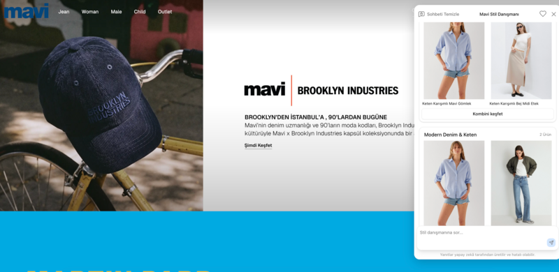
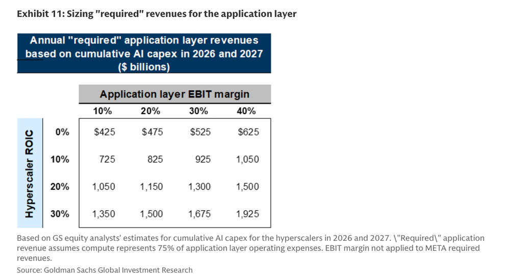
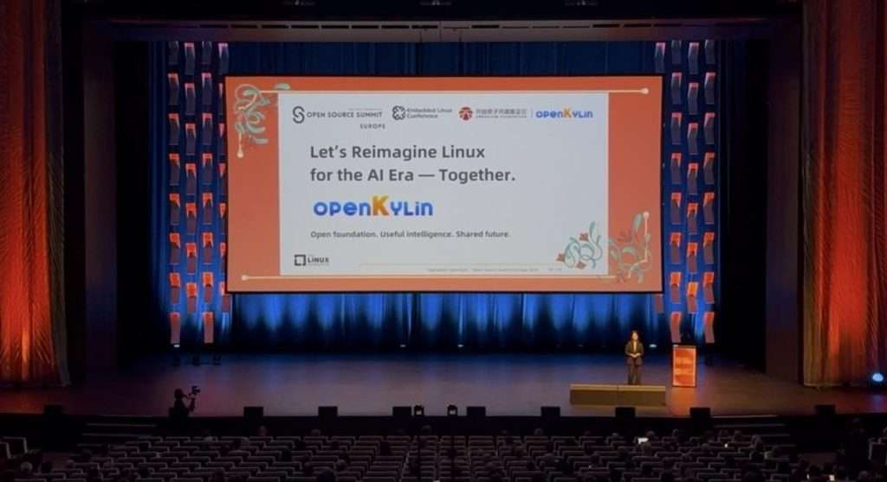
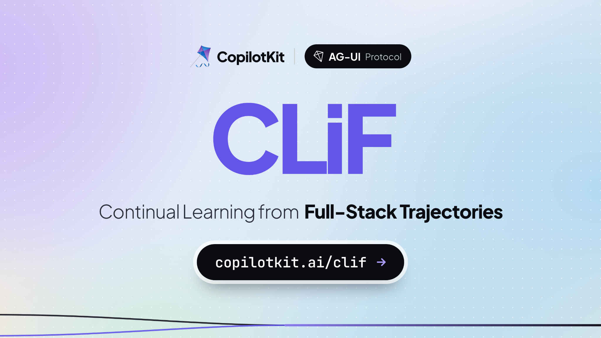
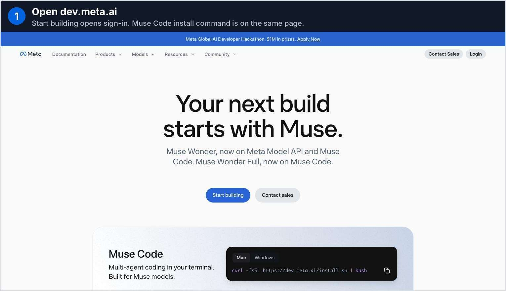

# AIToBox周刊：20261018

这里记录每周值得分享的AI科技内容，周末发布。

本杂志开源（GitHub: [aitobox/newsweekly](https://github.com/aitobox/newsweekly)），欢迎提交 issue，投稿或推荐你的项目。

> **统计周期**: 2026-10-11 ~ 2026-10-18 | **共收录优质资讯**：30 篇

## 🌟 本期头条 (Headline)

### **Meta 发布 Muse Spark Open：具备 1M 上下文的 8160 亿参数开源权重 MoE 模型[Meta Releases Muse Spark Open: 816B Open-Weight MoE With 1M Context]**

**深度解读**

Meta 旗下超级智能实验室（Meta Superintelligence Labs）近日重磅推出了开源权重模型 Muse Spark Open，这也是 Meta 迄今为止发布的最强开源多模态模型。该模型采用了大规模混合专家（MoE）架构，总参数高达 8160 亿，但每个 Token 仅激活 420 亿参数，同时原生支持文本、图像、音视频多模态输入，并具备惊人的 100 万 Token 上下文窗口。

在技术生态与部署层面上，该模型带来了里程碑式的突破。通过 NVFP4 量化技术以及 MLX 张量并行，该模型能够在两台搭载 M5 Ultra（各 512GB 统一内存）的 Mac Studio 上运行，或者借助 Unsloth 2-bit GGUF 压缩至约 300GB 内存的单工作站环境中，极大降低了超大模型在桌面与本地数据中心的推理门槛。

但在性能维度上，呈现出明显的结构性分化。Muse Spark Open 在智能体（Agent）工具调用（MCP-Atlas 斩获 89.2 分）与长程任务中表现极其亮眼，但在代码生成（Terminal-Bench 2.1 仅 76.4 分）与综合智能指标上，依然明显落后于 Kimi K3、GLM 5.3 以及 Qwen3.8 等中国头部开源模型。这不仅坐实了其“美国本土最强开源权重模型”的称号，也折射出当前全球大模型竞争的新常态：Meta 虽在架构工程和多模态落地部署上极具压迫感，但在基础推理与代码高阶任务上，中国开源梯队的综合壁垒依旧牢固。

**核心摘录 (Core Highlights)**

> **EN**: Muse Spark Open is an 816B-parameter Mixture-of-Experts model that activates 42B parameters per token. It takes text, image, video and audio input, returns text, and holds a 1M-token context window. Meta team claims it to be the most capable US open-weight model to date. For developers, the real news is deployment: the NVFP4 build runs on 2 Apple M5 Ultra Mac Studios.

> **ZH**: Muse Spark Open 是一个 8160 亿参数的混合专家（MoE

**资讯地址**

https://www.marktechpost.com/2026/10/15/meta-muse-spark-open-816b-open-weight-model/

## 📬 社区投稿

> 本期收录 4 条来自社区的投稿，感谢各位贡献者！

### Doc2X 文档解析与翻译

- **一句话简介**

Doc2X 是 PDF/图片文档解析与翻译工具，识别公式表格并导出可编辑文档。

- **功能特点**

网页产品可将PDF、扫描件、图片转 Word、Markdown、LaTeX，支持PDF/Word翻译、Zotero插件；开发者可使用API及配套开源MCP。

NoEdgeAI 官方 MIT TypeScript stdio MCP，配套实际 doc2x-mcp Skill，提供 PDF/图片解析、公式表格识别、导出文档与提取版面 JSON。适合作为科研办公文档预处理组件。

仓库：https://github.com/NoEdgeAI/doc2x-mcp
真实Skill：https://github.com/NoEdgeAI/doc2x-mcp/blob/main/skills/doc2x-mcp/SKILL.md

需 Node.js >=18、自己的 API Key。文档上传云端处理，API按用量收费；MIT是源码许可，不表示云API免费。国内网页 https://doc2x.noedgeai.com/ 有试用和部分免费工具，其余会员/积分，API另计。

受项目方委托自荐、AI辅助整理；本次仅核对公开资料，未调用付费API，不声称实测准确率或兼容性，供编辑审核。

- **体验地址**

https://doc2x.noedgeai.com/
API平台：https://open.noedgeai.com/

- **配图或视频**

暂无本次实际运行截图；官方README包含安装与工作流说明。

**投稿链接**: https://github.com/aitobox/newsweekly/issues/106

---

### [AI service recommendation] Ad Multiplier: variations of existing short video ads

- **一句话简介**

Ad Multiplier 是视频广告变体工具：以一条现有的 4–30 秒广告为输入，生成不同人物、服装、场景或产品的视觉版本，可选择保留原音频。

- **功能特点**

- 接受 MP4、MOV、WebM，源文件不超过 100 MB；每条广告最多生成 4 个版本，可排队处理最多 5 条源广告。
- 可补充文字指令及参考图片，选择 720p 或 1080p 输出，下载 MP4 或 ZIP 后人工检查和发布。
- 这是广告素材制作工具，不直接连接广告平台投放，也不提供效果提升保证。
- 付费积分按输出计费，无订阅。4–15 秒的 Standard 输出为 1 积分，单积分价格 $9.90；较长或 HD 输出消耗更多积分。价格以官网价格页为准。

- **体验地址**

官网：https://admultipliers.com/

价格与限制：https://admultipliers.com/pricing/

- **配图或视频**

官网展示页可公开查看。本次不附客户广告、私有工作截图或未经核实的生成结果。

- **关联说明**

我是项目关联方，这是自荐。介绍由 AI 辅助整理，依据当前官网功能与价格核对；没有提供实测广告效果、用户数或营收数据。请编辑判断是否适合读者。

**投稿链接**: https://github.com/aitobox/newsweekly/issues/105

---

### Beav：多账号社媒创作与 AI 素材库

- **一句话简介**

作者自荐：Beav 将多个社媒账号的素材、稿件和长期偏好分开管理，让 AI 基于已有素材辅助选题、写稿与图文制作。

- **功能特点**

- 多账号空间：按账号或品牌整理自己的知识、资产和创作规划。
- 小红书与社媒内容制作：保存公开笔记和评论作为参考，复用带文字变量与参考图的模板，制作不同主题的图文。
- AI 素材库：资料可检索、引用并拖入对话，供 AI 继续创作；提供 Beav Creator / MCP 接入说明。

定位是面向社媒创作、给 AI 使用的 Eagle 式素材工作台。

- **体验地址**

https://github.com/Jamailar/Beav

README 提供正式版下载与使用说明。公开源码是 Tauri + Rust 的 2.5.0 快照，采用 Beav Source-Available 非商业许可（非标准 MIT / OSI 开源许可）。正式产品持续更新，功能进度与公开源码不同。

- **配图或视频**

可在仓库 README 查看公开产品演示。

**投稿链接**: https://github.com/aitobox/newsweekly/issues/104

---

### Sage 2.0：桌面与 Web 共用 Python 运行时的开源智能体平台

- **一句话简介**

自荐 Sage 2.0：一个 MIT 开源的智能体平台，桌面端、Web 服务和自建 Python 应用共用同一套运行时，支持持久会话、人工审批以及 MCP 和 Skills。

- **功能特点**

我是 Sage 的维护者。这次 2.0 更新主要面向两类使用方式：直接在桌面端处理项目工作，或把智能体运行时嵌入自己的应用。

- **桌面端直接体验**：提供 macOS、Windows 和 Linux 安装包，已包含 Python 和后端；无需先搭建 Flutter 开发环境。Linux 仍需 GTK 和 bubblewrap。
- **执行过程可交互**：保存会话历史，流式输出执行事件；任务可以暂停，等待用户输入或审批后继续。
- **工具与协作**：接入内置工具、可复用 Skills 和 MCP 服务；Studio 成员可以通过定向消息协作。
- **Python 集成**：SAgents v2 要求 Python 3.12+，提供 Agent 包、Session、Run 和插件接口。桌面端、服务端和自建应用使用相同内核。

使用者需要配置自己的模型服务凭证，模型调用可能产生费用。macOS 安装包尚未公证，Windows 安装包尚未做代码签名，请先阅读发布页说明。自建 Server v2 当前支持单 worker；本地进程执行也不等同于容器隔离。

- **体验地址**

- 源码和中文介绍：https://github.com/ZHangZHengEric/Sage/blob/main/README_CN.md
- 2.0.0 安装包与发布说明：https://github.com/ZHangZHengEric/Sage/releases/tag/v2.0.0
- Python 运行时与最小示例：https://github.com/ZHangZHengEric/Sage/blob/main/sagents/v2/README.md

- **配图或视频**

欢迎试用后在 Sage 仓库提出具体问题。本次为维护者自荐。

**投稿链接**: https://github.com/aitobox/newsweekly/issues/103

---

## AI资讯

#### 1. 20 Jev Alternatives: The Decision Models Taking On TypeSafe in 2026

**：TypeSafe的Jev是一种纯文本并行打分/分类的决策模型（输入100万token仅0.042美元

**资讯地址**

https://www.marktechpost.com/2026/10/17/20-jev-alternatives-the-decision-models-taking-on-typesafe-in-2026/

#### 2. Perplexity 开源 SPACE：面向 AI Agent 的 Firecracker 微虚拟机沙箱平台 [Perplexity Open-Sources SPACE, a Firecracker MicroVM Sandbox for AI Agents]

Perplexity 正式开源了其支撑 Perplexity Computer 的核心沙箱平台 SPACE，通过基于 Rust 的 Firecracker 微虚拟机技术，为 AI Agent 的代码执行提供生产级安全隔离与亚秒级响应能力。

**详细内容** 

- **架构设计与技术栈**：SPACE 采用 Rust 编写并在 Apache 2.0 协议下开源（首发版本 0.8.0），系统由 PostgreSQL 支持的 API、控制器、Worker 服务

**资讯地址**

https://www.marktechpost.com/2026/10/16/perplexity-open-sources-space-firecracker-microvm-sandbox-ai-agents/

#### 3. 金融领域的 AI 风险管理：金融稳定委员会负责任 AI 报告的核心启示

[AI Risk Management in Finance: Key Lessons From

**资讯地址**

https://theaiinsider.tech/2026/10/16/ai-risk-management-in-finance-key-lessons-from-the-fsbs-new-report-on-responsible-ai/

#### 4. 走近 Grok Voice 3.0：SpaceXAI 语音智能体模型登顶 Artificial Analysis 榜单

[

**资讯地址**

https://www.marktechpost.com/2026/10/14/meet-grok-voice-3-0-spacexai-voice-agent-model-ranks-1-on-artificial-analysis/

#### 5. BigBear.ai 在国土安全、国防、情报及联邦民事机构斩获逾 2.25 亿美元合同

**资讯地址**

https://theaiinsider.tech/2026/10/14/bigbear-ai-secures-more-than-225m-in-contract-awards-across-homeland-security-defense-intelligence-and-federal-civilian-agencies/

#### 6. Claude，别动我的“工作总量”[Claude, don’t touch my lump]

面对 AI 引发的大规模

**资讯地址**

https://www.experimental-history.com/p/claude-dont-touch-my-lump

#### 7. Loops 完成 350 万美元融资，打造电商领域的“AI 操作系统”

[Loops Closes $3

**资讯地址**

https://theaiinsider.tech/2026/10/13/loops-closes-3-5m-in-funding-to-build-the-ai-operating-system-for-commerce/

#### 8. Annualized Enron Rate

：年化安然率[Annualized Enron Rate]

    - **引言**：本文尖锐抨击了当前生成式

**资讯地址**

https://www.wheresyoured.at/annualized-enron-rate/

#### 9. 开源模型优势显著，但能否抵消其潜在风险？[Open models have real benefits. Do they outweigh the risks?]

**资讯地址**

https://www.technologyreview.com/2026/10/13/1146366/open-models-have-real-benefits-do-they-outweigh-the-risks/

#### 10. 最后的回答[The Last Answer]

本文是一篇讽刺科幻短文，描绘了通用人工智能（AGI）

**资讯地址**

https://idiallo.com/blog/the-last-answer

#### 11. KONST 完成由威刚科技领投的 3000 万美元 B 轮融资，加速亚洲 AI 数据中心

**资讯地址**

https://theaiinsider.tech/2026/10/12/konst-announces-30m-series-b-funding-led-by-adata-technology-to-scale-up-ai-data-center-buildout-in-asia-and-advance-its-token-factory-strategy/

#### 12. 对 OpenAI 和 Anthropic 说“不”[Just say no to OpenAI and Anthropic]

文章呼吁开发者与用户放弃 OpenAI

**资讯地址**

https://micahflee.com/just-say-no-to-openai-and-anthropic/

#### 13. openKylin在欧洲开源峰会上描摹AI时代重塑Linux的新蓝图

[openKylin Outlines Its Vision

**资讯地址**

https://www.marktechpost.com/2026/10/15/openkylin-outlines-its-vision-for-reimagining-linux-in-the-ai-era-at-open-source-summit-europe-2026/

#### 14. Z.ai 推出 GLM-Legal 法律模型，在 Harvey LAB 基准测试中击败 Claude Fable 5 和 Kimi K3[Z.ai GLM-Legal Beats Claude Fable 5 and Kimi K3 on Harvey LAB]

Z.ai 正式发布基于 GLM-5.3-Flash 构建的法律领域专用模型 GLM-Legal，凭借极高的性价比在 Harvey 法律智能体基准测试中超越多款前沿模型。

**详细内容** 

- **架构与训练路径**：GLM-Legal 基于 320B 总参数、18B 激活参数的 GLM-5.3-Flash 混合专家（MoE）多模态底座构建，具备 1M 上下文和 128K 输出能力。训练采用两阶段方案：首先在扩充的法律语料上进行二次预训练（Mid-training），随后在数万个法律任务环境中进行强化学习，并实现智能体框架（Harness）与模型的共同演进。

- **基准测试与性能表现**：在权威的 Harvey 法律智能体基准测试（LAB）中，GLM-Legal 取得 19.17% 的全通过率，较底座模型的 6.67% 提升近 3 倍，在 Vals AI 榜单中位列第 7/79 名，领先于 Kimi K3（12.92%）和 Claude Fable 5（11.25%）；在 LegalBench 上达到 86.23%，逼近领跑的 Claude Fable 5（88.56%）。但在 Legal Research Bench 上出现性能倒退，得分（41.83%）略低于其底座模型（45.19%）。

- **成本与推理效率对比**：在 Harvey LAB 单次测试成本上，GLM-Legal 仅需 0.15 美元，约为 Claude Fable 5（19.23 美元）的 1/128，性价比极高；但其推理速度偏慢，单任务平均耗时达 1 小时 12 分钟，远超竞品。

- **开放与获取方式**：该模型目前不开源权重，未公开具体 API 定价，仅通过申请制向律所、企业法务等机构提供托管 API 访问权限，未来计划集成至其桌面端智能体应用 AutoClaw。

亮点：GLM-Legal 在极度严苛的 Harvey LAB 全通过率评估中逼近前沿梯队，以仅为 Claude Fable 5 约 1/128 的超低测试成本，实现了专业法律 Agent 任务上的重大效费比突破。

**资讯地址**

https://www.marktechpost.com/2026/10/13/zai-glm-legal-harvey-lab-legal-ai-model/

#### 15. 阿里通义千问推出 QwenGyre：面向超长周期智能体的弹性强化学习框架

[Alibaba Qwen Introdu

**资讯地址**

https://www.marktechpost.com/2026/10/12/alibaba-qwen-introduces-qwengyre-elastic-reinforcement-learning-rl-for-xlong-horizon-agents/

#### 16. AI周报前瞻：传亚马逊拟70亿美元收购Decart、英伟达洽购Reflection，以及“

**资讯地址**

https://theaiinsider.tech/2026/10/12/week-ahead-in-ai-report-of-decart-acquisition-by-amazon-nvidia-investment-in-reflection-talk-plus-will-super-intelligence-term-stick/

#### 17. 2026年9大最佳AI网关盘点：Bifrost、Portkey、LiteLLM、Kong等排名前列[9 Best AI Gateways in 2026: Bifrost, Portkey, LiteLLM, Kong and 5 More Ranked]

本文全面盘点了2026年面向生产级环境的9大主流AI网关，并从性能、覆盖度、治理能力与供应链安全等维度对各方案进行了深度对比与排名。

**详细内容** 

- **市场格局与安全风险加剧**：AI网关作为模型与应用之间的控制层，今年迎来快速整合与洗牌。Palo Alto Networks完成了对Portkey的收购，Mintlify收购了Helicone；同时，随着LiteLLM曾遭遇PyPI供应链安全问题，企业选型网关已从单纯关注功能扩展至考量供应商背景与供应链安全风险。

- **排名前三的核心开源网关特性**：

  - **Bifrost（排名第1）**：采用Go语言编写（Apache 2.0协议），主打极高性能，在5,000 RPS测试下仅产生11微秒（µs）延迟，支持MCP协议与分层预算控制，最适合高并发自托管与气隙（air-gapped）环境。

  - **Portkey（排名第2）**：MIT开源协议，支持1,600+模型，延迟低于1毫秒，具备完善的输入输出安全护栏（Guardrails）机制，目前已被Palo Alto Networks纳入旗下Prisma AIRS生态。

  - **LiteLLM（排名第3）**：生态普及度最高（GitHub超53.8K星标），支持100+模型提供商，Python技术栈友好，在1,000 RPS下P95延迟为8毫秒，覆盖聊天、嵌入、MCP及智能体间（A2A）全协议接口。

- **企业级与托管型网关各具优势**：

  - **Kong AI Gateway（排名第4）**：适合传统API团队，将成熟的API网关能力拓展至AI领域，统一治理LLM、MCP及智能体间（A2A）流量并提供PII数据脱敏与计费分摊能力。

  - **托管型选项**：Cloudflare依托边缘网络提供免费核心功能；Vercel主打零Token加价；OpenRouter专注于聚合主流商业与开源大模型的便捷调用。

亮点：在追求模型丰富度之外，AI网关正向“极低网络开销”（如Bifrost实现微秒级延迟）与“原生集成MCP/智能体（A2A）治理标准”两大方向深度演进。

**资讯地址**

https://www.marktechpost.com/2026/10/14/best-ai-gateways-2026/

#### 18. 认识 Kyutai REKI：为机器人操控引入高效记忆机制的 2.4B VLA 模型[Meet Kyutai REKI: The 2.4B VLA Model Bringing Efficient Memory to Robot Manipulation]

Kyutai 联合 Inria 与国立路桥大学推出开源视觉-语言-动作（VLA）模型 REKI，仅依赖公开数据预训练并通过创新的轻量化时序记忆机制显著提升机器人操控表现。

**详细内容**

- **架构设计与参数规模**：REKI 拥有 2.4B 参数，由 2.2B 的 Qwen3.5-2B 视觉语言主干网络与 200M 参数的流匹配（Flow-Matching）动作专家组成；在单张 NVIDIA H100 上经编译后，处理双视角 256×256 输入的动作块（Action Chunk）延迟仅为 21.8 ms。

- **高效记忆架构**：传统 VLA 多依赖单帧输入，REKI 则在动作专家中引入了 32 个可学习的寄存器 Token（Register Tokens），覆盖过去 3 帧的观测；该记忆缓存每过去一帧仅占用约 2 MiB 显存，读取耗时仅增加 0.1 ms，有效解决了因感知混淆导致机械臂在两种姿态间振荡的失败模式（在 RoboTwin 上振荡失败率从 18.6% 降至 4.1%）。

- **训练数据与基准表现**：预训练仅采用公开数据集（覆盖真实机器人遥测、仿真及第一人称人类视频共计 10 亿帧与 1220 万视觉语言样本）；在 LIBERO-Plus 基准上斩获 90.4% 的最高分，击败了参数量更大的 Qwen-RobotManip（89.0%）与 π0.5（85.7%），并在分布外（OOD）评估中展现出极佳的泛化性能。

- **部署与开源生态**：所有权重已在 Hugging Face 开源（采用 CC BY-NC-SA 4.0 协议），并支持 LeRobot 异步推理 gRPC 协议，实机测试中在 UR5 机械臂上仅需 50 条演示数据微调约 1 小时即可完成任务适配。

亮点：REKI 创新地将时序记忆嵌入动作专家而非庞大的视觉语言主干网络中，仅以 0.1 ms 的极低推理延迟和 2 MiB 显存开销，就成功解决了传统单帧 VLA 模型的机械臂姿态振荡难题，实现了小参数模型超越翻倍体量竞品的优异性能。

**资讯地址**

https://www.marktechpost.com/2026/10/17/meet-kyutai-reki-the-2-4b-vla-model-bringing-efficient-memory-to-robot-manipulation/

#### 19. Cloudflare 推出 Clef-omni：支持音视频及图文的 30B-A3B 多模态

**资讯地址**

https://www.marktechpost.com/2026/10/11/cloudflare-clef-omni-multimodal-decision-model/

#### 20. 什么是 Decision 3.0？vLLM 语义路由团队推出全新开源决策模型家族

[What is Decision 3.0

**资讯地址**

https://www.marktechpost.com/2026/10/11/what-is-decision-3-0-vllm-semantic-routers-new-open-decision-models/

#### 21. Claude Code 2.1.299 版本发布：引入空闲上下文压缩与多项安全性增强

[2.1

**资讯地址**

https://code.claude.com/docs/en/changelog#2-1-299

## AI服务

#### 22. 英伟达发布 Nemotron 3.5 Super VL：拥有 1200 亿参数的开源多模态智能

**资讯地址**

https://www.marktechpost.com/2026/10/15/nvidia-nemotron-3-5-super-vl-release/

#### 23. CopilotKit 发布 CLiF：将 Agent 轨迹与用户行为转化为技能、评估和微调数据的持续学习平台

**资讯地址**

https://www.marktechpost.com/2026/10/15/copilotkit-releases-clif-a-continual-learning-platform-that-turns-agent-traces-and-user-actions-into-skills-evals-and-fine-tuning-data/

#### 24. 谷歌发布 Gemini 4 Argon API：支持高达 100 万 Token 输出上限

[Google Releases Gemini

**资讯地址**

https://www.marktechpost.com/2026/10/13/google-gemini-4-argon-api-release/

#### 25. Liquid AI 发布 LFM2.5-24B-A2B：面向端侧 Agent 的 2

**资讯地址**

https://www.marktechpost.com/2026/10/14/liquid-ai-lfm2-5-24b-a2b/

#### 26. DeepSeek 发布 V4.1-Flash-1017：DeepSWE 评分达 77.0，

**资讯地址**

https://www.marktechpost.com/2026/10/17/deepseek-just-released-v4-1-flash-1017-scores-77-0-on-deepswe-opens-search-api/

#### 27. Meta 发布 Muse Wonder 与 Muse Wonder Full：基准测试、定价及使用指南

[Meta Launches Muse Wonder and Muse Wonder Full

**资讯地址**

https://www.marktechpost.com/2026/10/13/meta-muse-wonder-muse-wonder-full-release/

#### 28. 2026年12款顶级AI实时翻译工具：延迟、语言支持与定价全景盘点

[Top

**资讯地址**

https://www.marktechpost.com/2026/10/12/top-12-ai-live-translation-tools-2026/

#### 29. Datalab 发布 OmniParseBench：包含 16,288 项通过/失败测试的开源 OCR 基准，用于审查文档解析器[Datalab Releases OmniParseBench: An Open OCR Benchmark With 16,288 Pass/Fail Tests to Audit OCR Parsers]

Datalab 推出了包含 1.6 万余项单元测试的开源 OCR 评估基准 OmniParseBench，旨在通过多维度离线可审计的标准帮助工程师精准评估不同文档解析器的实际表现。

**详细内容** 

- **规模与覆盖范围**：OmniParseBench 包含基于 2,343 份文档（共 2,937 页）构建的 16,288 项“是/否”（通过/失败）单元测试，涵盖 92 种语言和 22 个测试套件，数据集和评估代码完全开源。

- **评测机制与架构**：基准不依赖大模型作为裁判，而是采用全开源代码进行纯离线评分（无需网络与 API 密钥）。最终得分为文本、表格和版面（Layout）三个家族维度的均值，涵盖内容存在性、阅读顺序、表格单元格邻接关系及排版类型等 5 种具体测试类型。

- **多维度细粒度标签**：每个测试参数均在结构、渲染、角色、文字书写系统（ISO 15924）和语言（ISO 639-3）等 5 个维度被打上标签，支持开发者按需筛选切片，并记录了每项测试答案的构建来源（如 JATS XML、PDF 文本层、人工校验等 10 种衍生方式）。

- **首发评测结果**：在各主流解析器中，Gemini 3.8 Flash 以 92.9 的总分位列第一，Datalab 自研的高精度解析器以 92.7 分居次席；Claude Sonnet 5.5 在文本和表格上取得最高分，但因版面得分受限总分为 88.7；传统 OCR 工具 Tesseract 则表现垫底。

亮点：摒弃了大模型作为裁判的主观性与不可控性，OmniParseBench 采用统一的离线单元测试指标和 5 维细粒度标签切片，让开发者能精确评估“哪种解析器最适合我手头的特定文档”。

**资讯地址**

https://www.marktechpost.com/2026/10/14/datalab-omniparsebench-open-ocr-document-parsing-benchmark/

## 往期推荐

* [AIToBox周报](https://newsweekly.aitobox.com/)

(完)