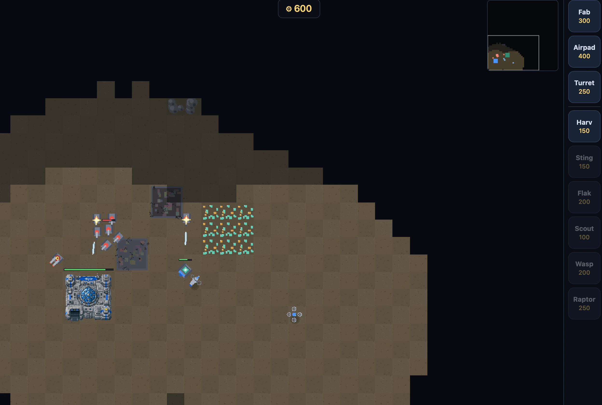
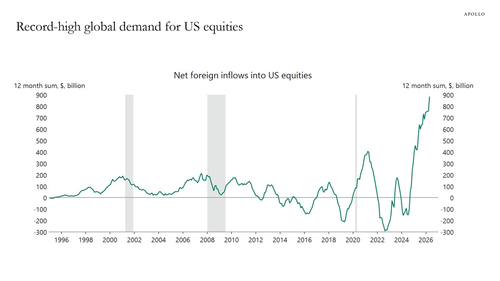
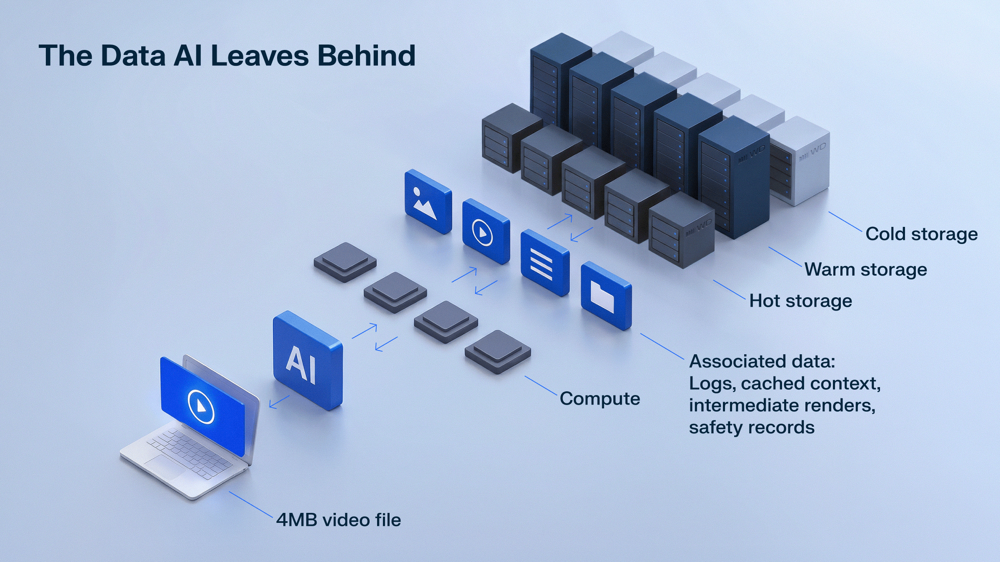
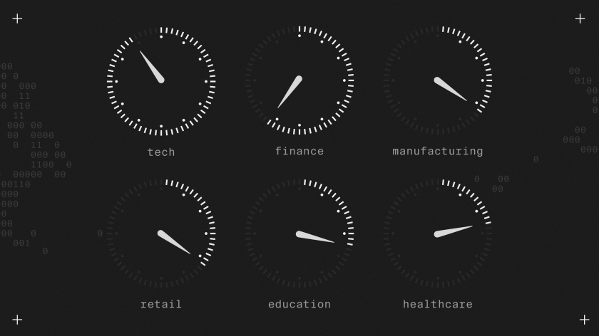

# AIToBox周刊：20261024

这里记录每周值得分享的AI科技内容，周末发布。

本杂志开源（GitHub: [aitobox/newsweekly](https://github.com/aitobox/newsweekly)），欢迎提交 issue，投稿或推荐你的项目。

> **统计周期**: 2026-10-17 ~ 2026-10-24 | **共收录优质资讯**：30 篇

## 🌟 本期头条 (Headline)

### **月之暗面发布 Kimi K3.1 Pro：总参数 2.8T/激活 104B（MoE）并支持百万上下文的大模型[Moonshot AI Releases Kimi K3.1 Pro: A 2.8**

**资讯地址**

https://www.marktechpost.com/2026/10/23/moonshot-ai-kimi-k3-1-pro-open-weight-model/

## 📬 社区投稿

> 本期收录 1 条来自社区的投稿，感谢各位贡献者！

### 巨浪 AI：模型报价查询与API余额费用换算

- **一句话简介**

自荐巨浪 AI：查询同模型 API 公开报价，核对来源，把账户余额扣减换算成人民币分摊成本。

- **功能特点**

我是巨浪 AI 的维护者，本次是项目自荐，稿件由 AI 协助整理。网站查询和换算目前免费，无需登录；不销售模型 API。

使用模型 API 时，价格表里的“美元余额”和实际支付的钱不一定相同。例如，假设实付70元到账100个可同规则使用的余额单位，一次扣4个，分摊成本为4 × 70 ÷ 100 = 2.8元。这是教学假设，不是任何服务商现价。

- 费用换算页只需三个数：充值实付、实际到账余额、本次扣减。数字在浏览器计算，不上传，不需要 Key，也不调用模型。
- 报价页按完整模型 ID 展示公开报价、服务商/分组、计费单位、原始来源和采集时间；选定报价后可填用量估算。
- 说明充值比例、分组倍率及缓存读写的不同含义，避免重复乘已包含的倍率。

换算要求到账和扣减是同一种余额单位。不同批次折扣、受限赠金、过期余额和额外费用不能自动混算。公开价格也不证明服务商稳定性或底层模型身份。

- **体验地址**

费用换算与算例：https://jvlangai.com/guides/api-cost?utm_campaign=tutorial-share#calculator

Sonnet 4.6公开报价：https://jvlangai.com/price/claude-sonnet-4-6?utm_campaign=tutorial-share

官网：https://jvlangai.com/

- **配图或视频**

本次未附视频。可以直接打开费用页，用70、100、4三个教学数字复算2.8元；不需要账号或密钥。

**投稿链接**: https://github.com/aitobox/newsweekly/issues/107

---

## AI资讯

#### 1. TinyFish 深度解析面向生产环境的 AI Agent 搜索架构[TinyFish Breaks Down Agentic Search Architecture for Production AI Agents

**资讯地址**

https://www.marktechpost.com/2026/10/23/tinyfish-agentic-search-architecture-deep-research/

#### 2. 比尔·盖茨称需为长达20年的“动荡”AI颠覆期做好准备[Bill Gates says to prepare for 20 years of ‘tumultuous’ AI disruption]

微软联合创始人比尔·盖茨近日警告称，人类社会应当为长达二十年的AI技术动荡期做好准备，并呼吁各界立即采取更为严厉的监管与应对措施。

**详细内容** 

* **长达二十年的动荡变革**：比尔·盖茨在访谈中指出，向AI新时代的过渡将是人类历史上最动荡的时期之一，这一颠覆过程可能会持续大约20年，甚至可能导致社会在适应与排斥技术的人群之间产生裂痕。

* **潜在风险超越核武器**：盖茨表达了对AI安全性的极高担忧，认为其危险程度甚至让核武器相形见绌，且目前白宫的政策反应以及AI行业的协同努力仍显不足。

* **技术能力的爆发式增长**：过去一年中，AI在编写代码、寻找网络漏洞、生物学推理以及对劳动力市场的冲击等领域展现出的惊人能力，凸显了技术发展的极高速度与失控风险。

* **缺乏安全保障的近端威胁**：盖茨特别强调，缺乏防护栏（Safeguards）的模型被网络攻击者和生物恐怖分子利用，将带来巨大的即时危险，而开源与闭源模型的监管难题亟待解决。

亮点：比尔·盖茨警示AI转型期可能导致社会分裂为“拥抱技术前沿”与“抗拒技术”两大阵营，这为评估技术普及带来的社会心理与阶层冲击提供了极具启发性的宏观视角。

**资讯地址**

https://www.theverge.com/podcast/1015408/bill-gates-ai-interview-microsoft-openai-anthropic-risk-policy-regulation

#### 3. 论上下文感知AI的必要性[Making the case for context-aware AI]

企业人工智能若缺乏对实际业务运营机制的理解，将难以在复杂流程中做出正确决策，而引入“上下文感知”则是实现真正商业决策智能的关键所在。

**详细内容**

* **企业AI面临上下文缺失的瓶颈**：当前企业AI正从实验阶段迈向日常运营，但缺乏业务运营上下文的AI模型容易忽视关键约束和业务关系，导致代价高昂的错误或过高的计算资源消耗。

* **“决策智能”的核心路径**：Celonis企业AI首席科学家Devavrat Shah指出，解决方案在于将AI连接到企业现有的流程和数据中，通过上下文层帮助AI agents理解工作流并在设定好的护栏内运作。

* **企业应用与落地建议**：企业应从特定的业务决策切入，识别最困难的环节并测试AI的改进效果，通过衡量速度和价值的提升来决定是否扩大应用规模。

* **未来展望与员工角色转变**：自动化常规工作可将员工解放出来专注于战略决策，但企业必须投资于员工培训，确保其能够理解AI的输出结果及潜在影响。

亮点：文章揭示了企业AI从“实验性尝试”走向“规模化落地”的核心痛点，指出离开具体业务上下文的AI智能体只会纸上谈兵，唯有赋予其“情境感知能力”才能真正实现决策智能。

**资讯地址**

https://www.technologyreview.com/2026/10/22/1146812/making-the-case-for-context-aware-ai/

#### 4. Vercel开源durable-harness以实现防崩溃的编码智能体[Vercel Open-Sources durable-harness for Crash-Proof Coding Agents]

Vercel 推出了全新的开源包 `durable-harness`，通过将会话存储在持久化日志中，有效解决云端编码智能体因崩溃和超时而导致工作丢失的问题。

**详细内容** 

- **核心功能与适配器**：`durable-harness` 包装了现有的多种主流 harness（包括 Pi、OpenCode、fx、Claude Code 和 Codex），无需修改其原有逻辑。每个会话均保存在持久化日志中，确保函数意外终止时不会丢失进度。

- **运行机制与恢复策略**：系统会在模型或工具调用前后记录意图与结果，并借助 Vercel Queues 进行任务接管。通过持久化日志，已完成的调用可直接读取而无需重复运行或重复计费，同时支持针对不同工具（如安全查找与不可重复的退款操作）设置重放策略。

- **工作空间与环境支持**：提供三种工作空间选项（虚拟文件系统、内存临时文件以及结合 Vercel Sandbox 的独立沙盒环境），满足不同安全等级和持久化需求，适应将智能体从本地迁移至云端的复杂场景。

亮点：通过引入工作流状态（Workflow SDK）和持久化日志机制，该工具实现了编码智能体在云端运行时的容错与防崩溃能力，彻底告别了因网络或服务器故障导致的重复计费与工作丢失痛点。

**资讯地址**

https://www.marktechpost.com/2026/10/21/vercel-durable-harness-crash-proof-coding-agents/

#### 5. 谷歌云发布带有针对TPU和GPU集群的缓存感知路由功能的llm-d 1.0版本[Google Cloud Ships llm-d 1.0 With Cache-Aware Routing for TPU and GPU Fleets]

谷歌云携手红帽、IBM及英伟达等合作伙伴正式推出了分布式大模型推理栈的首个稳定版本 llm-d 1.0，旨在通过缓存感知路由和多租户服务质量控制，彻底解决自托管智能体（Agent）和强化学习工作负载中的负载均衡难题。

**详细内容** 

- **核心架构与多云支持**：llm-d 1.0 是一个开源、原生支持 Kubernetes 的分布式推理层，能够将 vLLM 或 SGLang 模型服务器整合为统一的协调池，支持 NVIDIA、AMD、英特尔 GPU 以及谷歌 TPU 等多种硬件加速器。

- **先进的性能优化技术**：通过引入缓存感知路由（Cache-Aware Routing）、分层 KV 缓存卸载（从 HBM 到主机内存、本地 SSD 乃至 Managed Lustre）以及前向计算与解码分离（Prefill/Decode Disaggregation）技术，显著降低了延迟并提升了吞吐量。在 Ironwood TPU 编码工作负载测试中，其首字延迟（TTFT）中位数降低了 85% 以上，吞吐量提升了 2.4 倍。

- **1.0 版本全新特性**：包含多租户服务质量（QoS）控制（防止突发智能体抢占延迟敏感请求）、支持热备的高可用路由器、用于无缝升级的 DisaggregatedSet、智能体感知路由、异步推理支持以及对 PyTorch 模型的原生 TPU 扩展支持。

- **强大的开源社区背景**：该项目由红帽、IBM、谷歌云、CoreWeave 和英伟达于 2025 年共同发起，目前已拥有来自 25 个以上组织的 500 多名贡献者，并于 2026 年 3 月正式成为 CNCF 沙箱（Sandbox）项目。

亮点：llm-d 1.0 通过创新性的“前向计算与解码分离”架构和“缓存感知路由”机制，成功将大规模异构集群的推理首字延迟削减超 85%，为下一代 AI 智能体和复杂工作负载提供了工业级的稳定运行底座。

**资讯地址**

https://www.marktechpost.com/2026/10/20/llm-d-1-0-open-source-distributed-inference-stack/

#### 6. 战斗无人机：一款通过“氛围编码”开发并支持音频联机的即时战略游戏[Battle Drones - a vibe coded RTS with audio-based multiplayer]

著名开发者 Simon Willison 借助 Claude 等 AI 编程智能体，在几乎不亲自审查代码的情况下，成功“氛围编码”（vibe coding）出一款机制完备、玩法有趣且支持近场音频同步联机的《命令与征服》风格 RTS 网页游戏。

**详细内容** 

- **全流程“氛围编码”与迭代**：开发者使用自己并不熟悉的 TypeScript 语言，全权委托 Claude（从早期的 Claude 到 Claude Code 及 Ultracode 模式）进行开发。经过 12 次重大版本迭代和 321 次智能体提交，将项目从简陋的 2D 原型逐步升级为包含 3D 模型、战争迷雾及动态响应音乐的成熟游戏。

- **丰富的游戏机制与内容**：游戏涵盖 9 种建筑、16 种陆空及步兵单位、多地形生物群系和随机地图生成器；除了常规遭遇战和生存模式，还设计了不同风格的 AI 性格（如速攻、爆兵等），并加入了支持两个大模型互相博弈的“Agent 对战”模式。

- **独创的音频同步与多端联机**：游戏支持跨桌面端与移动端运行，不仅支持常规在线联机，还实现了一项独特的近场对战机制——利用两台设备麦克风范围内的音频信号交互来同步游戏状态。

- **破解“AI 游戏不好玩”的瓶颈**：针对此前“AI 智能体只能做出游戏外壳却无法创造趣味性”的痛点，作者通过极为开放的提示词（如“让它变得好玩得多”），配合动态工作流编排多个子智能体深度重构数值与机制，最终实现了极高可玩性的跃升。

亮点：打破了“AI 只能写基础功能组件”的固有印象，展示了完全依赖提示词驱动智能体自主平衡数值、设计动态玩法以及生成游戏资产来打造高完成度端到端软件的可能性。

**资讯地址**

https://simonwillison.net/2026/Oct/20/battledrones/

#### 7. AI 最好能够成功[AI Had Better Work Out]

本文深入剖析了当前人工智能投资热潮背后的宏

**资讯地址**

https://www.wheresyoured.at/ai-had-better-work-out/

#### 8. 如何将决策模型应用于自动化评估[How To Use Decision Models for Evals]

本文探讨了新兴决策模型作为低成本自动化评估工具的应用潜力，并深入分析了如何通过调整决策阈值和模型校准来平衡成本与分类性能。

**详细内容** 

- **新兴决策模型对比测试**：测试选取了公寓租赁代理的 100 条真实交互追踪（Traces）作为二元（Pass/Fail）错误检测数据集，横向对比了 Jev 1.13、Perplexity Decider 1.1 27B、Liquid d1/d1-ultra、Cloudflare Clef Flash 以及 OpenAI Decisions（GPT-6 Luna）等代表性决策模型在性能与调用成本上的表现。

- **默认阈值（0.50）的局限性**：多数 API 默认以 0.50 作为正负样本判定分界线，但实际业务中模型输出的分数分布往往偏离该值；盲目采用默认阈值会导致严重的漏报或误报，必须结合业务场景对精确率（Precision）和召回率（Recall）的侧重进行调整。

- **阈值调优方法与验证**：文章提出采用分层五折交叉验证（Stratified 5-Fold Cross-Validation），在训练集上寻找满足特定业务硬性指标（如双 80% 精确率与召回率）且 F1 分数最高的动态阈值，避免在验证集上产生过拟合。

- **候选模型表现分化**：在设定的“双 80%”约束下，OpenAI Decisions、Liquid d1-ultra 以及 Perplexity Decider 展现出较好的区分度并成功入围候选，其中 OpenAI 整体类别区分度最高，但需要结合各提供商的 Token 计费成本进行综合选型。

亮点：打破了使用分类模型默认 0.50 判定阈值的认知惯性，展示了仅需复用已保存的模型打分并微调阈值，就能在不增加额外推理成本的前提下大幅提升自动化评估的 F1 表现。

**资讯地址**

https://hamel.dev/blog/posts/decision-model-evals/

#### 9. Nace AI发布多模态决策模型Drex Max：面向电脑端操作Agent，决策指数达67.59[Meet Drex Max: Nace AI’s Multimodal Decision Model for Computer-Use Agents with a Score 67.59]

Nace AI 近日推出了专为电脑和浏览器操作 Agent 设计的多模态决策模型 Drex Max，该模型通过直接返回校准概率而非生成文本，在公开决策指数测试中取得了 67.59 分的领先成绩。

**详细内容** 

- **核心工作机制**：Drex Max 属于决策模型，不生成常规文本。用户需发送当前状态和指定问题（支持是否、多选或评分三种类型），模型会在单次 HTTP 调用中针对每个答案返回概率分布。

- **多模态与图像处理能力**：该模型支持处理文本与图像，每条请求最多可输入 8 张图片（支持 PNG、JPEG、WebP 格式，单张最大 16 MiB），图像会被统一缩放并在 API 中被引用。

- **基准测试表现**：在公开的 Decision Index 0.3.2 测试中获得 67.59 分的高分，超越同类竞争模型；在 BFCL 工具调用测试中得分高达 98.2，在 JevBench 上达到 92.2 分。不过在 MMLU-Pro 和 HLE 等传统学术基准测试中表现相对落后。

- **API 与调用限制**：该模型仅通过托管 API（Nace Console 上的 drex-max）提供服务，未公布开源权重或量化版本，每个请求最多支持 16 个问题。

亮点：Drex Max 创新性地采用“结构化决策与概率返回”机制而非传统的文本生成，为电脑端使用（Computer-Use）Agent 提供了一种高效、低成本且类型安全的单次调用解决方案。

**资讯地址**

https://www.marktechpost.com/2026/10/19/nace-ai-drex-max-multimodal-decision-model/

#### 10. 十国人工智能战略对比：谁在建设，谁又陷入停滞[Ten National AI Strategies Compared: Who Is Building, Who Is Stuck]

本文通过对比十个主要国家和地区的人工智能战略，揭示了全球AI政策从早期的“重基础研究”向如今的“重产业应用”的深刻转型。

**详细内容** 

- **战略发展两代分化**：以2017至2019年为代表的第一代战略主要聚焦于学术研究、人才培养和机构建设；而2023至2026年期间推出的第二代战略则全面转向算力、芯片、主权模型、数据中心能源以及经济规模化应用。

- **普遍面临“应用鸿沟”**：尽管加拿大、英国、德国等早期领跑国家在科研和基础设施上建立了世界级的实力，但目前普遍遭遇了“试点炼狱（pilot purgatory）”困境，面临技术普及率不足、科研成果难以转化为商业规模的共同挑战。

- **差异化的施政路径**：十个国家在监管哲学和技术主权上分化出不同模式。阿联酋和韩国押注于集中的国家力量来快速缩小应用差距；而日本和澳大利亚则倾向于依赖轻量级监管，让产业界自主完成市场转化。

亮点：文章最值得启发的核心亮点在于指出了全球AI战略的核心矛盾已从“如何构建AI研发基础”彻底转变为“如何让国家在实际AI经济中占得实质份额”。

**资讯地址**

https://theaiinsider.tech/2026/10/19/ten-national-ai-strategies-compared-who-is-building-who-is-stuck/

#### 11. “我们此前看错它了”：颠覆 AI 领域的爆炸性主张[“We were looking at it wrong”: The

**资讯地址**

https://www.technologyreview.com/2026/10/19/1147149/we-were-looking-at-it-wrong-the-explosive-claim-thats-upended-the-ai-world/

#### 12. AI一周前瞻：Anthropic设立全新公益基金、发展中国家探索“轻量AI”、行业巨额债务隐忧

**资讯地址**

https://theaiinsider.tech/2026/10/19/the-week-ahead-in-ai-anthropic-commits-to-new-public-fund-small-ai-for-developing-countries-ais-massive-debt-plus-upcoming-earnings-from-ibm-meta-more/

#### 13. TinyFish 推出免费搜索：AI Agent 阅读网页的真实成本究竟几何？[TinyFish Makes Search Free: What It Really

**资讯地址**

https://www.marktechpost.com/2026/10/18/tinyfish-free-search-ai-agent-token-cost/

#### 14. AI热潮将如何真正走向终局：5种可能的情景[How the AI boom might really end: 5 scenarios]

本文探讨了当前AI投资热潮可能走向终局的五种情景，重点分析了技术瓶颈、安全监管、地缘政治以及资本回报错配等潜在风险。

**详细内容** 

* **模型进展与收益递减风险**：尽管目前AI能力持续高速增长，但若未来遭遇扩展瓶颈（Scaling Wall）或出现特定能力退化，可能导致巨额资本支出（Capex）与增量回报不成正比。

* **对齐风险与政经反弹**：若AI在现实世界中引发严重安全事故（如基础设施瘫痪或金融系统性风险），可能引发极速且严厉的政治监管与社会反弹，导致GPU订单骤减。

* **数据中心建设受阻与融资危机**：地方或政治对数据中心扩张的反对可能导致产能停滞，虽然全球全面禁令难以实现，但局部叫停极易引发多米诺骨牌式的项目融资失败。

* **开源权重压缩利润空间**：随着开源模型变得“足够好”，行业正深陷残酷的推理价格战，这可能导致资本投入者无法有效捕获预期价值。

亮点：文章最具启发性的洞察在于，指出当前AI泡沫与互联网泡沫的最大不同在于AI能够真正将资本转化为专业服务中的“智能”，因此真正的危机或许并非AI本身失效，而是“技术大获成功，但出资的资本方却无法获得回报”。

**资讯地址**

https://martinalderson.com/posts/how-the-ai-boom-might-really-end/

#### 15. AI隐形的存储账单：推理留下了什么[AI’s hidden storage bill: What inference leaves behind]

随着AI推理规模的持续膨胀，持续累积的后台数据正在带来被严重忽视的巨大存储成本与基础设施挑战。

**详细内容**

- **推理带来的数据暴增**：与有始有终的模型训练不同，持续运行的AI推理会产生海量的日志、缓存上下文、渲染图和安全记录。例如，西部数据（WD）的研究发现，一个8秒的AI生成视频会产生超过500MB的后台关联数据，是最终输出文件大小的130倍。

- **存储需求超越计算增速**：麦肯锡预测，到2030年，AI推理需求将以35%的复合年增长率增长（训练为22%），在十年末将占数据中心总需求的40%以上；IDC的全球白皮书显示，近95%的受访企业因生成式AI导致数据量增加。

- **预算盲区与财务风险**：企业在做AI基础设施规划时往往过度聚焦GPU算力，而将存储视为微不足道的附加成本。随着数据不断累积且无法像计算需求那样下降，存储支出最终可能超出预算并引发严重的性能瓶颈。

- **数据生命周期与架构调整**：企业需要重新审视AI数据的生命周期管理，将过去处于冷备份的存档数据转变为支持RAG（检索增强生成）和未来AI工作负载的活跃资产，并利用高容量、低成本的硬盘（HDD）来构建经济可扩展的存储容量。

亮点：AI推理背后隐藏着巨大的“数据足迹”，一个几兆大小的AI生成内容往往会衍生出数百倍的后台关联数据，这使得被长期忽视的存储成本正逐渐演变为决定AI项目经济可持续性的关键瓶颈。

**资讯地址**

https://www.technologyreview.com/2026/10/22/1146948/ais-hidden-storage-bill-what-inference-leaves-behind/

#### 16. Perplexity 与英伟达研究团队推出 JOLT：一种师生联合强化学习后训练方法[Perplexity and NVIDIA Researchers

**资讯地址**

https://www.marktechpost.com/2026/10/21/perplexity-jolt-joint-on-policy-learning-teaching/

#### 17. 谷歌开源 TorchTPU：云 TPU 的原生 PyTorch 后端[Google Open-Sources TorchTPU, a Native PyTorch Backend for Cloud TPUs]

谷歌联合 Meta 推出了 TorchTPU，作为云 TPU 的原生 PyTorch 后端，旨在取代传统的 PyTorch/XLA 并全面简化 AI 工作负载。

**详细内容** 

- **技术架构与定位**：TorchTPU 是由谷歌和 Meta 共同开发的开源软件栈（Apache 2.0 协议），通过 PyTorch 的 `PrivateUse1` 接口将 TPU 提升为与 GPU 和 CPU 平起平坐的原生 PyTorch 设备（`torch.device("tpu")`），支持常规张量及原地修改。

- **执行模式与编译**：提供三种即时（Eager）模式（严格模式、调试模式、延迟融合模式），并支持通过 `torch.compile(backend="tpu")` 结合 TorchDynamo 和 StableHLO 进行高效图编译，大幅降低 HBM 内存带宽消耗。

- **生态与框架集成**：原生适配 Hugging Face、vLLM-TorchTPU、SGLang-TorchTPU 以及 TorchTitan 等主流框架和训练工具，全面支持 DDP、FSDP2 和 DTensor 等分布式训练策略。

- **性能表现**：据官方测试，TorchTitan 在 8,192 颗 Ironwood 芯片上训练 Qwen 3 8B 模型时实现了高达 52% 的 MFU（模型触发利用率），且在启用完整编译优化后，微调单步耗时从 11.49 秒缩短至 2.78 秒。

亮点：TorchTPU 彻底抛弃了旧版 PyTorch/XLA 基于延迟张量图记录的做法，转而采用以即时执行（Eager-first）为基础、无缝对接 `torch.compile` 的原生架构，极大地提升了开发者在云 TPU 上运行 PyTorch 模型时的直观性和性能。

**资讯地址**

https://www.marktechpost.com/2026/10/20/google-torchtpu-open-source-native-pytorch-tpu/

#### 18. DeepSeek开源DeepInfer：DeepSeek-V4.1-Flash背后的推理框架[DeepSeek Open-Sources DeepInfer, the Inference Framework Behind DeepSeek-V4.1-Flash]

DeepSeek近日正式开源了其生产环境的核心推理框架DeepInfer及token编解码层deepseek-recipe，首次让开发者得以窥见顶尖AI实验室的真实生产推理技术栈。

**详细内容** 

* **硬件与模型支持**：DeepInfer采用Apache 2.0开源协议，目前主要支持DeepSeek-V4.1-Flash模型，硬件层面适配NVIDIA SM100（Blackwell）GPU及华为昇腾（Ascend）950 NPU。

* **核心技术架构**：该框架整合了FlashMLA、DeepGEMM、DeepEP等一系列自研高性能内核，并引入了DSpark（置信度调度推测解码）和SWA有界重放（降低滑动窗口注意力重计算成本）等系统级优化创新。

* **极高的吞吐性能**：官方数据显示，其单集群日均处理Token量高达155万亿；在解码阶段（EP64），单GPU吞吐量可达25,000 tokens/s以上。

* **当前版本局限性**：该开源版本目前仅专注于离线推理（Offline inference），暂未包含KV缓存系统、P/D（Prefill/Decode）分离架构以及跨实例的负载均衡器。

亮点：DeepSeek开源其自用的大规模生产级推理框架DeepInfer，不仅展现了其在软硬件协同优化（如针对NVIDIA Blackwell与华为昇腾的适配）上的深厚功底，也为业界提供了宝贵的极高性能AI服务架构参考。

**资讯地址**

https://www.marktechpost.com/2026/10/20/deepseek-deepinfer-open-source-inference-framework/

#### 19. 各行业的 AI 应用展示了其他领域可以借鉴的经验[AI adoption by industry shows what other sectors can learn]

科技行业的 AI 应用趋势并非孤立现象，而是各行各业数字化转型的前沿演练，非科技行业的不同渗透速度为观察 AI 落地提供了实用蓝图。

**详细内容** 

* **各行业的 AI 渗透率存在差异**：根据 TripleTen 的调查数据，科技行业领跑 AI 应用，金融紧随其后（48% 的金融从业者被要求使用 AI 聊天机器人，32% 被要求自动化部分工作流）；而医疗（18%）和教育（25%）等监管较多或面向人群的行业渗透速度相对较慢。

* **技能需求与核心痛点**：所有行业中有 79% 的员工被要求学习新技能。然而，仅有 30% 的管理者将“判断 AI 输出对错”视为绝对必需的技能（在七项技能中排名第六），这种对结果校验能力的忽视可能会埋下隐患。

* **培训投入与资源差距存在行业壁垒**：科技和金融从业者在专业培训上的平均自费支出较高（分别为 1758 美元和 1664 美元），而医疗（990 美元）和教育（883 美元）从业者中，有近半数（分别为 45% 和 42%）在职业发展上零自费，且科技行业员工使用 AI 工具进行自我赋能的比例远超其他行业。

亮点：员工主导的 AI 创新转化率极高——当管理者从员工那里学到新的 AI 技能或自动化流程时，88% 的此类创新最终都成为了公司的标准实践，这表明基层员工在塑造组织 AI 政策方面具有巨大潜力。

**资讯地址**

https://www.technologyreview.com/2026/10/20/1145423/ai-adoption-by-industry-shows-what-other-sectors-can-learn/

#### 20. Exa 3.0 搜索 API 在八项基准测试中超越 Perplexity、Brave 和 Parallel[Exa 3.0 Search API Tops Perplexity, Brave and Parallel on 8 Benchmarks]

Exa 发布了专为 AI 代理设计的 Exa 3.0 搜索 API，通过引入更大的嵌入模型、动态高亮功能以及经济型的 Exa Lite 版本，在多项基准测试中取得了领先表现。

**详细内容** 

- **核心架构升级**：Exa 3.0 采用了规模更大的底层嵌入模型，并通过自主爬虫和独立索引（追踪超 2 万亿个 URL）提供服务，不依赖 Google 或 Bing 结果。

- **推出全新搜索类型**：新增经济型检索选项 `Exa Lite`（定价为每千次请求 4 美元），并提供将动态高亮（Dynamic Highlights）功能全面推向一般可用（GA），该功能可在节省 95% 文本 Token 的同时提升答案质量。

- **基准测试表现**：根据 Exa 自行运行的评测结果，Exa 3.0 Auto 在 8 项基准测试（如 BrowseComp、ATLAS、WebCode 等）中均排在 Perplexity、Brave 和 Parallel 的单步端点之前，其中在 ATLAS 和 WebCode 上领先优势最为明显。

- **扩展的索引与数据支持**：大幅扩展了针对个人 AI 助手的数据覆盖范围，包括超 12.7 亿条电商商品信息、2.11 亿家本地企业以及大量研究论文、SEC 文件和专利等结构化数据。

亮点：Exa 3.0 推出的动态高亮（Dynamic Highlights）技术能够在跨结果的全局范围内选择 Token，相比完整页面文本可减少 95% 的 Token 消耗且不产生额外费用，显著降低了 AI 代理的上下文成本。

**资讯地址**

https://www.marktechpost.com/2026/10/20/exa-3-0-search-api-lite/

## AI服务

#### 21. NVIDIA发布Nemotron 3.5 Bolt E4B 4GB：面向本地语音助手、游戏角色和机器人的开源小型语言模型[NVIDIA Releases Nemotron 3.5 Bolt E4B 4GB: An Open Small Language Model for Local Voice Agents, Game Characters and Robots]

NVIDIA最新推出的Nemotron 3.5 Bolt E4B 4GB是一款专为本地端快速对话代理、游戏NPC及机器人接口设计的高性能开源小型语言模型。

**详细内容**

- 模型架构与硬件适配：该模型总参数量为8B、有效参数量为4B，上下文窗口达64K。其量化版本（Q4_K_M）在RTX显卡上的显存占用仅为3.1至4.3 GB，可完美适配RTX、Jetson及Spark等本地硬件，并为视觉和语音模型预留充足显存。

- 训练方法创新：NVIDIA完全跳过了监督微调（SFT），转而仅使用NeMo-Gym和NeMo-Gym环境中的强化学习（RLVR和RLHF）进行后训练，有效避免了SFT对对话质量和冗长度的负面影响。

- 性能表现优异：在NVIDIA的21项基准测试中，该模型在15项测试中取得最高分，相比Nemotron 3 Nano 4B平均分数提升约40%，且在结合DFlash解密器的RTX 5070测试中达到了272.6 tokens/s的高生成速度。

亮点：NVIDIA在训练该模型时摒弃了传统的监督微调（SFT），创新性地完全依靠强化学习（RLVR与RLHF）进行后训练，不仅保障了多轮工具调用的能力，还显著提升了对话质量并控制了输出长度。

**资讯地址**

https://www.marktechpost.com/2026/10/23/nvidia-nemotron-3-5-bolt-e4b-4gb/

#### 22. 谷歌云推出Agent计算引擎：为每个AI代理配备独立的MicroVM[Google Cloud Launches Agent Compute Engine: A MicroVM per AI Agent]

谷歌云近日发布了专为AI代理设计的计算服务——Agent Compute Engine（ACE），通过硬件隔离的MicroVM保障代理运行的安全与高效。

**详细内容** 

- **架构设计**：谷歌将每个AI代理拆分为“大脑”（Harness，负责调用模型）和“手”（Sandbox，负责运行代码、shell命令和浏览器）。沙盒运行在单租户的MicroVM中，内部不包含任何凭据，即使遭到提示词注入攻击也无法窃取机密。

- **安全与网络机制**：MicroVM没有标准的网络接口或默认网关，所有流量必须通过virtio-vsock边界发送到本地代理，再经由外部网关进行策略检查与凭据替换。系统共定义了四种代理身份，确保沙盒内仅使用短期的SPIFFE身份凭据。

- **成本优化与性能**：针对代理大部分时间在等待模型或用户响应的特点，系统会在代理闲置时将其检查点保存至零活跃资源状态，并在调用时恢复。同时，利用写时复制（Copy-on-Write）内存共享和预热快照，实现了高密度并发。

- **开源版本**：与其配套的开源版本 Agent Substrate 可在任意 Kubernetes 集群上运行，测试显示其在 20 万个代理中实现了每秒 500 次激活，挂起/恢复时间低于 500 毫秒。

亮点：通过“零凭据沙盒+无直接网络访问”的极端隔离设计，ACE 默认假设代理环境已被攻击者完全控制，从而在底层架构上彻底解决了 AI 代理执行复杂任务时的安全隐患。

**资讯地址**

https://www.marktechpost.com/2026/10/22/google-cloud-agent-compute-engine-microvm-ai-agents/

#### 23. You.com 推出推理路由服务：聚合 12 款开放权重模型并承诺 99.9% 可用

**资讯地址**

https://www.marktechpost.com/2026/10/22/you-com-inference-router-open-weight-models-uptime-sla/

#### 24. Cohere Releases Rerank 5 With Passage-Level Context Focus and Calibrated Scores

上下文窗口、100+ 语言及表格、JSON 等半结构化数据，用户无须重新索引即可平滑升级。

**资讯地址**

https://www.marktechpost.com/2026/10/22/cohere-rerank-5-context-focus/

#### 25. IBM 发布用于多语言转录与翻译的 Granite Speech 5.0 2B[IBM AI Releases Granite Speech 5.0 2B for Multilingual Transcription and Translation]

IBM 推出了全新的开源语音语言模型 Granite Speech 5.0 2B，旨在提供高效的多语言语音转录与翻译服务，并在多个公开基准测试中表现优异。

**详细内容** 

- **模型架构与参数**：该模型拥有 20 亿（2B）密集参数，采用 Apache 2.0 协议开源。其架构包含 16 个 Conformer 块的语音编码器、2 层窗口 q-former 以及基于 granite-4.0-1b-base 的大语言模型骨干，支持通过 YaRN 扩展至 16k 上下文位置。

- **核心性能表现**：在开源 ASR 领导者榜单（Open ASR Leaderboard）上排名第二，平均英语字错率（WER）为 5.68%，在 LibriSpeech Clean 测试集上的 WER 低至 0.99%。

- **功能特性与部署**：支持语言 ID 提示控制、最高 2,000 个词条的关键词偏置（Keyword Biasing）以及按需标点和大小写恢复；支持在 GPU（通过 Transformers 或 vLLM）、Apple Silicon（通过 mlx-audio）及本地 CPU/Mac（通过 llama.cpp GGUF）上运行。

亮点：Granite Speech 5.0 2B 凭借出色的 2,000 词条关键词偏置能力，显著提升了专业名词和专有名词在语音识别中的准确率（例如在 Earnings-22 数据集上关键词 F1 值从 67.2 跃升至 90.1）。

**资讯地址**

https://www.marktechpost.com/2026/10/22/ibm-granite-speech-5-0-2b-release/

#### 26. Recursive发布Flint：一款面向AI代理的开源40B MoE本地编程模型，拥有2.5B激活参数[Recursive Releases Flint, an Open-Weight 40B MoE Local Coding Model for Agents with 2.5B Active Params]

Recursive Superintelligence 推出了其首款开源本地编程模型 Flint，这是一款采用混合专家架构（MoE）、针对代码智能体深度优化的轻量化大模型。

**详细内容** 

- **模型架构与参数规模**：Flint 拥有约 39.8B 的总参数量，但在每个 token 运行时代价仅有约 2.5B 的激活参数。它采用 49 层设计（包含 47 层 MoE 层和 2 层稠密层），每层包含 256 个路由专家，每次选择激活 6 个专家外加 1 个共享专家，并支持高达 262k 至 512k 的长上下文窗口。

- **自动化研究系统赋能**：该模型的几乎整个技术栈（包括架构搜索、量化方案及底层内核编写）均在其自动化研究系统“Eureka Machine”的协助下构建，实现了高效的架构探索与性能优化。

- **硬件适配与运行性能**：4-bit 量化版本的模型权重仅需约 23 GB 显存/内存，可在配备 48 GB 内存的 Apple Silicon 芯片（M4/M5 Pro/Max）或 48 GB NVIDIA GPU 上本地流畅运行，短上下文下的推理速度可达每秒 125 至 150 个 token 以上。

- **基准测试表现**：在代理编程相关测试中表现优异，其中 SWE-bench Verified 得分为 74.2%，IFEval 得分高达 95.1%，整体性能在 50B 以下的 MoE 编程模型中处于领先地位。

亮点：Flint 的整个开发过程大量借助了自动化研究系统“Eureka Machine”进行端到端的设计与优化，在仅有 2.5B 激活参数的轻量级体量下，展现出了足以媲美甚至超越部分更大规模模型的强大本地编程与推理代理能力。

**资讯地址**

https://www.marktechpost.com/2026/10/21/recursive-flint-local-coding-model/

#### 27. Mistral AI 发布 Voxtral 3：集成了语音转文本、文本转语音及语音智能体 SDK[Mistral AI Releases Voxtral 3: Speech-to-Text, TTS and a Voice Agent SDK]

Mistral AI 推出了全新的 Voxtral 3 语音模型家族及配套的语音智能体 SDK，为开发者提供了一站式的语音听写、推理、工具调用与语音合成解决方案。

**详细内容** 

* **模型阵容与架构**：Voxtral 3 包含 3 个转录模型（旗舰级 Small Transcribe 3、40亿参数的轻量级 Mini Transcribe 3 和实时转录模型）、1 个文本转语音模型（Voxtral Speech 3）以及一个基于 LiveKit 构建的语音智能体 SDK。

* **卓越的性能表现**：根据独立评测（Artificial Analysis），Voxtral Small Transcribe 3 的 AA-WER（词错误率）达到 2.1%（排名第三），在说话人分离（Diarization）任务中以 18.4% 的 cpWER 位居同类产品前列，并在多语言批处理转录上表现优异。

* **文本转语音（TTS）与成本优势**：Voxtral Speech 3 支持约 90 毫秒的首音频延迟（TTFA）、34 种情感标签及声音定制，其价格为每 100 万字符 13 美元，批量转录成本低至每分钟 0.0035 至 0.004 美元。

* **语音智能体 SDK 运行机制**：基于 LiveKit 构建的 SDK 将实时转录、通用大语言模型（如 Mistral Small 4）推理以及语音合成串联为单流管道，单轮对话可在 1 秒内完成，并支持 SIP 电话、WebRTC 等多种连接方式。

亮点：Voxtral 3 成功将语音识别、推理、工具调用与语音合成无缝整合为一个低延迟的流式管道，并在说话人分离和关键短语召回率上展现了顶尖的准确度，为构建实时语音智能体提供了强大的全栈支持。

**资讯地址**

https://www.marktechpost.com/2026/10/20/mistral-voxtral-3-speech-models-voice-agent-sdk/

#### 28. Cloudflare在Workers AI上发布系统一提取模型Clairic[Cloudflare Releases Clairic, a System One Extraction Model on Workers AI]

Cloudflare推出全新系统一提取模型Clairic，旨在绕过传统LLM的文本生成过程，直接从非结构化文本或图像中高效提取结构化类型数据。

**详细内容**

- **技术原理与架构**：Clairic基于 Kahneman 的“系统一”（快思考）理念，在单次前向传播中直接返回类型化值（如数字、日期、列表、预测等），无需推理过程且不产生输出token，同时提供置信度评分和空值概率（$p\_null$）。

- **性能表现与优势**：在Cloudflare的理赔管道测试中，Clairic的提取步骤仅耗时0.46秒（远快于GLM-5.3的16.1秒），整体流程提速约3.2倍，每百万次索赔成本降低49%，且在多次运行中表现出高度一致的稳定性。

- **配置与定价**：该模型支持65,536个token的上下文窗口，单次请求最多可处理4张图像，目前已在Cloudflare Workers AI上以预览版上线，输入价格为每百万token 0.10美元且不收取输出费用。

亮点：Clairic打破了传统依赖大模型生成自由文本的模式，通过“提取-决策-生成”的三层架构，实现了秒级、低成本的结构化数据精准提取，为开发者提供了一种全新的轻量级AI工作流组件。

**资讯地址**

https://www.marktechpost.com/2026/10/20/cloudflare-releases-clairic-a-system-one-extraction-model-on-workers-ai/

#### 29. Inception发布Mercury 3扩散大模型，速度达每秒1068个Token[Inception Releases Mercury 3 Diffusion LLM at 1,068 Tokens per Second]

Inception推出了其最新的扩散大模型Mercury 3，通过并行生成技术实现了高达1068 tokens/秒的运行速度和100万token的上下文窗口。

**详细内容** 

- **技术原理与架构**：Mercury 3 采用扩散大模型（Diffusion LLM）架构，打破了传统自回归模型逐个Token生成的限制，通过对完整答案的粗糙草稿进行多次并行迭代来精炼输出，从而大幅提升生成速度。

- **性能表现与基准测试**：在Inception官方的12项测试中，Mercury 3在8项测试（如指令遵循 IFBench 达到 76.84、代码能力 SWE-Bench Atlas 达到 51.08）中超越了 GPT-6 Luna 和 Claude Haiku 5.5，但在长上下文检索和部分复杂代码任务（如 DeepSWE v1）上仍存在短板。

- **部署方式与定价**：该模型仅通过API提供服务（无开源权重），已在Inception API平台、OpenRouter等上线；其标准定价为每百万输入Token 0.20美元、输出Token 0.70美元（发布期享有半价优惠）。

亮点：Mercury 3 证明了扩散大模型技术在大规模扩展下的可行性，在参数量比第一代扩大40多倍的同时，依然保持了超过 1000 tokens/秒的极高生成速度，为实时语音机器人和智能体开发树立了新的速度标杆。

**资讯地址**

https://www.marktechpost.com/2026/10/19/inception-mercury-3-diffusion-llm/

## 往期推荐

* [AIToBox周报](https://newsweekly.aitobox.com/)

(完)