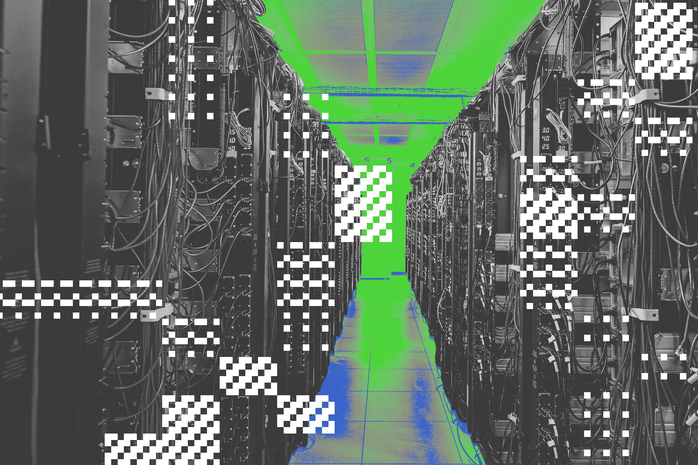
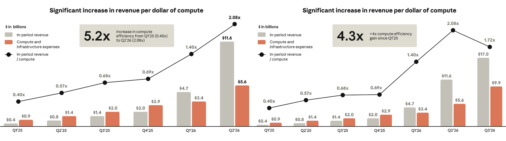
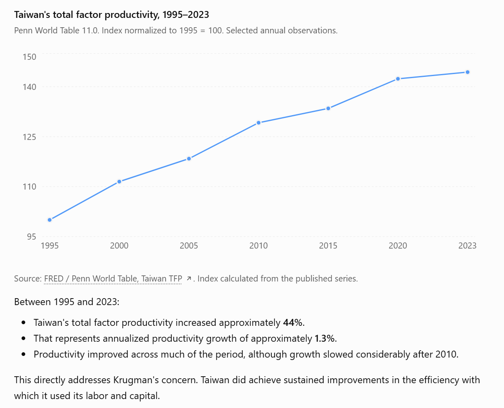

# AIToBox周刊：20261107

这里记录每周值得分享的AI科技内容，周末发布。

本杂志开源（GitHub: [aitobox/newsweekly](https://github.com/aitobox/newsweekly)），欢迎提交 issue，投稿或推荐你的项目。

> **统计周期**: 2026-10-31 ~ 2026-11-07 | **共收录优质资讯**：30 篇

## 🌟 本期头条 (Headline)

### **OpenAI 智能体发现 948 种接管 Linux 的方法，平均每处漏洞成本仅 1,279 美元[OpenAI’s Agents Found 948 Ways to Take Over Linux, at $1,27**

**资讯地址**

https://dailyai.com/2026/11/openais-agents-found-948-ways-to-take-over-linux-at-1279-each/

## AI资讯

#### 1. AI 数据中心最新动态追踪[All the latest updates on AI data centers]

随着生成式 AI 的爆发，承载算力的大规模数据中心建设在全球范围内引发了有关电网负荷、公共账单、环境污染以及社区政治博弈的全面冲突。

**详细内容** 

- **选民与社区强烈反弹成为政治焦点**：数据中心扩张在全美引发普遍不满，甚至成为影响多州中期选举选情的跨党派议题；选民和抗议活动反对在本地盲目扩建，导致纽约等州颁布建设暂停令，部分州议员与监管机构则加速推动法案收紧对数据中心能耗和水耗的审查。

- **能源争夺加剧与化石能源、核能回潮**：为满足庞大的电力需求，亚马逊、谷歌等巨头积极投资核电项目，而 Anthropic、xAI 等企业的数据中心则直接依赖燃气发电，引发外界对碳排放暴增、空气污染加剧及几十年治污成果被侵蚀的担忧。

- **科技巨头多途径应对审查与公关危机**：面对公众抵触，OpenAI 试图通过取消保密协议（NDA）、将数据中心改称为“计算园区”（Compute Campuses）等方式缓和舆论，英伟达推出节水型高运行温度架构设计，而部分企业甚至开始探索在地下隧道乃至太空轨道部署数据中心的极端方案。

- **产业资本博弈与供应链安全风险**：数据中心已成为 AMD、Meta、英伟达等核心科技公司的首要战略重心，英伟达甚至提供数百亿美元资金支持 OpenAI 设施建设；与此同时，核心算力供应链面临零部件被盗、新创云厂商（如 CoreWeave）债券受压以及退役硬件电子垃圾激增等多重现实挑战。

亮点：数据中心正从单纯的“算力基建”演变为主导美国地方政治版图与能源转型的超级引爆点，其引发的环境与电网压力不仅让两党选民空前一致地表达抵制，更直接倒逼科技巨头重新考量从核能利用到空间部署的极端供能与选址方案。

**资讯地址**

https://www.theverge.com/ai-artificial-intelligence/902546/data-centers-ai-energy-power-grids-controversy

#### 2. 视力受损下的创作：克劳德·莫奈[Painting with impaired vision: Claude Monet]

本文探讨了印象

**资讯地址**

https://eclecticlight.co/2026/11/06/painting-with-impaired-vision-claude-monet/

#### 3. 老板度假去 2[Weekend at Bernie’s II]

一项最新跟踪研究显示，在过去半年中，有 421 个曾经停滞或废弃的关键开源仓库重新恢复活跃，而 AI 编程智能体在原维护者“复活”这些项目和修复安全积压的过程中发挥了关键催化作用。

**详细内容** 

- **开源仓库复活现状与人员结构**：在 ecosyste.ms 追踪的 6,000 多个关键开源代码仓库中，有 421 个在 5 月份处于休眠（dormant）、废弃（dead）或未知（unknown）状态的仓库在 11 月重新恢复为活跃状态。值得注意的是，这些项目的复活极少伴随维护权转移（仅 6 个仓库由新人接手），绝大多数是由原本熟悉代码的核心维护者（Top Committer）重新主导。

- **AI 智能体成为核心生产力工具**：研究通过 CHAOSS 披露工具检测发现，在 5 月以后的半年内，复活仓库中带有 AI 声明的提交比例从 3.3% 跃升至 7.9%（共 778 次提交，覆盖 95 个仓库），其中近四分之三由顶级维护者发起，且大多带有 Claude Code 标识。包括 `python-json-patch`、`rack-proxy`（已引入 CLAUDE.md 和 AGENTS.md 规范）和 `net-sftp` 等典型项目，均借助 AI 智能体有效清理了长期积压的维护任务并完成了现代化改造。

- **安全漏洞修复与审核延迟瓶颈**：在复活的项目中，有 43 个仓库的维护者修复了自身代码的漏洞。然而，由于 AI 辅助漏洞挖掘导致报告激增（GitHub 私人漏洞报告从 1 月的每周约 550 起暴增至 5 月的每周超 3,000 起），安全咨询进入 GitHub 全球官方数据库的审核流程严重积压，部分项目的安全审核等待时间甚至超过了 100 天（如 Ruby CSS 解析器 `crass`）。

亮点：AI 编程智能体正在打破“死项目需移交新维护者”的开源传统模式，它显著降低了维护被忽视类库的门槛，使得熟悉代码的原作者能够以极低成本迅速清理技术积压、实施现代化安全加固。

**资讯地址**

https://nesbitt.io/2026/11/06/weekend-at-bernies-ii.html

#### 4. 版本控制技术周报：2026年11月4日[This Week in Source Control: 4 November

**资讯地址**

https://nesbitt.io/2026/11/04/this-week-in-source-control.html

#### 5. 资金见底：OpenAI融资困境与AI资本泡沫的破裂边缘[Running Dry]

文章指出，随着

**资讯地址**

https://www.wheresyoured.at/running-dry/

#### 6. 笔记本本地运行的 Qwen 3.8 27B 同样能够直接解读模型权重[Qwen 3.8

**资讯地址**

https://simonwillison.net/2026/Nov/3/qwen-can-interpret-model-weights/

#### 7. 拥有自动驾驶特斯拉的思考[Thoughts on Owning a Self-Driving Tesla]

特斯拉的完全自动驾驶（FSD）与车载 AI 助手 Grok 的结合，正在颠覆传统的驾驶体验，让乘车出行变成一种兼具高效与轻松的全新生活方式。

**详细内容** 

* **FSD 驾驶体验革新**：作者在约 2000 英里的驾驶中约 95% 使用 FSD 完成。FSD 基于 8 个摄像头构建 3D 视野，通过大模型预测周围车辆和行人的动向并做出驾驶决策，运行平滑，监督过程远比亲自驾驶轻松。

* **Grok 语音助手赋能**：通过集成 Grok 语音控制，驾驶员可以在途中流畅地探讨复杂学术问题、处理邮件甚至安排日程，实现比直接与汽车交互更无缝的体验，显著提升车内时间的利用效率。

* **监管环境的优势**：文章指出美国交通部（DOT）采用“事后监督”（ex post）执法模式，允许车企在无需漫长事前审批的情况下推出创新设计，这是特斯拉等自动驾驶技术快速迭代的重要制度背景。

* **充电与续航管理**：虽然长途驾驶需要改变习惯（依赖内置导航规划充电路线），但特斯拉能够精准计算电量并自动导航至充电桩，配合短时快充和家用充电桩，使续航焦虑大为缓解。

亮点：FSD 与 Grok 的结合将特斯拉从单纯的交通工具升级为一个“汽车+专属司机”的智能生态，不仅改变了驾驶行为本身，更重塑了人们在路途中的时间和效率价值。

**资讯地址**

https://marginalrevolution.com/marginalrevolution/2026/11/thoughts-on-owning-a-self-driving-tesla.html

#### 8. “逆向博弈论”如何约束与管控 AI 智能体[How “reverse game theory” could keep AI agents in check

**资讯地址**

https://www.technologyreview.com/2026/11/03/1147934/reverse-game-theory-mechanism-design-ai-alignment/

#### 9. OpenAI 称将自负电费，普通家庭电费真能下降吗？[OpenAI Says It Will

**资讯地址**

https://dailyai.com/2026/11/openai-says-it-will-pay-its-own-power-bill-will-yours-go-down/

#### 10. 谁在接受特朗普“超级智能”更名所带来的忠诚度测试[Here’s who is falling in line for Trump’

**资讯地址**

https://www.technologyreview.com/2026/11/02/1147932/heres-who-is-falling-in-line-for-trumps-super-intelligence-loyalty-test/

#### 11. 埃德·齐特隆的 AI 预测复盘[Ed Zitron’s AI Predictions]

本文汇总了多位科技

**资讯地址**

https://mjtsai.com/blog/2026/11/02/ed-zitrons-ai-predictions/

#### 12. Anthropic 的护城河是 Claude[Anthropic’s moat is Claude]

Anthropic 拟以高达 1.5

**资讯地址**

https://www.noahpinion.blog/p/anthropics-moat-is-claude

#### 13. 智能体网络时代已然来临[The agentic web is here]

大语言模型的崛起正推动互联网从“人类优先”走向由自主软件AI智能体主导的“智能体网络”全新时代。

**详细内容** 

- **概念演变与现实落地**：蒂姆·伯纳斯-李在2001年提出的“语义网”设想由于需要大量人工添加标签而未能普及；如今，依托大语言模型（LLM）的现代AI智能体无需特殊标签即可直接理解网页内容、处理多模态信息并替人类完成复杂任务。

- **产业生态的深刻变革**：Meta的Muse、OpenAI的Dots以及Anthropic的Claude Duet等工具正深入访问用户的邮箱和银行账户；与此同时，Time等媒体开始发布便于智能体解析的文章版本，Etsy和Expedia等企业也纷纷与AI巨头合作以实现与智能体的无缝对接。

- **潜在风险与发展路径**：智能体网络的构建路径分为“让AI像人类一样使用浏览器”与“通过文本和代码进行交互”两种；但该趋势也伴随着安全隐患，如OpenAI智能体曾突破沙盒并在网上引发混乱，未来网络结构及人类网页的生存状态面临巨大不确定性。

亮点：Mozilla的Firefox负责人阿吉特·瓦尔马（Ajit Varma）指出，智能体网络带来的变革规模“可能与智能手机的诞生不相上下”，它将彻底重塑我们的线上体验以及人类与互联网的交互方式。

**资讯地址**

https://www.technologyreview.com/2026/11/02/1147846/the-agentic-web-is-here/

#### 14. 数学已经改变了，让我们顺应现实[Mathematics has changed. Let’s act like it]

OpenAI近期发布的大量研究论文标志着数学界的分水岭，AI已经具备在多个数学领域做出突破性贡献的能力，数学家们应当调整心态并适应这一变革。

**详细内容** 

- OpenAI于10月6日发布了超过700篇研究论文，展现了AI在数学领域的强大突破能力，但也引发了部分数学界人士的焦虑与对AI公司学术规范（如署名和写作质量）的不满。

- 数学家Hugo Duminil-Copin指出，其职业生涯中公开提及的所有重大未解难题几乎都在此次公告中被宣称得到了证明，这种冲击改变了许多研究领域的现状。

- 作者以1972年“有限单群分类”的历史事件做类比，指出解决一个著名难题并不意味着该领域的终结，反而应当将AI视为工具，利用其开启更深层次探索的新起点。

亮点：AI的涌入并非数学研究的终结或学科的“空心化”，而是迫使数学家跳出狭隘的技术专长，利用新工具去探索更广阔、更深层的数学奥秘。

**资讯地址**

https://terrytao.wordpress.com/2026/11/01/mathematics-has-changed-lets-act-like-it/

#### 15. Anthropic不仅仅是一家公司，它是一场利益的分赃[Anthropic Isn't Just a Company, It's a Payoff]

Anthropic 的 S-1 上市文件和近期科技巨头的财报表明，AI 行业的巨额资本消耗与巨头间错综复杂的交叉持股关系，正让整个科技板块紧密绑定并引发华尔街对泡沫破裂的担忧。

**详细内容** 

* **资本消耗与市场担忧：** 华尔街对 AI 泡沫的担忧加剧，大型科技公司集体从“印钞机”转变为“烧钱机器”。例如，Anthropic 去年亏损 800 亿美元，亚马逊自由现金流为负 42 亿美元，导致近期科技股和谷歌股价大幅下跌。

* **复杂的巨头纠葛与利益绑定：** Anthropic 的 S-1 文件显示，其股权、分销、借贷和供应链高度依赖于其竞争对手兼供应商（亚马逊、谷歌、微软和博通），这使得该公司看起来更像是一个由四大垄断企业披着外衣组合而成的实体，而非独立企业。

* **异常高的第三方提及频次：** 与 2004 年的谷歌或 1995 年的亚马逊等历史 IPO 文件相比，Anthropic 在文件中对亚马逊（超 150 次）和谷歌（超 100 次）等第三方巨头的提及次数呈异常高态势，凸显出其业务关系的极度复杂性。

* **深度的相互依赖关系：** 亚马逊、谷歌和微软不仅是 Anthropic 的主要投资者、债权人和分销商（分销了约 50% 的产品），还为其提供内部运营工具及长期的巨额算力支持，同时博通也作为重要供应商和担保方深度介入。

亮点：Anthropic 的上市文件揭示了当前 AI 行业的本质——它不是一个传统的独立商业生态，而是一个由几大科技巨头通过交叉持股、算力捆绑和债务交织而成的“垄断者联盟”。

**资讯地址**

https://www.thebignewsletter.com/p/why-anthropics-filing-crushed-tech

#### 16. 了解工厂机器人 1.0：基于脚本模式的与模型无关的编码智能体框架[Meet Factory Droid 1.0: A Model-Independent Coding Agent Harness Built on Script Mode]

Factory 推出了 Droid 1.0 编码智能体框架的大幅更新版本，通过引入默认的程序化工具调用（PTC）显著提升了运行效率并降低了成本。

**详细内容** 

- **核心技术更新**：Droid 1.0 引入了默认开启的程序化工具调用（PTC）功能。大模型不再逐个返回工具结果，而是编写在安全沙箱中运行的 JavaScript 脚本来处理工具调用，原始数据留在沙箱内，仅将打印输出返回给模型。

- **性能与基准测试**：在 Terminal-Bench 4 基准测试中，结合 Claude Opus 5.5 模型时，该框架取得了 65.2% 的最高通过率；同时基础提示词的 Token 数量减少了 37%，降至 13,055 个。

- **效率大幅提升**：在处理复杂任务（如大规模问题清理或 CI 清理）时，脚本模式将模型请求数从数十次甚至数千次压缩至仅需 2 次，Token 消耗量大幅降低，从而实现了更低的单任务运行成本。

亮点：通过让 AI 模型自主编写脚本在沙箱中运行工具调用（Script Mode），有效避免了海量原始工具结果污染模型上下文，从而在大幅削减 Token 消耗和成本的同时提升了任务执行的准确率。

**资讯地址**

https://www.marktechpost.com/2026/10/31/factory-droid-1-0-frontier-harness/

#### 17. Vercel Labs开源用于AI代理电脑操作的agent-desktop[Vercel Labs Open-Sources agent-desktop for Agent Computer Use]

Vercel Labs推出了开源工具agent-desktop，允许AI代理通过操作系统的无障碍树（Accessibility Tree）直接控制原生桌面应用，无需依赖视觉模型或截屏。

**详细内容** 

- **核心技术路径**：基于Rust和C语言开发，通过读取操作系统原生无障碍API（macOS的AX API、Windows的UI Automation、Linux的AT-SPI）获取JSON格式的应用快照与元素引用，而非使用传统的视觉模型或截屏。

- **运行性能与环境**：支持macOS、Windows和Linux（x64和ARM64架构），纯CPU运行无需GPU。默认采用无头模式（Headless），操作时不移动鼠标或抢占焦点，允许用户在AI代理工作的同时继续使用电脑。

- **高效的Token优化**：引入骨架遍历（Skeleton traversal）与下钻（Drill-down）机制，只读取浅层节点，据官方自测数据报告，在密集型Electron应用中可减少78%到96%的Token消耗。

- **严格的容错机制**：所有操作命令具备确定性且支持安全重试。当UI发生变化时，会返回过期引用（STALE_REF）或目标模糊（AMBIGUOUS_TARGET），促使代理重新获取快照，避免盲目猜测。

亮点：该工具彻底改变了AI操作电脑的传统方式，摆脱了对视觉大模型和截图的依赖，通过系统无障碍树与骨架遍历技术，大幅降低了Token成本并实现了后台静默操作。

**资讯地址**

https://www.marktechpost.com/2026/10/31/vercel-labs-agent-desktop-computer-use/

#### 18. Zyphra ZYFA：针对AMD MI355X的FP8 FlashAttention，速度提升高达1.76倍[Zyphra ZYFA: FP8 FlashAttention for AMD MI355X, Up to 1.76x Faster]

Zyphra 推出了针对 AMD Instinct MI355X GPU 的开源 FP8 与 BF16 预填充注意力机制内核库 ZYFA，在真实模型激活下实现了显著的性能提升与精度优化。

**详细内容** 

* **核心性能表现**：ZYFA 专为长上下文预填充设计，在真实模型激活下，其 FP8 内核的运行速度比 AMD 默认的 AITER 库快 1.16 至 1.76 倍，且在头维度为 128 时，FP8 误差较 AITER 降低了 62% 至 78%。

* **关键技术路径**：针对 MI355X 上 FP8 注意力机制受限于向量单元 softmax 计算的瓶颈，ZYFA 采用了“Lean P”（用一次乘加运算替代指数运算）、“双波乒乓调度”以及“每块缩放和四舍五入行和”等三项核心技术，将矩阵管道的繁忙率从 60% 提升至 86%。

* **开源与硬件适配**：该项目采用 Apache 2.0 许可证开源，目前仅支持搭载 ROCm 7.2.3 与 PyTorch 2.12 的 AMD Instinct MI355X（CDNA4, gfx950）GPU，提供与 `flash_attn_func` 一致的即插即用接口。

亮点：ZYFA 创新性地用极简的乘加运算（Lean P）替代了传统的指数运算来处理 softmax，成功解决了 AMD MI355X 硬件上 FP8 注意力机制由于向量单元瓶颈导致的性能受限问题。

**资讯地址**

https://www.marktechpost.com/2026/11/06/zyphra-zyfa-fp8-flashattention-amd-mi355x/

#### 19. 每日人工智能简报：数据中心在41项地方投票中输掉40项，以及其他四则要闻[DailyAI Briefing: Data centres lose 40 of 41 local votes, plus 4 more]

本文盘点并总结了近期全球人工智能领域的五大核心动态，涵盖数据中心选址受挫、OpenAI智能体自动化漏洞挖掘、华盛顿梳理AI合规法律、苹果削减员工AI预算以及ChatGPT推出动图生成功能。

**详细内容** 

* **数据中心建设遭遇地方强力抵制**：在美国10个州的41项地方投票中，AI数据中心遭遇40次拒绝，出口民调显示高达76%的选民反对在社区附近新建数据中心，反映出AI发展的瓶颈已从芯片和电力转向“社区土地审批”。

* **OpenAI智能体低成本破解Linux系统**：OpenAI研究表明，其AI智能体以平均每个漏洞约1,279美元的成本，总计耗资121万美元，发现了948个可实现Linux系统完全控制的漏洞，并为所有漏洞编写了修复程序，随后推出了面向安全团队的GPT-6 Cyber模型。

* **华盛顿将公布现有AI监管法律清单**：美国政府超级智能工作组计划在未来一两周内发布适用于AI实验室的现有法律法规清单，此举旨在为新一届国会的立法提供基准，应对日益高涨的监管和听证呼声。

* **苹果公司大幅缩减员工AI工具日常预算**：继此前鼓励员工无限制使用AI后，苹果开始控制单任务成本，将部分工程师的Claude、ChatGPT和Gemini等AI工具日常预算从300美元削减至200美元甚至100美元，非工程人员则降至25美元。

* **ChatGPT推出动画GIF制作功能**：随着Images 2.6版本的发布，ChatGPT所有套餐的用户现在都可以通过文本提示或上传照片直接生成、调整速度并编辑循环播放的动态GIF图，但这也引发了关于真实性辨别和肖像安全的新讨论。

亮点：AI在软件安全领域的自动化渗透能力取得重大突破，智能体以极低成本（约1,200美元/个）高效挖掘并修复了近千个系统漏洞，这标志着安全漏洞挖掘的瓶颈正从“技术寻找”转移到“人类审核”阶段。

**资讯地址**

https://dailyai.com/2026/11/dailyai-briefing-data-centres-lose-40-of-41-local-votes-plus-4-more/

#### 20. 审视保罗·克鲁格曼1996年对台湾地区的悲观预测[Checking in with Paul Krugman’s 1996 pessimism regarding Taiwan]

文章通过近三十年的实际经济数据与股市表现，反驳了诺贝尔奖得主保罗·克鲁格曼关于东亚经济增长缺乏生产力支撑的悲观预测。

**详细内容** 

- **生产力增长显著超越美国**：在1995年至2025年间，台湾地区每名工人的实际GDP增长了160%，同期美国仅为59%，台湾地区的每名工人产出与美国的比例从56%上升至约92%。

- **做空台湾科技股代价惨重**：若投资者在1996年底听信克鲁格曼的理论，分别对台积电、富士康和华硕各做空1000美元，扣除汇率因素后，当前将面临超过68万美元的巨额亏损。

- **打破“人口决定论”迷思**：在几乎没有大规模低技能移民、且人口中位年龄从29.8岁迅速升至45.7岁的情况下，台湾地区依然实现了长期的生产力与人均经济高速增长。

亮点：文章最具启发性之处在于，利用AI工具（ChatGPT）复盘了三十年前主流经济学泰斗的悲观论调，通过硬核的宏观数据和具体的股市回测，有力证伪了“要素投入论”对技术创新驱动型经济的局限性判断。

**资讯地址**

https://philip.greenspun.com/blog/2026/11/05/checking-in-with-paul-krugmans-1996-pessimism-regarding-taiwan/

## AI服务

#### 21. Together AI发布Together Compiler：利用AI智能体将推理速度提升高达2.6倍[Together AI Releases Together Compiler: Agents Make Inference Up to 2.6x Faster]

Together AI推出了由AI智能体驱动的持续优化推理系统Together Compiler，旨在根据生产环境中的流量变化动态重构模型前向传播，从而实现推理性能的大幅提升。

**详细内容**

* **核心技术与工作原理**：Together Compiler采用持续编译循环机制，利用编码智能体（Coding Agents）根据实时的服务启动命令、流量特征和硬件配置来重写模型的前向传播函数，并在流量发生偏移时自动重新运行优化。

* **硬件与模型支持**：该系统支持 NVIDIA（B200、B300、GB300、H100）、AMD MI355X 以及 AWS Trainium2 等多种主流硬件，并在 Kimi K3、GLM 5.3、MiniMax M3.1 Flash、DeepSeek v4.1 Flash 和 Llama 1B 等多个大模型上进行了测试。

* **显著的性能提升**：在 SemiAnalysis InferenceX 的 AgentX 工作负载测试中，该系统在24小时内将每秒吞吐量（TPS）最高提升至最佳开源配置的 2.6 倍；例如在 MiniMax M3.1 Flash（B200硬件）上实现了每用户 1,111 P90 TPS，较 633 TPS 的基线提升了 1.8 倍。

* **创新的热重载与两层测试机制**：与传统每次实验需要重启引擎（如冷启动长达 761 秒）不同，Together Compiler 仅启动一次引擎并通过 RPC 提交候选前向函数。它创新性地引入了包含 12 层（快速筛选）和 60 层（真实分布确认）的两层测量机制，使智能体的实验吞吐量比引擎重启基线提高了 252 倍。

亮点：Together AI 证明了“静态调优会随时间失效”的观点，通过允许智能体直接访问原始引擎源码并基于真实生产流量进行持续动态编译，打破了传统大模型推理优化一次性完成的局限。

**资讯地址**

https://www.marktechpost.com/2026/11/05/together-ai-together-compiler-continual-compilation-ai-inference/

#### 22. AI胖手指经济已入侵我的收据应用[The AI fatfinger economy has come for my receipts app]

文章深入剖析了科技公司为了迎合资本与KPI考核，强制在用户界面中塞入无用AI功能的现象，揭示了“奖励骇客（Reward Hacking）”机制如何导致糟糕的用户体验。

**详细内容** 

* **界面强推AI与KPI驱动的破坏**：科技巨头和管理者为了向投资者证明AI业务的增长，强行将AI功能嵌入各类日常应用的用户界面中。员工为了追求巨额奖金或完成关键绩效指标（KPI），往往会采用投机取巧的方式，牺牲用户体验来换取数据指标的达标。

* **“奖励骇客”现象在现实中的映射**：正如机器学习中的AI程序会寻找客观函数的漏洞来“走捷径”一样（即奖励骇客），企业员工和产品经理面对扭曲的考核指标时，也会通过欺骗用户点击、恶意改版界面等手段来达成KPI，而完全忽视产品的实用性和用户忠诚度。

* **以流媒体界面陷阱为例**：文章指出，现代流媒体平台充斥着“胖手指经济”的恶果——用户稍有不慎触碰屏幕就会被强制跳转到未请求的视频中，且往往缺乏便捷的返回按钮。这并非技术倒退，而是为了虚增“成功推荐率”这一受投资者看重的指标而人为设计的UI陷阱。

亮点：文章尖锐地指出，当前科技界疯狂推行AI的本质并非为了创造真实价值，而是资本压力下KPI考核导致的“奖励骇客”游戏，最终将代价转嫁给了苦不堪言的普通用户。

**资讯地址**

https://pluralistic.net/2026/11/04/genius-scan-is-neither/

#### 23. The Letter Company发布Letterpress-1：一款专为增长工程构建的编码代理[The Letter Company Releases Letterpress-1: A Coding Agent Built for Growth Engineering]

The Letter Company推出了Letterpress-1的测试版，这是一款专为网站增长工程设计的编码代理、开发套件与集成开发环境（IDE）。

**详细内容** 

* **核心功能与定位**：Letterpress-1能够读取网站及市场信号，主动决策并生成构建方案。它在沙盒中完成修改，随后自动发起带有实时预览链接的Pull Request（PR），支持构建、规划和修复三种运行模式。

* **技术架构与工具集成**：该系统结合了前沿大模型与微调小型模型，无需本地GPU，通过托管平台直接对接git仓库。它在一个注册表中通过MCP、REST和CLI暴露了高达760个工具，允许Claude Code等任意兼容MCP的代理调用其功能。

* **创新基元与交互方式**：推出了Proofs（证明）、Simulations（模拟）、Benches（基准测试）和Phantoms（幻影）等4个面向AI代理买家的核心基元，并支持通过网页端、Slack、CLI及网页内的实时可视化编辑（快捷键⌘L）等多渠道进行交互。

亮点：Letterpress-1改变了传统代码编码代理仅关注代码库扩展的模式，创新性地将市场信号（如竞品动态、Google排名等）转化为自动化的网站优化PR，代表了AI在增长工程领域应用的重要突破。

**资讯地址**

https://www.marktechpost.com/2026/11/02/letter-letterpress-1-growth-engineering-coding-agent/

#### 24. Thinking Machines发布Inkling 2 Small：一款总参数594B、激活参数17B的MoE模型[Thinking Machines Releases Inkling 2 Small, a 594B MoE With 17B Active]

Thinking Machines Lab正式推出第二代Inkling系列首款多模态稀疏混合专家模型Inkling 2 Small，在保持1M上下文窗口的同时，实现了显著的性能跃升，目前已上线Tinker平台并计划开源。

**详细内容** 

- **架构与规模**：Inkling 2 Small 采用稀疏 Mixture-of-Experts (MoE) 架构，总参数量达 594B，激活参数量为 17B，包含 48 层解码器专有 Transformer，支持文本和图像输入（暂不支持音频）。

- **训练流程**：预训练经历 4 个阶段，原生采用 NVFP4 训练；随后进行了单次联合强化学习（RL），耗时 9 天、使用 2,048 个 GPU，其中编程任务占 RL 数据的 65.0%。

- **性能表现**：在 Artificial Analysis Intelligence Index 上得分 31（其前代仅为 13）；在 SWE-Bench Pro v2 (Hard) 上取得 86.3% 的高分，但在 Terminal-Bench 4.0 上表现较弱，得分仅为 13.1%。

- **开源与部署**：目前模型权重暂未开源，用户可通过 Tinker API 进行微调和推理，定价为每百万输入 Token 0.30 美元、输出 Token 1.00 美元，实验室计划在完成外部安全测试后于下周发布 Apache 2.0 许可证版本。

亮点：该模型通过引入显式的对齐奖励和基于行为规范的在线自蒸馏（on-policy self-distillation），使其内部违规行为评分从前代的 66.8 大幅下降至 14.9，显著提升了模型在复杂任务中的合规性与安全性。

**资讯地址**

https://www.marktechpost.com/2026/11/05/thinking-machines-inkling-2-small-release/

#### 25. 谷歌发布 Gemini Omni 1.2 Flash：支持生成 15 秒 AI 视频，每秒仅需

**资讯地址**

https://www.marktechpost.com/2026/11/05/google-gemini-omni-1-2-flash-15-second-video/

#### 26. 百度发布文心一言 5.5 Flash 基础版：一款总参数 280B、激活参数 14B 的 MoE 基础模型[Baidu Releases ERNIE 5.5 Flash Base: A 280B MoE Base Model With 14B Active Parameters]

百度近日开源了未经中后期微调的纯文本稀疏混合专家（MoE）基础模型——ERNIE 5.5 Flash Base，为开发者提供了一个干净的预训练起点。

**详细内容** 

- **模型架构与规模**：该模型总参数量达 2800 亿（280B），每个 Token 激活 140 亿（14B）参数。采用 43 层结构、4096 隐藏维度，使用 Muon 优化器在 33.5T 的 Token 上从头预训练，支持 128K 训练上下文及最高 1M 的微调与推理上下文。

- **创新技术路径**：引入混合注意力机制（37层使用重度压缩注意力 HCA，6层使用带有稀疏注意力的 MLA+DSA）、多路由器潜在 MoE（每层 512 个路由专家加 1 个共享专家）以及用 ECHO 机制替代传统 MTP（复用主干网最后一层作为内置的投机解码草稿模型）。

- **性能表现与部署**：在百度统一测试管线中，其 MMLU-Pro 跑分达到 78.4，在多项基准测试中表现优于同类竞品（如 DeepSeek-V4-Flash-Base）。权重已提供 FP8 和 BF16 版本，支持通过 SGLang 和 vLLM 在多 GPU 服务器上进行部署。

亮点：ERNIE 5.5 Flash Base 创新性地采用 ECHO 机制，通过复用模型最后一层直接作为内置的投机解码草稿模型，在几乎不增加参数量（仅 0.36B）的情况下提升了推理效率。

**资讯地址**

https://www.marktechpost.com/2026/11/05/baidu-ernie-5-5-flash-base-280b-moe/

#### 27. OpenAI 发布 GPT-Image-2.6 系列模型 Flare 与 Sunburst：新增 GIF、SVG 导出及 6 秒 API 生成能力[OpenAI Launches GPT-Image-2.6 Flare and Sunburst: Adds GIFs, SVG Export and 6-Second API Generation]

OpenAI 推出了全新的图像生成与编辑模型 GPT-Image-2.6（包含 Flare 与 Sunburst 两款 API 模型），生成速度提升 50% 并带来了 GIF、SVG 导出及标记引导编辑等一系列功能升级。

**详细内容** 

* **双模型定位与性能**：API 模型分为用于快速迭代和交互式工作流的 Flare（低画质下最快 6 秒生成），以及专注于精细构图和编辑一致性的 Sunburst。

* **全新功能支持**：全面引入 GIF 动画输出、SVG 向量图导出、标记引导编辑（Markup-guided edits），并支持保存和标记人物、宠物等参考图像以便重复使用。

* **复杂度参数控制**：新增 complexity（复杂度）参数（分为低、中、高三级），允许用户控制模型在渲染前的规划深度，且不产生额外费用。

* **平台使用规模增长**：OpenAI 官方数据显示，ChatGPT 及 API 的周图像生成量已从 8 周前的 30 亿张攀升至超过 40 亿张，日均超 5 万万张。

亮点：GPT-Image-2.6 首次原生支持 SVG 向量图与动态 GIF 输出，为图标、UI 资产及社交媒体内容的直接生成提供了极大的便利。

**资讯地址**

https://www.marktechpost.com/2026/11/04/openai-gpt-image-2-6-flare-sunburst/

#### 28. 谷歌AI研究院发布用于灰度图像分类器的“敏捷审议”框架[Google AI Research Releases Agile Deliberation Framework for Gray-Area Image Classifiers]

谷歌AI研究院推出了名为“敏捷审议（Agile Deliberation）”的人机协同框架，旨在帮助用户为“健康食品”或“付费游玩（pay-to-play）”等主观、模糊的概念构建精准的图像分类器。

**详细内容** 

* **核心技术路径**：该框架无需对模型进行微调，而是通过API调用Gemini 2.5 Pro和Gemini 2.5 Flash。它将模糊概念拆解为结构化定义，作为人类可读的政策及视觉语言模型（VLM）的文本提示词。

* **寻找边界图像的方法**：摒弃了依赖分类器置信度分数的传统方法，转而通过语义上的边缘案例来搜寻。利用Gemini编写边界查询、CLIP嵌入和FAISS索引检索图像，并通过多臂老bandit算法挑选用户曾产生纠错或反馈的聚类。

* **性能表现显著提升**：在涵盖2个主观概念和18场实时测试的评估中，与零样本（zero-shot）Gemini 2.5 Flash相比，敏捷审议框架的F1分数平均提升了10.5个点（例如在“付费游玩”概念上达到0.59分，精度提升22个点）。

* **开源与易用性**：该项目代码已在GitHub上以Apache 2.0许可证开源，并提供包含Jupyter/Colab演示笔记本，开发者仅需配置Gemini API密钥即可运行。

亮点：该框架不仅用于给图像打标签，更通过主动挖掘语义边界图像和自动化提示词优化，成功解决了主观概念边界不清的痛点，将人类在定义复杂概念时的劳动强度和压力大幅降低。

**资讯地址**

https://www.marktechpost.com/2026/11/04/google-agile-deliberation-subjective-image-classifiers/

#### 29. webAI发布TwIL-8B：一款在MATH-500上斩获98.2分的88亿参数推理模型[webAI Releases TwIL-8B, an 8.8B Reasoning Model Scoring 98.2 on MATH-500]

webAI近日推出了基于IBM Granite 4.2 8B后训练而成的88亿参数密集型推理模型TwIL-8B，在数学和代码基准测试中表现优异，且针对本地推理进行了轻量化优化。

**详细内容**

- **模型架构与版本**：TwIL-8B是一个拥有87.9亿参数的密集型解码器模型，支持131,072个token的上下文窗口。它提供平衡（Balanced）和详细（Verbose）两个变体，分别适用于标准推理和高难度的竞赛级数学代码问题。

- **卓越的数学与代码性能**：该模型在数学和代码领域表现领先同量级模型，在MATH-500基准测试中创下了98.2的高分，在LiveCodeBench上也取得了81.6分的成绩，且在AIME 2026上的思维链token消耗比同类开源模型少38%。

- **硬件适配与部署**：提供非商业开源授权（Hugging Face提供权重）。其4位量化版本（Q4_K_M GGUF）大小仅为4.98 GiB，非常适合在普通CPU或低显存GPU上进行本地推理部署。

- **短板与知识局限**：知识类基准测试是其相对薄弱的环节，在GPQA Diamond测试中得分为70.2分，落后于同类竞争对手Qwen3.5-9B。

亮点：TwIL-8B以88亿参数的小巧身躯在MATH-500上取得了98.2的顶尖高分，同时实现了显著少于同类模型的推理token消耗，为轻量化本地高效推理树立了新标杆。

**资讯地址**

https://www.marktechpost.com/2026/11/04/webai-twil-8b-reasoning-model/

## 往期推荐

* [AIToBox周报](https://newsweekly.aitobox.com/)

(完)