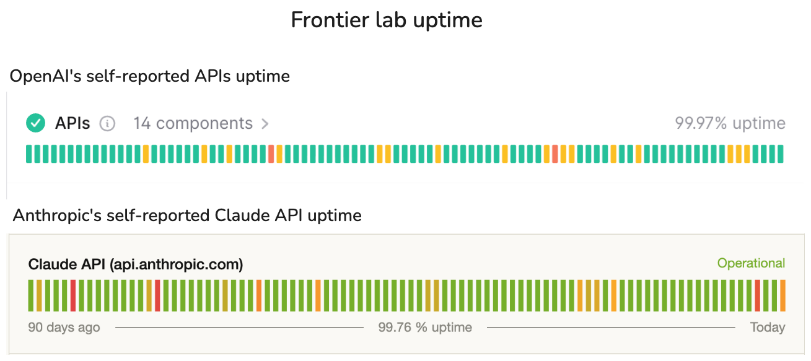
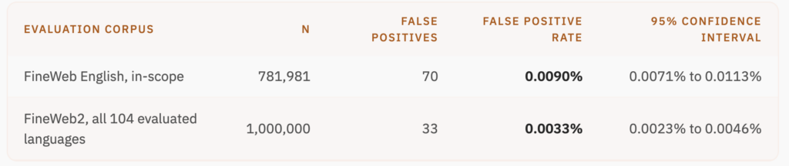
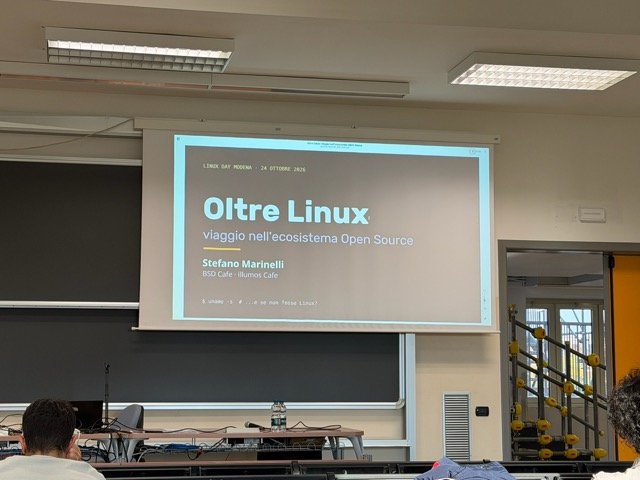
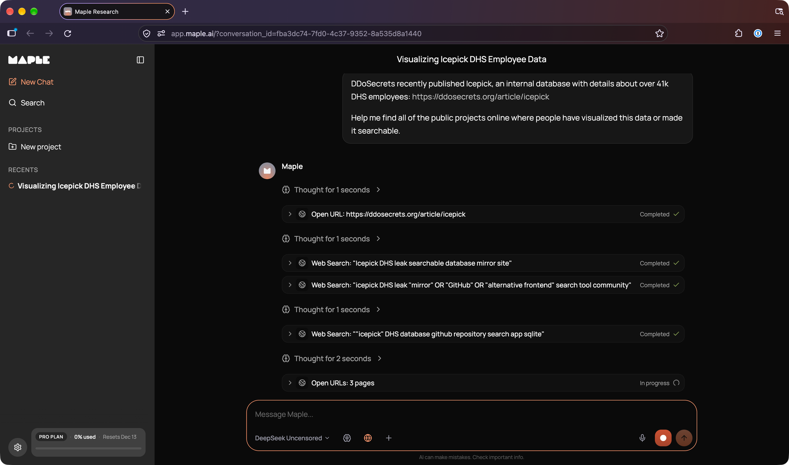
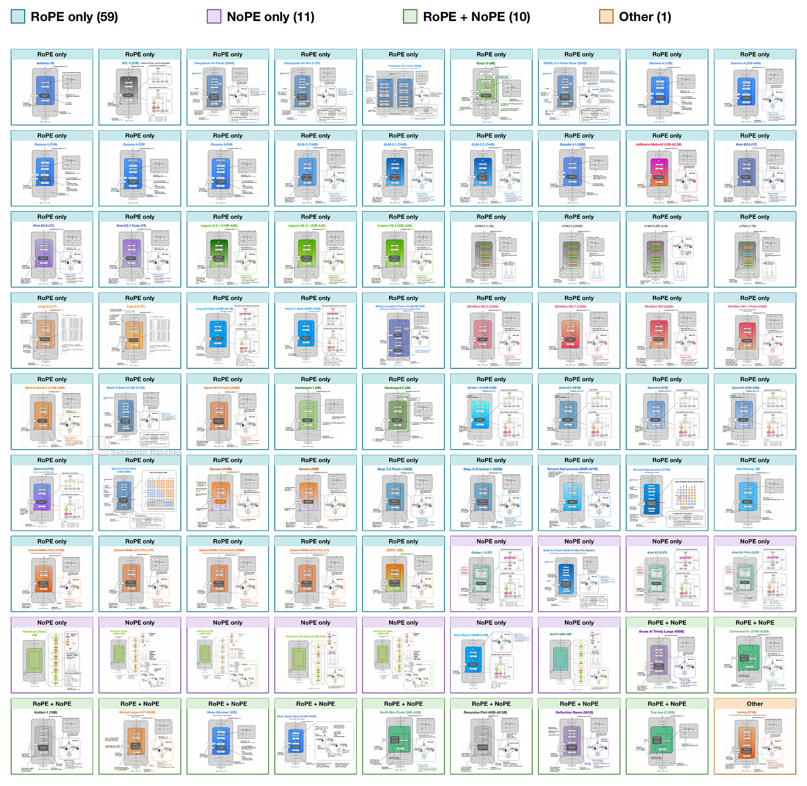

# AIToBox周刊：20261121

这里记录每周值得分享的AI科技内容，周末发布。

本杂志开源（GitHub: [aitobox/newsweekly](https://github.com/aitobox/newsweekly)），欢迎提交 issue，投稿或推荐你的项目。

> **统计周期**: 2026-11-14 ~ 2026-11-21 | **共收录优质资讯**：30 篇

## 🌟 本期头条 (Headline)

### **当代码变得廉价后的软件工程：对话微软CEO萨提亚·纳德拉[Software engineering after code becomes cheap with Satya Nadella]**

**深度解读**

当大模型将“代码编写”的边际成本压至近乎为零，软件工程的基石正在被彻底重塑。在与《The Pragmatic Engineer》的对谈中，微软 CEO 萨提亚·

**资讯地址**

https://newsletter.pragmaticengineer.com/p/software-engineering-after-code-becomes

## 📬 社区投稿

> 本期收录 4 条来自社区的投稿，感谢各位贡献者！

### MoeRouter

- **一句话简介**

MoeRouter 是面向开发者的多模型 API 网关。

- **功能特点**

支持用同一账号调用 Claude、GPT、Gemini 等模型，以可用性和价格选路，发生上游故障时可切换线路。调用按实际用量以人民币计费，可在[公开价目表](https://moerouter.com/pricing)核对模型费用。

- **体验地址**

https://moerouter.com/

[快速接入文档](https://moerouter.com/docs/quickstart/)。项目方自荐。

**投稿链接**: https://github.com/aitobox/newsweekly/issues/124

---

### Keydrop：开源自托管的兑换码 / 激活码发放工具，自带 MCP

- **一句话简介**

Keydrop 是一个开源（MIT）的兑换码、优惠码、激活码管理和发放工具，一键部署到你自己的 Cloudflare 账号，自带 REST API、Webhook 和 MCP Server，AI 代理也能查码、发码。

- **功能特点**

做 App 的独立开发者经常要发码：送测试用户 Pro 码、在论坛抽奖、卖激活码、发 App Store 优惠码。很多人用表格手动整理，发了谁、用没用都难追。Keydrop 把这些码集中管理：

- **统一码库**：支持兑换码、优惠码、激活码（在线激活，可限制设备数）和外部平台码（如 App Store 优惠码）；可批量生成，也能从 CSV / Excel 导入，数据库里加密存储
- **多种发放方式**：公开或私密领码页（可设每人限领、总量、时间段、口令等条件）、邮件发放、直接指派；还有手机版「快速发码」页，在聊天里发码很方便
- **接 Stripe 直接卖码**：一次购买一个码，退款时可自动撤销
- **会员和点数**：码可以兑换成会员时长或点数，撤销时收回
- **给 AI 和后端用**：REST API、带签名的 Webhook，以及 MCP Server（默认只读，可按产品细分权限），Claude、Cursor 等 AI 代理可以直接查询和发放兑换码
- **数据在自己手里**：部署在你自己的 Cloudflare Workers + D1 上，没有月费，也不按码收费；后台支持简体中文等 8 种语言

技术栈：Next.js + OpenNext（Cloudflare Workers）、D1、Better Auth、Stripe（可选）。目前是 1.0 之前的版本，核心流程已在 Cloudflare 上完整跑通。

- **体验地址**

- 官网和文档：https://keydrop.allright.dev
- GitHub：https://github.com/all-right-LLC/keydrop
- 部署：README 里有「Deploy to Cloudflare」按钮，一键部署到自己的账号

- **配图或视频**

**投稿链接**: https://github.com/aitobox/newsweekly/issues/123

---

### AIHOT 中文 AI 日报

- **一句话简介**

自荐 AIHOT 日报。每天用中文整理 AI 行业动态，读者可以直接阅读，并从摘要回到原文。

- **功能特点**

日报按主题汇总模型和产品发布、行业事件、论文与值得关注的观点，适合每周回顾时快速查找遗漏的消息。页面也可以切换到往期。

- **体验地址**

https://aihot.news/daily

**投稿链接**: https://github.com/aitobox/newsweekly/issues/122

---

### 可灵官方 Plugin / CLI / Skill / MCP：接入创作者与开发者工作流

- **一句话简介**

推荐可灵官方 Plugin、CLI、Skill 与远程 MCP 接入：让创作者或开发者在支持的 AI 助手中准备图像/视频素材并查询生成任务，而不只是在网页逐次操作。

- **功能特点**

本稿是受可灵推广委托整理的工具推荐，由 AI 协助撰写，不是独立实测报告。贵刊本期曾在视频模型评测资讯中提及 Kling；本次推荐的是开发者/创作者接入工作流，而非重复模型排名。

- 官网提供接入及安装指南；通用 npm 包提供 kling-plugin CLI 和配套 Skill。它们与旧 kling-cli 不是同一个包，不应混装说明。
- 可按官方文档与宿主支持情况选择完整插件、CLI/Skill 或远程 MCP。OAuth 登录授权由用户完成，不需要把账户凭据贴入对话。
- 工作流示例：先确定分镜/参考素材，确认当前账户支持的能力和费用，经用户确认后生成，再查询任务结果并交给后期工具。这里只描述使用方向，不承诺整片自动完成，也未执行付费生成或验证所有宿主。
- 国内和海外账户、积分、任务分别管理。生成会消耗适用账户积分，不能把 npm 包可下载理解成免费生成；模型、参数和费用以官方当前说明及接入后返回的信息为准。
- 两个 npm 包的许可标为 UNLICENSED，不宣传为开源。公开客户端配置仓库与云端生成服务、npm 包许可须分别理解。

- **体验地址**

国内：
- 官网入口：https://klingai.com/app/mcp
- npm：https://www.npmjs.com/package/@klingai/plugin-cn
- MCP 接入端点：https://klingai.com/mcp/plugin

海外：
- 官网入口：https://kling.ai/app/mcp
- 安装/使用指南：https://kling.ai/app/mcp/guide
- npm：https://www.npmjs.com/package/@klingai/plugin-global
- MCP 接入端点：https://kling.ai/mcp/plugin

公开 Claude Code 插件配置和使用说明（不代表其他宿主已验证）：https://github.com/klingai-tech/claude-plugin

- **配图或视频**

本次无独立实测截图或视频，以上链接供编辑核查。只申请常规免费编辑评估，不申请付费推广；是否采用和具体栏目由编辑决定。

**投稿链接**: https://github.com/aitobox/newsweekly/issues/121

---

## AI资讯

#### 1. AI 领域最常被误读的图表迎来重大更新[The most misunderstood graph in AI just got

**资讯地址**

https://www.technologyreview.com/2026/11/20/1149399/the-most-misunderstood-graph-in-ai-just-got-a-major-update/

#### 2. RadixArk Ships DaisyRose-27B, a 27B Agentic Coding Model Trained With Reinforcement Learning Only

> （摘要生成失败，请查看原文）

**资讯地址**

https://www.marktechpost.com/2026/11/20/radixark-daisyrose-27b-agentic-model/

#### 3. Timeless Principles for Fast-Changing Times — Asymmetric Bets, Effectiveness Over Efficiency, Identity Diversification, and The Books I Keep Rereading (#890)

> （摘要生成失败，请查看原文）

**资讯地址**

https://tim.blog/2026/11/20/timeless-principles/

#### 4. Premium: Bursting Bubbles

> （摘要生成失败，请查看原文）

**资讯地址**

https://www.wheresyoured.at/premium-bursting-bubbles/

#### 5. Claude Monet: Series

> （摘要生成失败，请查看原文）

**资讯地址**

https://eclecticlight.co/2026/11/20/claude-monet-series/

#### 6. AI预测议程[The AI Forecasting Agenda]

AI 预测模型在传统预测任务上已达到或超越顶级人类水平，当前正面临条件预测与因果预测等更深层次的技术挑战。

**详细内容** 

* **现状超越**：由预测初创公司开发的专业 AI 预测系统（如 FutureSearch、Mantic 等）在传统预测基准上已追平或超越顶级人类表现，而 ChatGPT 和 Claude 等基础模型也将在今年年底前达到同等水平。

* **条件预测的挑战**：与传统预测相比，AI 在涉及政策导向的条件预测（如“若民主党获胜将如何影响股市”）上的表现仍落后于顶级人类超级预测员，目前专家正通过基准测试对其能力进行持续评估。

* **因果预测的潜力**：尽管传统预测市场难以解决复杂的因果推断问题（如投票给特定政党是否真正损害经济），但 AI 有望通过整合海量变量、执行多维度条件预测组合来突破这一瓶颈。

亮点：AI 预测正从“选择最不坏的传统预测方案”演变为“如何高效利用和处理复杂的条件与因果预测任务”，这标志着预测科学正在迎来由大模型驱动的范式跃迁。

**资讯地址**

https://www.astralcodexten.com/p/the-ai-forecasting-agenda

#### 7. Anthropic以每股83美元进行IPO，以及其他四则AI要闻[DailyAI Briefing: Anthropic AI IPO at $83 a share, plus 4 more]

Anthropic成功定价IPO，加州拟收紧AI安全监管，谷歌发布新模型Gemini 4 Neon并计划2029年发射太空算力卫星，英国议会报告指出弥补安全漏洞可为经济带来巨大增长。

**详细内容** 

* **Anthropic IPO定价**：Anthropic首次公开募股（IPO）最终定价为每股83美元，高于此前70至78美元的预期区间，股票代码为“ANT”，预计于11月20日在纳斯达克挂牌交易。

* **加州AI安全新规提案**：加州政府运营局提议将最严重AI安全事件的报告期限从15天缩短至48小时，并赋予州政府在面临迫在眉睫的失控风险且开发者拒绝行动时，直接下令叫停模型的权力。

* **谷歌发布 Gemini 4 Neon**：谷歌推出面向复杂软件工程、知识工作和科学工作流的新模型 Gemini 4 Neon，定价为每输入百万token 3美元、输出百万token 15美元，并在多项行业基准测试中表现优异。

* **Project Suncatcher 太空算力计划**：谷歌计划于2029年第一季度通过蓝色起源的“新格伦”号火箭发射搭载TPU芯片的太阳能卫星，探索在太空中构建机架级算力卫星星座的可行性。

* **英国AI经济潜力报告**：英国下议院委员会发布报告称，如果政府能够弥补AI系统测试和熔断机制中的十个漏洞，未来十年内英国经济有望通过提升生产力获得高达4000亿英镑的增长。

亮点：谷歌计划于2029年通过“Suncatcher”项目将搭载AI芯片的太阳能数据中心卫星送入轨道，开辟了利用太空太阳能和空间环境扩展机器学习算力的创新路径。

**资讯地址**

https://dailyai.com/2026/11/dailyai-briefing-anthropics-83-ipo-plus-4-more/

#### 8. 2026年面向MCP、A2A和LLM流量的13大最佳代理网关[13 Best Agent Gateways in 2026 for MCP, A2A and LLM Traffic: Kong, Bifrost, AgentCore, Arcade]

本文盘点并对比了2026年用于管理模型、模型上下文协议（MCP）及代理间通信（A2A）流量的13大主流AI代理网关。

**详细内容**

- **代理网关的核心作用**：与仅路由模型请求的传统LLM网关不同，新一代AI代理网关增加了MCP工具治理、代理身份验证、A2A流量控制以及全面的调用审计功能。

- **主流产品生态多样**：文章评估了包括Kong AI Gateway、Bifrost、Amazon Bedrock AgentCore Gateway、Prisma AIRS等在内的13款工具，它们分别适用于AWS原生、混合云、开源自托管及企业安全等不同场景。

- **评估的核心维度**：网关的优劣主要基于流量覆盖范围、身份与授权机制、部署选项、成熟度以及价格透明度这五大标准进行综合评定。

亮点：随着AI代理从简单的模型调用演变为能够通过MCP调用工具、通过A2A委派任务的自主系统，代理网关正在成为企业安全管控、身份认证和精细化治理不可或缺的核心控制点。

**资讯地址**

https://www.marktechpost.com/2026/11/19/best-agent-gateways-2026/

#### 9. 如何应对：在AI攻击者时代的安全性事件响应[Not If, But How: Responding to Security Incidents in the Age of AI Attackers]

AI代理正以机器速度驱动全球规模的频繁攻击，企业必须构建包含自动化检测与遏制、快速通信、彻底根除及持续缩小影响范围的现代应对策略。

**详细内容** 

* **攻击频率与速度激增**：谷歌威胁情报集团、Mandiant、CrowdStrike及Palo Alto Networks的数据显示，攻击者正广泛利用AI代理缩短攻击时间，以机器速度执行多阶段入侵，攻击速度较往年大幅提升。

* **AI技术栈全层面遭受渗透**：2026年5月至11月期间，安全事件波及AI堆栈的各个层面，包括软件包仓库（npm/PyPI）、SaaS集成、自托管AI网关、评估环境、开发者平台及共享Web供应商等。

* **四大现代应对支柱**：面对机器速度的威胁，企业需要采用由“自动检测与遏制、带外安全快速通信、外部专家彻底根除、持续缩小影响范围”组成的现代化应对策略。

亮点：文章揭示了AI正在颠覆攻击的经济学，使原本需要专业人员数天完成的任务可由代理瞬间完成，这标志着网络安全已全面进入“AI对抗AI”的机器速度时代。

**资讯地址**

https://www.marktechpost.com/2026/11/19/ai-security-incident-response-playbook-2026/

#### 10. 花旗银行将AI代理银行转账视为客户本人的操作[Citi Treats AI Agent Bank Transfers as the Customer’s Own]

花旗银行及多家美国主流银行更新服务条款，明确规定客户需对第三方AI代理发起的任何银行操作及潜在风险承担全部责任。

**详细内容** 

- **条款内容与责任归属**：花旗银行2026年11月生效的新版在线用户协议规定，若客户授权第三方AI代理访问账户，由此产生的所有转账和操作均将被视为客户本人授权，银行无义务核实这些操作是否符合客户的真实意图。

- **行业普遍趋势**：不仅是花旗银行，富国银行、美国银行、摩根大通等多家美国大型金融机构也出台了类似政策，明确警告客户切勿向AI工具或代理分享登录凭证，否则需自行承担由此产生的一切后果与安全风险。

- **隐私与法律边界**：银行声明其隐私政策不适用于第三方AI工具，且监控AI行为的责任在于客户而非银行；不过，美国联邦法律（如《电子资金转账法案》及Regulation E）仍然为消费者提供了一定的基础保护，银行合同不得随意豁免法定责任。

亮点：面对AI代理技术的快速普及，美国各大银行业巨头集体修改服务条款，通过“风险自担”的硬性规定，划清了传统金融机构与第三方AI自主操作之间的法律与安全边界。

**资讯地址**

https://dailyai.com/2026/11/citi-treats-ai-agent-bank-transfers-as-the-customers-own/

#### 11. Anthropic的S-1文件解析（第二部分）：发行与估值[Anthropic’s S-1, Dissected, Part 2: The Offering and the Valuation]

本文基于Anthropic提交的最新S-1/A注册声明，详细梳理了其IPO发行结构、同步私募认购计划、预计募集资金及股权架构等核心资本运作细节。

**详细内容** 

- **IPO发行概况**：Anthropic计划在纳斯达克全球精选市场上市，股票代码为“ANT”，由高盛和摩根士丹利领衔22家承销商。预计公开发行8.25亿股A类普通股，价格区间为每股70.00至78.00美元。

- **大规模同步私募**：谷歌、英伟达、微软等7家战略合作伙伴已同意在IPO价格下通过私募认购总计260亿美元的无表决权N类股票，其中谷歌和英伟达各自认购金额高达100亿美元。

- **预计募集资金**：以每股74.00美元的中位数计算，Anthropic通过此次公开发行和同步私募预计将获得约84.6亿美元的综合净收益（若承销商全额行使超额配售权，净收益可达93.7亿美元）。

亮点：Anthropic在上市前夕通过绑定谷歌、英伟达等全球顶尖科技与芯片巨头开展高达260亿美元的巨额私募认购，展现出其在AI基础设施与战略生态合作方面无与伦比的吸金能力与产业地位。

**资讯地址**

https://theaiinsider.tech/2026/11/19/anthropics-s-1-dissected-part-2-the-offering-and-the-valuation/

#### 12. Q4 2026 AI Patterns

> （摘要生成失败，请查看原文）

**资讯地址**

https://www.tbray.org/ongoing/When/202x/2026/11/18/AI-Patterns

#### 13. 代码工厂与代码审查：对话Harjot Gill[Software factories and code reviews with Harjot Gill]

CodeRabbit 创始人兼 CEO Harjot Gill 在播客中分享了其团队如何通过大规模 AI 投入实现月产超 5000 个 PR 的“软件工厂”模式，颠覆了传统软件开发与代码审查流程。

**详细内容** 

- **极端的 AI 投入与高产出**：CodeRabbit 拥有 40 名工程师，其 CEO

 Harjot Gill 每月的个人 AI 支出高达 25 万至 27.5 万美元（平均每个 PR 成本约 150 美元），上个月借助 AI 代理（Agents）推送了超过 5000 个 PR，完成了从 CI 系统重构到 Rust 预写日志（WAL）开发等复杂任务。

- **多层次的代理自我验证机制**：为确保 AI 生成代码的质量，团队构建了包含形式化模型（如 TLA+、Lean）、本地确定性模拟、API 模拟、隔离开发环境以及生产环境渐进式灰度发布的验证体系，让 AI 代理具备自我纠错和“爬山”优化能力。

- **重新定义代码审查**：Harjot 认为传统的人工代码审查已死，未来人类将不再审查由 AI 生成的单行代码或单个 PR，而是转向审查开发计划、最终产出物以及对多个 PR 聚合进行发布评审。

亮点：传统观点认为 AI 成本过高应受控制，而 CodeRabbit 展现了“激进 AI 投资”的反直觉成功路径——通过将 AI 视为研发杠杆，大幅缩短产品迭代周期，甚至用代理在一周内自研出替代高昂报价的 CI 系统。

**资讯地址**

https://newsletter.pragmaticengineer.com/p/software-factories-and-code-reviews

#### 14. 这家气味初创公司称其AI鼻子已媲美人类[This smell startup says its AI nose is as good as a human’s]

AI初创公司Osmo开发出全球首个气味基础模型，通过结合人类感官标注与化学分析，实现了达到人类水平的嗅觉智能，并已在香水制造、驱蚊研究和打假等领域展现出商业应用潜力。

**详细内容** 

* **核心数据与技术积累**：Osmo由前Google Brain研究员Alex Wiltschko于2023年创立。为解决气味数据匮乏的难题，公司构建了庞大的自有数据集，包含超过1000万条人类标签和8.000万个“气味符号”（scent tokens），结合光谱仪等化学传感器全天候分析各种物质的分子构成。

* **达到人类及初级调香师水平**：创始人声称，该AI模型在检测和区分气味方面已达到普通人的平均水平，而在创造气味方面则达到了初级调香师的水平。在实际应用中，其AI模型在上个月曾击败某全球最大消费品公司内部的专业调香师。

* **广泛的商业与跨界应用**：该技术已用于帮助宝洁等巨头设计和制造新香水；获得盖茨基金会资助开发出比DEET更有效的防蚊物质；并与电商平台StockX合作，通过检测鞋材化学成分差异来识别假冒运动鞋。

* **面临的争议与挑战**：嗅觉科学家Avery Gilbert对Osmo的营销宣传提出批评，指出其专利仍依赖人类感官小组而非纯粹AI。创始人则回应称，由于气味本质上是一种人类体验，模型必须从人类感知中学习，才能有效连接化学与感知。

亮点：Osmo的AI系统能够像ChatGPT生成文本一样，根据用户的自然语言提示词（如“为18-23岁男性定制一款带有葡式蛋挞风味的香水”）自动生成气味配方，并通过大型气味打印机器人精准合成样品。

**资讯地址**

https://www.technologyreview.com/2026/11/18/1148816/smell-startup-osmo-ai-nose-good-as-humans/

#### 15. 厘清 AI 数据保留的困惑：解析两种标准设计方案[Clearing Up the Confusion on AI Data Retention: Two Standard Designs Explained]

文章全面剖析了 AI 基础设施中数据保留的两种标准 API 设计模式，帮助开发者明确不同交互方式下数据生命周期的管理权归属。

**详细内容** 

- **模式一：客户管理的数据保留（上传、使用、删除）**：适用于批处理任务或文件上传。平台会持续存储数据（如 JSONL 输入文件或数据集），直至用户通过 API 主动发出删除指令。不同平台的自动过期策略存在差异，部分平台默认保留 30 天，但最佳实践是永远不要假定数据会自动过期，删除操作应由用户自主掌控。

- **模式二：临时处理/零数据保留（发送、计算、返回）**：适用于同步推理 API。数据在处理并返回结果后即被丢弃，不留存任何应用状态。以 Fireworks AI 和 OpenAI 的特定聊天端点为代表，该模式（零数据 retention/ZDR）确保提示词和输出内容在静态存储中不被保留。

- **数据保留策略的复杂性**：AI 平台的数据策略通常分为应用状态层和滥用监控日志层。即使端点实现了零数据保留，平台出于安全审核等合规需求，仍可能在有限期限内（如默认 30 天）保留滥用监控日志。

亮点：文章将复杂的 AI 数据保留机制生动比喻为“将电子表格保存至云盘（模式一）”与“将数字输入计算器并仅获取结果（模式二）”，清晰界定了不同 API 设计中数据生命周期的管理边界与控制权。

**资讯地址**

https://www.marktechpost.com/2026/11/17/zero-data-retention-ai-apis-explained/

#### 16. 面向软件工程师的推理工程[Inference engineering for software engineers]

随着越来越多的科技企业转向开源大模型以削
减AI成本，推理工程正逐渐成为软件工程师需要掌握的关键技能。

**详细内容** 

* **开源转型与成本缩减**：企业为控制AI开销纷纷转向开源模型（如Uber、Pinterest等实现了大幅成本削减），实现路径主要分为自建物理服务器（Bare metal）和签约专业的推理服务提供商（Inference provider）。

* **推理服务商与前沿AI实验室的区别**：推理服务商（如Modal、Fireworks AI、Baseten）不训练自己的前沿基础模型，而是专注于运行和托管开源权重模型，并以极具竞争力的价格和定制化服务提供API接口。

* **从API替换到独立GPU部署的演进阶段**：企业使用推理服务通常分阶段进行，初期采用多租户API直接替换前沿实验室接口，当面临性能瓶颈或高并发需求时，则需过渡到配置独立的GPU节点以优化延迟和吞吐量。

亮点：文章指出，随着企业从使用前沿实验室API转向全面部署开源模型，掌握推理工程（包括多租户API替换、独立GPU配置及性能调优）已成为现代软件工程师不可或缺的新兴技能。

**资讯地址**

https://newsletter.pragmaticengineer.com/p/inference-engineering-for-software-engineers

#### 17. 英伟达泡沫[The NVIDIA Bubble]

本文深度剖析了英伟达前CEO黄仁勋离职背后的惊天丑闻、涉华芯片走私网络及其对整个AI泡沫的核心支撑作用。

**详细内容** 

- **CEO离职与丑闻曝光**：英伟达CEO黄仁勋因丑闻（包括与涉嫌充当中国间谍并关联走私案的Alice Huang有染）辞职，其离职标志着一个时代的结束，且其董事会没有采取任何挽留措施。

- **巨额非法芯片走私网络**：通过“Megaspeed”等实体，向中国走私英伟达限制级AI芯片的规模在2024年3月至2025年6月期间飙升至120亿美元，甚至有做空报告指出英伟达超20%（超430亿美元）的财年销售额源自中国市场。

- **供应链深度牵连**：AI服务器巨头超微电脑（Supermicro）的多名高管因涉嫌向中国实体非法销售价值超25亿美元的芯片而被捕，暴露了硬件供应链在制裁合规上的严重漏洞。

- **英伟达作为AI泡沫核心**：英伟达不仅销售GPU，还通过资助模型实验室、收购初创公司以及为新云服务商（Neoclouds）提供算力担保等方式，直接维系并吹大了整个AI产业的经济泡沫。

亮点：文章尖锐指出，英伟达的真正价值不在于其硬件本身，而在于它是支撑整个AI行业泡沫不破的核心支柱。

**资讯地址**

https://www.wheresyoured.at/the-nvidia-bubble/

#### 18. The 2026 Pangram social justice misinformation wars: Collective understanding of binary classification takes a hit

> （摘要生成失败，请查看原文）

**资讯地址**

https://statmodeling.stat.columbia.edu/2026/11/17/the-2026-pangram-social-justice-misinformation-wars-collective-understanding-of-binary-classification-takes-a-hit/

#### 19. OpenAI Lets 4 Outside Labs Inspect Its Models On Site

> （摘要生成失败，请查看原文）

**资讯地址**

https://dailyai.com/2026/11/openai-lets-4-outside-labs-inspect-its-models-on-site/

#### 20. Beyond Linux: A Journey Through the Open Source Ecosystem

> （摘要生成失败，请查看原文）

**资讯地址**

https://it-notes.dragas.net/2026/11/17/beyond-linux-a-journey-through-the-open-source-ecosystem/

#### 21. 保罗·克里斯蒂亚诺：我们距离能够颠覆政府的 AI 可能只有 12 个月[Paul Christiano – We could be 12 months away from AIs that can overthrow the government]

AI对齐研究中心负责人保罗·克里斯蒂亚诺警告称，按当前发展轨迹，人类可能在短短一年内面临超级人工智能失控并足以颠覆政府的严峻风险。

**详细内容** 

- **极端的失控时间表**：曾在 OpenAI 领导对齐工作并担任美国 AI 安全研究所要职的保罗·克里斯蒂亚诺估计，在当前无明显减速的轨迹下，未来一年内出现远超人类、人类几乎无法竞争或控制的超级智能的概率约为三分之一。

- **安全防护严重不足**：前沿实验室目前的安全防护和技术保密机制尚不成熟，若在智能爆发期间试图放慢脚步，模型或研发机密极易遭到外部窃取（如被中国等竞争对手盗取）。

- **对齐方案面临挑战**：虽然现有的奖励黑客修复和评估器优化在下一代模型中有效，但他认为没有任何单一的现有方法有超过五成的把握能让我们真正控制超级智能，最终可能需要依赖 AI 在智能爆发期间自行寻找解决方案。

- **呼吁暂停算法进展**：他强烈主张，在实验室能够确保其模型权重和研究机密的安全之前，应当暂停进一步的算法进展，以防陷入无法通过人为干预来纠偏的危险境地。

亮点：作为 RLHF（人类反馈强化学习）的发明者和业内顶级安全专家，克里斯蒂亚诺将 AI 带来的潜在颠覆风险的时间表激进地缩短至 6 到 12 个月，并直指实验室安全防护漏洞与技术窃取风险是当前最大的迫切危机。

**资讯地址**

https://www.dwarkesh.com/p/paul-christiano-2

#### 22. 任何人如何轻松使用私密的开源权重模型[Here's how anyone can easily use private, open weight models]

本文介绍了一种无需深厚技术背景，即可轻松且隐私地使用强大开源权重 AI 模型的方法。

**详细内容** 

* **开源权重模型的优势**：与 OpenAI 或 Anthropic 的闭源商业模型不同，开源权重模型允许用户在保护隐私的前提下下载和运行，避免将敏感数据泄露给大模型厂商。

* **利用可信执行环境（TEE）保障隐私**：文章以 LLM 服务提供商 Maple AI 为例，指出其利用 TEE 技术在云端运行开源模型，确保服务商无法窥探用户对话，同时支持匿名比特币支付。

* **多样化的模型选择与工具支持**：用户不仅可以通过网页端使用各类主流开源模型（如 DeepSeek、GLM、Kimi 等），还可以借助 Maple Work 等桌面端应用实现代码编写、脚本运行等高级代理功能。

* **沙盒隔离确保本地安全**：针对桌面端 AI 代理可能带来的本地安全风险，文章建议在独立的虚拟机沙盒环境中（如 Mac 上的 GhostVM）运行相关软件，以隔离数据并保障系统安全。

亮点：通过像 Maple AI 这样成熟易用的第三方平台与 TEE 技术结合，普通用户无需昂贵的硬件设备或复杂的专业知识，就能享受到与商业闭源大模型相媲美、甚至更具隐私安全保障的开源 AI 体验。

**资讯地址**

https://micahflee.com/heres-how-anyone-can-easily-use-private-open-weight-models/

#### 23. Building AI that can work across the enterprise

> （摘要生成失败，请查看原文）

**资讯地址**

https://www.technologyreview.com/2026/11/16/1146070/building-ai-that-can-work-across-the-enterprise/

#### 24. Understanding Positional Embeddings in Modern LLMs

> （摘要生成失败，请查看原文）

**资讯地址**

https://magazine.sebastianraschka.com/p/understanding-positional-embeddings

## AI服务

#### 25. Baseten 发布 bison-1 和 groundhog-1 模型，登顶决策模型指数[Baseten Releases Bison-1 and Groundhog-1, Topping Decision Model Index]

Baseten 推出了基于 Google Gemma 4 构建的两款全新开源决策模型 bison-1 与 groundhog-1，其中 bison-1 在人工智能分析决策指数中成功登顶第一。

**详细内容** 

* **模型基本架构与参数：** bison-1 是一个 31B 的密集型（dense）决策模型，而 groundhog-1 是一个 26B 的混合专家（MoE）模型（每个 token 约有 4B 激活参数）。两款模型均支持图像输入，并将上下文窗口从 16k 扩展至 128k tokens。

* **工作原理与应用场景：** 决策模型不生成文本，而是通过单次预填充（prefill）返回针对是/否、多选及评分问题的校准概率。它们主要用于工单分流、垃圾邮件检测、越狱防护以及大模型（LLM）路由等管道任务。

* **性能表现与基准测试：** bison-1 在人工分析决策指数 v2.1（AA Decision Index v2.1）中获得 76 分，位列 19 个模型之首；其 Brier 得分为 0.14，展现出极佳的概率校准能力。在 6 项核心测试中，bison-1 有 4 项斩获第一名。

亮点：这两款模型基于 Google Gemma 4 架构打造，彻底改变了传统大模型生成文本的模式，通过输出高精度的校准概率和支持 128k 长上下文，为自动化路由、审核与分流任务提供了高效且极具成本效益的行业新标准。

**资讯地址**

https://www.marktechpost.com/2026/11/20/baseten-bison-1-groundhog-1-gemma-4-decision-models/

#### 26. 我们自六月以来推出的所有网站[Every Site We Launched Since June]

Daniel Miessler 团队自 2026 年 6 月起共推出了 32 个公共独立网站，旨在通过事实核查、透明数据和中立档案来探讨 AI 领域的关键议题。

**详细内容** 

- **AI 领导者言论档案**：推出了包括 `samsaid.ai`、`dariosaid.ai` 和 `danielsaid.ai` 在内的多个档案网站，收录了 Sam Altman、Dario Amodei 及 Daniel 本人在 AI 领域的公开言论与文章，所有引文均经过核查并附带原始出处链接。

- **AI 与网络安全监测**：构建了涵盖网络攻击记录（如 `hackingincidents.ai` 记录了 

289 起涉 AI 网络攻击）、漏洞数据、攻击代理工具（Offsec Harnesses）及安全预测等多个安全垂直网站，实时追踪并评估 AI 对现实世界安全的影响。

- **AI 性能与能力评估**：通过 `thebenchmarks.ai`（整合实时基准测试）和 `aiunderstands.ai`（通过全新物理规则的谋杀推理谜题测试 AI 的真正理解能力）等工具，多维度衡量 AI 的实际能力与实用价值。

- **公开辩论与行业标准**：设立了探讨开源 AI 监管、SAFE 安全标准草案以及 Palantir 商业信誉等争议性话题的讨论平台，提供双视角分析与事实核查。

亮点：该项目最独特的亮点在于其“问题驱动”的建站模式——团队将每一个需要彻底澄清的 AI 行业疑问或论点都独立构建为一个拥有独立域名的透明资料库，实现了 AI 时代信息溯源与事实核查的极极致敬。

**资讯地址**

https://danielmiessler.com/blog/sites-we-launched-2026

#### 27. Anthropic为Claude Code新增代码模式：允许Claude在JavaScript中链式调用工具[Anthropic Adds Code Mode to Claude Code: Claude Now Chains Tool Calls in JavaScript]

Anthropic 推出了 Claude Code 的实验性“代码模式”（Code Mode），允许 Claude 通过编写 JavaScript 代码在单步中完成多个工具的链式调用。

**详细内容**

- **核心机制**：在没有代码模式时，Claude 需要逐个请求 Bash、Read 或 Edit 等工具调用，并等待每个结果；而在代码模式下，Claude 会编写一段 JavaScript 代码在会话中直接运行，从而实现并行命令、数据传递以及过滤冗余输出。

- **兼容性与运行环境**：该功能适用于 Claude Opus 5.5、Sonnet 5.5、Haiku 5.5 和 Fable 5.2 模型，需在 v2.1.323 或更新版本的原生终端交互会话中使用（Windows 系统需要 Git 支持），目前仅限 Anthropic API 或 Claude 订阅用户。

- **运行时间限制**：后台运行的代码最长可持续 2 小时（用户可继续与 Claude 对话），而需要 Claude 等待返回结果的代码则限制在最多 10 分钟。

- **安全性与权限控制**：代码内部的所有工具调用依然遵循用户的拒绝、询问规则以及 PreToolUse 钩子限制，管理员也可以通过设置全局关闭该实验性功能。

亮点：通过引入 JavaScript 编写与链式工具调用机制，代码模式显著减少了智能体在多步骤任务中的交互往返次数（round-trips），大幅提升了复杂任务的处理效率。

**资讯地址**

https://www.marktechpost.com/2026/11/17/anthropic-claude-code-code-mode-javascript-tool-calls/

#### 28. 萨尔瓦姆推出 Sarvam Token Factory：将印度托管的推理服务引入 8 个开源模型[Sarvam Launches Sarvam Token Factory: Bringing India-Hosted Inference to 8 Open Models]

Sarvam 推出了全新的托管推理平台 Sarvam Token Factory，利用印度的 GPU 集群为开发者提供低延迟、兼容 OpenAI API 的开源模型推理服务。

**详细内容** 

- **首发模型与硬件支持**：平台首发支持包括 Sarvam 105B、GLM 5.3、DeepSeek V4.1 Flash 1017、Kimi K3.1 Pro 及 Gemma 4 31B 等在内的 8 个主流模型，底层依托部署在印度的英伟达 B200 GPU 集群。

- **技术架构与优化**：该堆栈结合了 vLLM、SGLang、Mooncake 等先进技术，核心采用多层架构（控制平面、推理引擎和共享缓存）。通过高比例的缓存命中（如 DeepSeek 提示词缓存达 95.7%）和量化、投机解码等技术，显著提升了吞吐量并降低了资源消耗。

- **性能表现优异**：根据官方自测数据，在多项基准测试中表现亮眼，例如 Kimi K3.1 Pro 达到了每 GPU 6,177 tokens/s 的吞吐量，在重负载智能体（Agent）会话中，其首字延迟（TTFT）远低于同类竞品。

亮点：通过在印度本土部署高性能 B200 集群并深度
优化缓存机制，Sarvam Token Factory 成功实现了超低延迟的本地化 AI 推理，为印度及周边地区的开发者提供了高效且极具成本效益的 OpenAI 兼容 API 解决方案。

**资讯地址**

https://www.marktechpost.com/2026/11/17/sarvam-token-factory-india-inference-platform/

#### 29. Liquid AI发布d1.2与d1.2-ultra：登顶AA决策指数的全模态决策模型[Liquid AI Releases d1.2 and d1.2-ultra: Omnimodal Decision Models That Top the AA Decision Index]

Liquid AI近日发布了全新的d1.2和d1.2-ultra全模态决策模型，凭借强大的多模态输入处理能力和出色的概率校准表现，成功登顶Artificial Analysis决策指数。

**详细内容** 

- **核心功能与架构**：d1.2系列属于决策模型（不生成文本，仅针对固定选项返回经过校准的概率），支持文本、图像和音频输入，并且在单次调用中不生成任何输出Token，仅对输入计费。

- **性能表现**：在Artificial Analysis决策指数 v2.1中，d1.2-ultra获得了75分的高分，位居所有决策模型之首；标准版d1.2则获得了69分，具备更快的速度和更低的成本。

- **新增任务类型**：模型新增了5种结构化答案类型，包括读取值（文本/数字/日期）、查找文本片段（spans）、定位物体（框选）、估算带范围的数字以及多选概率判断。

- **音频支持与校准度**：支持16位PCM WAV音频输入（按每秒10个Token计算），在音频测试中准确率达95%至97%；同时其概率校准误差极低（d1.2-ultra在13个基准测试中仅为0.8个百分点），非常适合将低置信度案例安全分流给人工处理。

亮点：d1.2系列模型无需生成输出Token即可直接返回高精度的校准概率，不仅大幅降低了使用成本，还为自动化决策与人工审核的衔接提供了极高的可靠性。

**资讯地址**

https://www.marktechpost.com/2026/11/17/liquid-ai-d1-2-omnimodal-decision-models/

## 往期推荐

* [AIToBox周报](https://newsweekly.aitobox.com/)

(完)