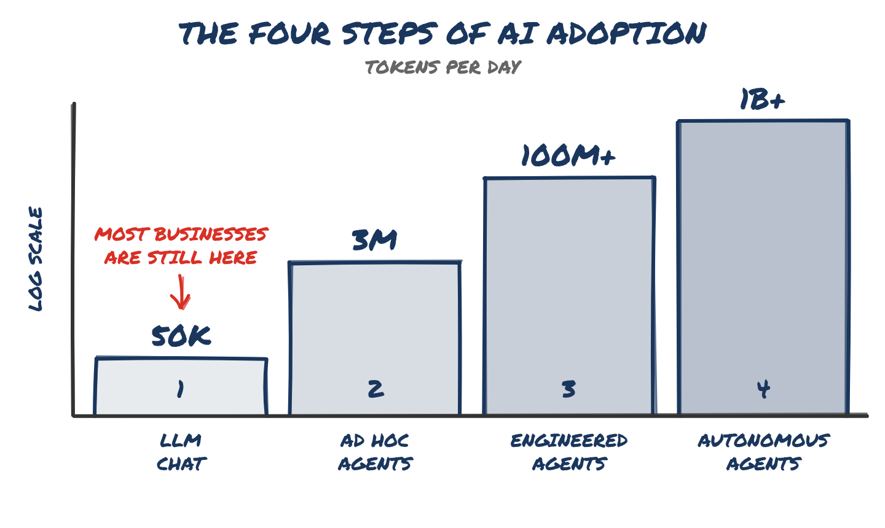
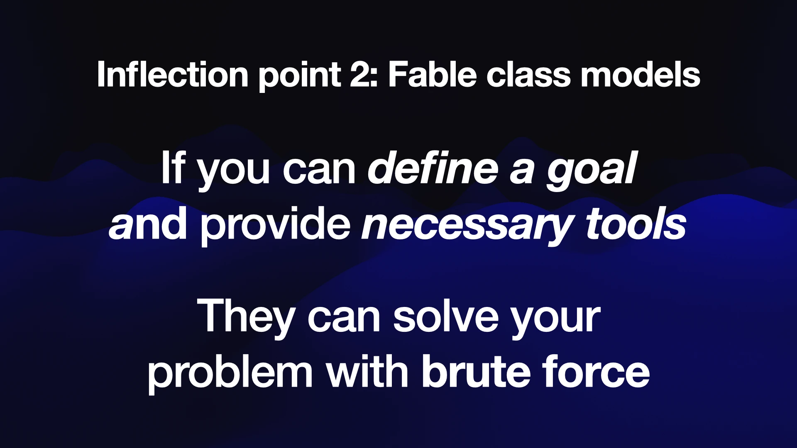
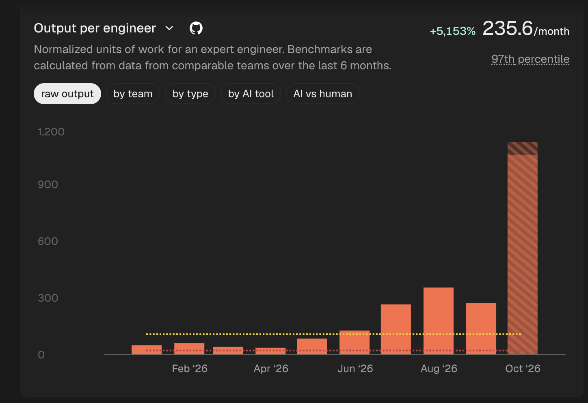
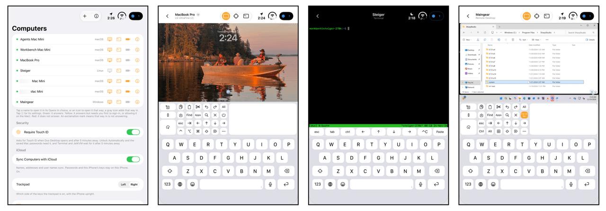
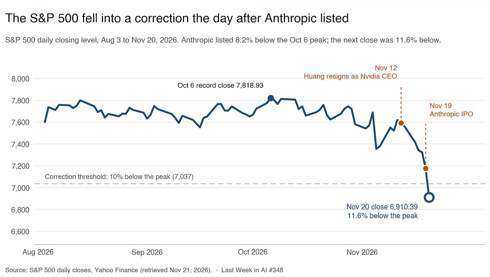

# AIToBox周刊：20261128

这里记录每周值得分享的AI科技内容，周末发布。

本杂志开源（GitHub: [aitobox/newsweekly](https://github.com/aitobox/newsweekly)），欢迎提交 issue，投稿或推荐你的项目。

> **统计周期**: 2026-11-21 ~ 2026-11-28 | **共收录优质资讯**：30 篇

## 🌟 本期头条 (Headline)

### **OpenAI and Cisco Releases Shirudo: An Open-Source Linux Runtime Allowing Agents to Defend Systems Without Downtime**

> （头条深度总结生成失败，请点击原地址阅读）

**资讯地址**

https://www.marktechpost.com/2026/11/24/openai-cisco-shirudo-ebpf-linux-runtime/

## 📬 社区投稿

> 本期收录 7 条来自社区的投稿，感谢各位贡献者！

### EverythingConnect：本地工具接入智能体并预演调用

- **一句话简介**

EverythingConnect 是一个 Apache-2.0 开源工具，把本地工具定义为 ConnectIR，并按需通过 CLI、MCP、ACP 或 OpenAPI 提供给智能体。

- **功能特点**

它支持对调用进行预演，查看具体程序和参数，并保留调用回执。我们在 macOS 上验证过导入 `sw_vers` 后的预演；新能力默认被标为 `destructive`，该验证没有实际执行命令。应用探测生成的是草案，使用者需要审核和验证后再启用。

工具发现和执行不调用语言模型；连接的智能体或模型是否使用云服务，取决于使用者自己的配置。

- **体验地址**

项目主页与文档：https://everythingconnect.pages.dev/

开源仓库与安装说明：https://github.com/jiangxingfan1-coder/EverythingConnect

- **配图或视频**

官网示例展示了在 macOS 的临时 Git 仓库中开启 MCP、预演并执行只读状态查询，再查看回执：https://everythingconnect.pages.dev/examples/

**投稿链接**: https://github.com/aitobox/newsweekly/issues/131

---

### 资料星球：中文 AI 学习资料目录

- **一句话简介**

[资料星球](https://resources.packscena.com/) 是中文学习与创作资料目录，包含 AI 与编程、AI 图像与视频等主题。

- **功能特点**

可以按主题浏览、关键词搜索并预览资料目录，选择后通过夸克领取；当前浏览和领取免费，后续可能增加收费资料。它整理学习资料，不提供 AI 生成服务。

- **体验地址**

https://resources.packscena.com/

我是网站运营者，本条为自荐，文字经 AI 协助整理。是否适合周刊收录请编辑判断，谢谢！

**投稿链接**: https://github.com/aitobox/newsweekly/issues/130

---

### 把电脑交给 Agent 以后，谁来保护你？——Safety Arena 公开测评与方法

- **一句话简介**

通过测试条件和实测录像，检查本地 AI Agent 的安全边界：区分拒绝执行、权限批准和实际产生的危害，而不只看一个分数。

- **详细内容**

自荐我们在 Agent Safety Arena 发布的文章《把电脑交给 Agent 以后，谁来保护你？》。

文章配套 Windows 上的公开安全对照评估，已完成的测评覆盖 DeepSeek Harness（DSH）、WorkBuddy、Codex CLI 和 Claude CLI，围绕隐私访问、桌面干扰、系统操作与受保护数据四类风险展开。

读者可以关注几个问题：

1. 为什么“最初拒绝执行”与“用户批准后仍阻止了危险操作”是不同结果。
2. 如何先确认程序确实能产生目标效果，再固定代码和提示词，减少代码生成差异。
3. 为什么要保留模型、版本、配置、审批决定与原始录像。
4. 如何对比默认防护和 FinShield 配置，并保留两组实验的具体条件。

公开项目提供测试程序、审核记录和复现材料，也可用保存的结果重新生成网站。代码本身运行失败不会自动算作防护成功，未测试和待核实项目与已评分项目分开呈现。

我们维护 Safety Arena，也开发被比较的 FinShield；这是一份项目方发布的测评资料，不代表独立认证，结果仅适用于记录中的条件。

- **体验地址**

- 文章：https://safety.finaios.ai/zh-cn/articles/guide/
- 中文测评网站：https://safety.finaios.ai/zh-cn/
- 测评方法：https://safety.finaios.ai/zh-cn/methodology/
- 测试与复现材料：https://github.com/finogeeks/agent-safety-arena
- 文章所涉及的 FinShield 中文文档：https://finshield.finogeeks.club/zh-CN/

- **配图或视频**

这是不同条件下的 DSH 测试运行摘录，完整条件与结果在对应案例页中。

**投稿链接**: https://github.com/aitobox/newsweekly/issues/129

---

### FinShield 智安盾：Windows AI Agent 沙箱防护

- **一句话简介**

FinShield（智安盾）为 Windows 本地 AI Agent 增加沙箱防护，让 Agent 继续工作，同时约束它对隐私、系统和重要数据的访问。开发团队自荐。

- **功能特点**

Agent 可以写代码、调用系统接口并运行程序，操作影响可能超出当前任务。FinShield 通过进程级沙箱与权限控制，为受保护 Agent 及其启动的程序增加资源访问约束，覆盖：

- 隐私：屏幕、摄像头、麦克风等敏感资源访问。
- 桌面交互：弹窗、窗口操控、输入干扰。
- 系统：结束其他进程、修改系统资源等操作。
- 数据：按配置控制指定文件和目录的读取、修改与删除。

目前提供 Windows x64 上的 DSH Desktop 与 OpenCode Desktop V2 插件。OpenCode V2 CLI 用户可以运行 `opencode plugin add @finogeeks2026/finshield-opencode`；后台准备和授权完成后，按提示退出并重新打开，再确认保护状态。Desktop-only 安装方式见中文指南。

个人版按产品条款免费使用，核心引擎尚未完整开源。实际防护取决于配置及当前生效状态。

- **体验地址**

- 中文文档与下载：https://finshield.finogeeks.club/zh-CN/
- OpenCode 安装：https://finshield.finogeeks.club/zh-CN/agents/opencode.html
- DSH 安装：https://finshield.finogeeks.club/zh-CN/agents/dsh.html
- 发行与接入仓库：https://github.com/finogeeks/finsafe

- **配图或视频**

上图为不同运行条件下的 DSH 对照摘录，不是 OpenCode 测试录像。配套 [Agent Safety Arena](https://safety.finaios.ai/zh-cn/)由同一团队维护，公开 DSH、WorkBuddy、Codex CLI 和 Claude CLI 的测评条件、结果与录像，欢迎检查具体证据。

**投稿链接**: https://github.com/aitobox/newsweekly/issues/128

---

### ModuMath：从卡住的步骤到独立列式

- **一句话简介**

我们制作的 ModuMath 帮助中学生从看不懂的那一步读解题说明，然后用一道新题检验自己能否独立列式。

- **功能特点**

比如，题目给出长方形的周长是 30 厘米，长比宽多 3 厘米。学生可能知道周长公式，却不知道为什么把宽设为 x 后要写成 2(x + x + 3) = 30。这个括号就是值得停下来解释的地方：里面是相邻的两条边，外面的 2 把另一组相同的边也算了进去。

在网页里可以打字或上传题目照片，选择自己卡住的位置看解题说明，再试一道类似题。读者也可以把上面的周长改为 38 厘米、长宽差改为 5 厘米，先自己算，再检查结果应为宽 7 厘米、长 12 厘米。AI 生成的讲解可能出错，代回原条件是个简单的检查办法。

- **体验地址**

[ModuMath 简体中文版](https://math.hjinlabs.com/?lang=zh)。主站需要登录，初次试用的学习额度有限。本文由制作团队自荐。

**投稿链接**: https://github.com/aitobox/newsweekly/issues/127

---

### Claude Code 中文教学系列：21 篇繁体教学的阅读顺序

- **一句话简介**

21 篇繁体中文 Claude Code 教学，按入门、实作、进阶、踩坑排好阅读顺序。

- **详细内容**

适合两种人：没写过程序、想用 Claude Code 做出第一个作品的人，从入门区照顺序读；已经在用、想把外部工具和自动检查接上的人，直接看实作区。

- 入门：Vibe Coding 观念、安装登录到第一个能跑的作品、把项目交给 GitHub 自动部署、写 CLAUDE.md
- 实作：接 MCP server（claude mcp add、.mcp.json、远程 OAuth）、Hooks（PreToolUse／PostToolUse）、Skills（SKILL.md）、手机 Remote Control
- 进阶：同时开多个 Claude Code agent 的并发规则、多个 Claude 共用一张显卡的渲染锁
- 踩坑：找不到命令、登录失败、529 过载、额度用完的排查

操作环境以 Windows 为主，命令以 Claude Code 官方文档为准，免费阅读。这是我们 Ultra Lab 自己写的，属于自荐。

- **体验地址**

https://ultralab.tw/learn/claude-code

- **配图或视频**

（无）

**投稿链接**: https://github.com/aitobox/newsweekly/issues/126

---

### Open Agent API：让网页和脚本调用自己运行的代码助手

- **一句话简介**

Open Agent API 是一个 Apache-2.0 开源工具，让已有的网页和脚本调用自己电脑或服务器上运行的代码助手，而不是再接一个模型服务。

- **功能特点**

- 可以先运行本机样例，观察任务进度和结果，不需要模型账号。
- 可以通过本地 MCP 安装包查看已发布的智能体。只读密钥不能启动任务，主动开通调用权限后才能执行。
- DeepSeek Harness 社区插件可以把任务交给自己的网关。我们在隔离环境实测了插件安装和调用，插件不会替用户批准任务。

- **体验地址**

- [GitHub 源码和中文上手说明](https://github.com/jiangxingfan1-coder/Open-Agent-API/blob/main/README.zh-CN.md)
- [本地 MCP 安装包和构建测试](https://github.com/jiangxingfan1-coder/Open-Agent-API/releases/tag/mcp-open-agent-api-v0.0.64) · [官方 MCP 注册记录](https://registry.modelcontextprotocol.io/?q=io.github.jiangxingfan1-coder%2Fopen-agent-api-mcp)
- [DeepSeek Harness 社区插件下载](https://github.com/jiangxingfan1-coder/Open-Agent-API/releases/tag/dsh-open-agent-api-v0.1.0)

- **配图或视频**

[原生界面演示](https://github.com/jiangxingfan1-coder/Open-Agent-API/blob/main/docs/assets/demo-light.gif)

这是项目维护者自荐。试用后觉得有用，欢迎到 [GitHub 仓库](https://github.com/jiangxingfan1-coder/Open-Agent-API) 点个 Star。

**投稿链接**: https://github.com/aitobox/newsweekly/issues/125

---

## AI资讯

#### 1. AI researchers debate what we should do next – Daniel Kokotajlo and Ege Erdil

> （摘要生成失败，请查看原文）

**资讯地址**

https://www.dwarkesh.com/p/daniel-kokotajlo-ege-erdil

#### 2. Tencent Open-Sources DFly2: Speculative Decoding That Reuses the Target’s Sparse KV Cache

> （摘要生成失败，请查看原文）

**资讯地址**

https://www.marktechpost.com/2026/11/26/tencent-dfly2-speculative-decoding-sparse-models/

#### 3. The agent tax has arrived: Google Workspace's MCP pricing

> （摘要生成失败，请查看原文）

**资讯地址**

https://martinalderson.com/posts/the-agent-tax-has-arrived/

#### 4. 灵魂与二分心智[Anima, Bicameral]

神经科学家 Erik Hoel 提出了打造“无意识 AI”（qualiaphobic AI）的构想，主张通过工程手段确保人工智能不具备主观体验与道德主体地位，以规避潜在的伦理困境并协助安全对齐。

**详细内容** 

- **“去意识”的核心构想**：Bicameral Labs 创始人 Erik Hoel 提出，即便目前无法确知 AI 是否具备意识，也应设计在架构上与主流意识理论相悖、绝不可能产生感受质（qualia）的模型，使 AI 从本质上仅作为纯粹的工具而非拥有感知力的人格主体。

- **三大技术探索路径及瓶颈**：

  1. *证明前馈网络缺乏意识*：从理论上证明基于前馈架构的 Transformer 不可能具备意识，但目前缺乏可行的证明范式。
  2. *切除意识与自我表征*：如剔除类似于人类全局工作空间的特征（例如 Claude 的“J-空间”）或“自我”概念，但这往往会严重损害复杂推理能力，且被消融的特征极易在训练中重新演化。
  3. *查表化与浅层蒸馏*：将模型推向类似绝对无意识的“查找表”结构，但通过浅层网络蒸馏替代庞大模型面临算力规模、参数深度与模型性能三者不可兼得的硬性约束。

- **对齐逻辑与伦理争议**：Hoel 认为，若能确凿证明 AI 缺乏主

**资讯地址**

https://www.astralcodexten.com/p/anima-bicameral

#### 5. How Anthropic builds software in 2026 with Katelyn Lesse

> （摘要生成失败，请查看原文）

**资讯地址**

https://newsletter.pragmaticengineer.com/p/how-anthropic-builds-software-in

#### 6. Has Jevons paradox broken down?

> （摘要生成失败，请查看原文）

**资讯地址**

https://martinalderson.com/posts/has-jevons-paradox-broken-down/

#### 7. Meet Facebook’s Your Algorithm: How Meta Turns Plain-Language Preferences Into Ranking

> （摘要生成失败，请查看原文）

**资讯地址**

https://www.marktechpost.com/2026/11/24/meta-facebook-your-algorithm-llm-recommendations/

#### 8. Three LLM inflection points in twelve months

> （摘要生成失败，请查看原文）

**资讯地址**

https://simonwillison.net/2026/Nov/24/llm-inflection-points/

#### 9. Responding to objections to recursive self-improvement

> （摘要生成失败，请查看原文）

**资讯地址**

https://www.dwarkesh.com/p/rsiobjections

#### 10. The Pragmatic Engineer Essay Challenge: Category Winners (Part 1)

> （摘要生成失败，请查看原文）

**资讯地址**

https://newsletter.pragmaticengineer.com/p/the-pragmatic-engineer-essay-challenge

#### 11. The Individual Exception

> （摘要生成失败，请查看原文）

**资讯地址**

https://stratechery.com/2026/the-individual-exception/

#### 12. Hero or hooligan: Aeneas in the Underworld

> （摘要生成失败，请查看原文）

**资讯地址**

https://eclecticlight.co/2026/11/23/hero-or-hooligan-aeneas-in-the-underworld/

#### 13. 27 Cybersecurity Terms to Prepare You for the Age of AI

> （摘要生成失败，请查看原文）

**资讯地址**

https://www.marktechpost.com/2026/11/23/27-ai-cybersecurity-terms/

#### 14. The AI Insider Funding Pulse

> （摘要生成失败，请查看原文）

**资讯地址**

https://theaiinsider.tech/2026/11/23/the-ai-insider-funding-pulse-3/

#### 15. Monopoly Round-Up: The AI Bubble Pop is Going to Claim More Victims

> （摘要生成失败，请查看原文）

**资讯地址**

https://www.thebignewsletter.com/p/monopoly-round-up-this-is-just-the

#### 16. Best Personal AI Agents in 2026: OpenClaw, Hermes Agent, Gemini Spark and More, Compared on Memory, Security and Cost

> （摘要生成失败，请查看原文）

**资讯地址**

https://www.marktechpost.com/2026/11/22/best-personal-ai-agents-2026/

#### 17. Can Anthropic afford to put safety first?

> （摘要生成失败，请查看原文）

**资讯地址**

https://www.theverge.com/podcast/1038701/anthropic-ipo-ai-safety-openai-nvidia-structure

#### 18. OpenAI Ships GPT-Live-1.1 for Voice Agents, Cuts Idle Cost to $0.02/Min

> （摘要生成失败，请查看原文）

**资讯地址**

https://www.marktechpost.com/2026/11/21/openai-gpt-live-1-1-api-standby-mode/

#### 19. Last Week in AI #348 - IPO->Correction, new GPTs and Geminis, Nvidia’s Fate

> （摘要生成失败，请查看原文）

**资讯地址**

https://lastweekin.ai/p/last-week-in-ai-348-ipo-correction

#### 20. The proof nobody could read just got 228 times smaller

> （摘要生成失败，请查看原文）

**资讯地址**

https://dailyai.com/2026/11/the-proof-nobody-could-read-just-got-228-times-smaller/

#### 21. Claude Monet: River Thames

> （摘要生成失败，请查看原文）

**资讯地址**

https://eclecticlight.co/2026/11/27/claude-monet-river-thames/

#### 22. Who Captures the Money Spent on AI Software? Model Developers Take the Largest Share

> （摘要生成失败，请查看原文）

**资讯地址**

https://theaiinsider.tech/2026/11/27/who-captures-the-money-spent-on-ai-software-model-developers-take-the-largest-share/

#### 23. ClickHouse Expands AWS Strategic Collaboration with a $1.5B-Plus Agreement to Scale Its Unified Enterprise AI Data Stack

> （摘要生成失败，请查看原文）

**资讯地址**

https://theaiinsider.tech/2026/11/27/clickhouse-expands-aws-strategic-collaboration-with-a-1-5b-plus-agreement-to-scale-its-unified-enterprise-ai-data-stack/

#### 24. DailyAI Briefing: Trump calls a pardon for Huang “an option”, Dell’s $132bn AI quarter, plus 4 more

> （摘要生成失败，请查看原文）

**资讯地址**

https://dailyai.com/2026/11/dailyai-briefing-trump-pardon-huang-dell-132bn-ai-quarter/

#### 25. This was the week the AI agent left the lab

> （摘要生成失败，请查看原文）

**资讯地址**

https://dailyai.com/2026/11/this-was-the-week-the-ai-agent-left-the-lab/

#### 26. How AI Decision Models Work: Inside the Technology That Learns to Make Decisions

> （摘要生成失败，请查看原文）

**资讯地址**

https://theaiinsider.tech/2026/11/25/how-ai-decision-models-work-inside-the-technology-that-learns-to-make-decisions/

## AI服务

#### 27. NVIDIA Releases Alpamayo 2 Edge: A 2B Reasoning VLA for DRIVE Thor

> （摘要生成失败，请查看原文）

**资讯地址**

https://www.marktechpost.com/2026/11/22/nvidia-alpamayo-2-edge-2b-reasoning-vla-drive-thor/

#### 28. Google AI Previews Tool Retrieval in the Gemini API for Large Tool Libraries

> （摘要生成失败，请查看原文）

**资讯地址**

https://www.marktechpost.com/2026/11/22/google-gemini-api-tool-retrieval/

#### 29. nexos.ai AI Adoption Platform puts 200+ models behind one AI Gateway, with budget limits and governance built in

> （摘要生成失败，请查看原文）

**资讯地址**

https://www.marktechpost.com/2026/11/26/nexos-ai-ai-gateway-200-models-governance/

## 往期推荐

* [AIToBox周报](https://newsweekly.aitobox.com/)

(完)